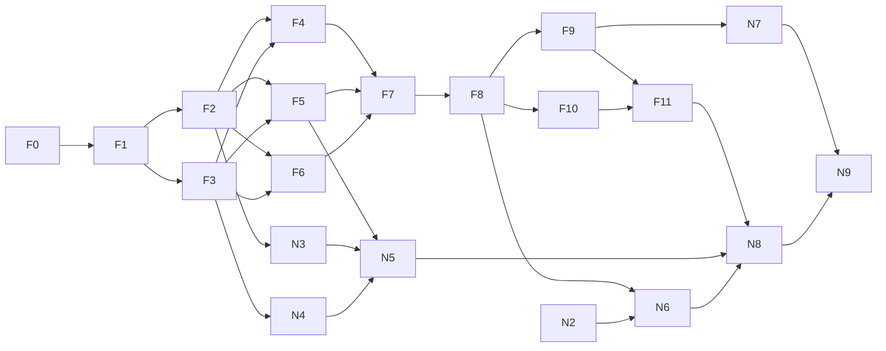

# COMERCIO-CONVERSACIONAL-FRAMEWORK-PLANO: o núcleo genérico em pacotes delegáveis

> **Estado:** plano de implementação. Nenhum código de produção neste PR.
> **Compromisso:** DEV-2026-045.
> **Deriva de:** `docs/research/INTELIGENCIA-COMERCIO-CONVERSACIONAL-v2.md` (PR #2623; enquanto
> não estiver no `main`, ler de `origin/claude/conversational-commerce-intelligence-eca993`).
> Seções usadas: 15 (guia), 4.1 a 4.7, 5, 10, Apêndice A. Quando este plano disser "v2 4.7",
> é essa seção.
> **Irmão:** [COMERCIO-CONVERSACIONAL-ADAPTADOR-NICE-PLANO](COMERCIO-CONVERSACIONAL-ADAPTADOR-NICE-PLANO.md)
> (o adaptador da Nice). As ondas dos dois correm juntas e estão na seção 7 deste documento.
> **Base:** `origin/main` em `032b74755` (17/11/2026). Toda sessão reconfere o `main` antes de
> começar e escreve no PR o SHA em que trabalhou.
>
> Legenda: **[MEDIDO]** saída de comando com caminho; **[DECIDIDO]** decisão de engenharia
> fechada aqui, com motivo; **[DIVERGE]** ponto em que este plano diverge da v2, anotado (a v2
> não se edita).

## 0. Em uma tela

- **O que é:** um pacote Python puro, `conversational-commerce` (import
  `conversational_commerce`), com contratos, máquina de estados, portas, política, contrato de
  efeito, resposta com prova, adaptadores falsos e a suíte de conformidade. Sem Django, sem
  Shopman, sem SDK de modelo ou de canal, sem dependência nenhuma.
- **Onde nasce:** `packages/conversational-commerce/`, no monorepo, ao lado dos pacotes da
  suíte, com um teste que reprova qualquer import de infraestrutura e o gate de wheel limpo
  que já existe (`scripts/wheel_suite.py`). Sai para repositório próprio quando houver o
  segundo adaptador real (degrau D7).
- **Quanto:** 12 pacotes (F0 a F11) cobrindo os degraus D0 e D1. Com os 9 do adaptador da
  Nice, 21 pacotes em 10 ondas.
- **Pronto quando:** `make test-conversational-commerce` passa com a rede bloqueada, as seis
  jornadas de referência rodam de ponta a ponta sobre adaptadores falsos, e a matriz K01 a K40
  não tem buraco (F11).
- **Primeiro a delegar:** F0 (esqueleto, ADR e guardas), em paralelo com N1 e N2 do adaptador
  (os dois defeitos locais, #2626 e #2625).
- **Do dono:** nenhuma decisão bloqueia o framework. As duas que bloqueiam o adaptador estão no
  plano irmão.

## 1. Regra de corte e o que não entra

A regra de corte da v2 (15.2) vale para todo pacote: **o que não puder ser dito sem "padaria",
"Shopman", "WhatsApp" ou "Django" pertence ao adaptador ou ao perfil.** Desconto, alérgenos,
prazos, voz da casa e vocabulário são perfil e fontes; o núcleo governa como consultar, decidir
e comprovar.

Fora deste plano, com o gatilho de reabertura da v2 (15.6): redação por modelo, bandit e
aprendizado por reforço, preferência inferida, preço personalizado, contato proativo, vários
agentes ou serviços, nota única de qualidade. O núcleo **prevê o lugar** de cada um (o campo
`selection` do registro de decisão aceita sorteio; a porta de modelo tem `draft`), mas não os
constrói.

Degraus D2 em diante (v2, 10) são do adaptador ou de plano futuro. Este plano entrega D0 e D1.

## 2. Decisões de engenharia (v2 15.4), fechadas

Nenhuma precisou do dono. Cada uma com o motivo.

| # | Decisão | Fechada assim | Motivo |
|---|---|---|---|
| 1a | Onde o pacote nasce | `packages/conversational-commerce/`, layout plano como os irmãos (`conversational_commerce/` na raiz do pacote), testes dentro do pacote (`conversational_commerce/tests/`) | Suíte e primeiro adaptador evoluem juntos; o gate de wheel limpo (`wheel-sovereignty.yml`) já prova que um pacote de `packages/` instala só com o que declara. Repositório próprio quando existir o segundo adaptador real (D7): antes disso, extrair só cria dois lugares para mudar um contrato |
| 1b | Nome | Distribuição `conversational-commerce`, import `conversational_commerce` | Descritivo, como pede o `CLAUDE.md` ("nomes descritivos, sem jargão inventado"). Não leva Nice, Concierge, Shopman nem o sufixo `-man`, que é a família da suíte: o pacote não pode dizer nada do Shopman. Livre no PyPI [MEDIDO, 17/11: `https://pypi.org/pypi/conversational-commerce/json` devolve 404]; `attendant`, a alternativa curta, já existe lá (200). Nome de produto, se um dia houver, é escolha do dono na extração e não muda o import antes disso sem custo |
| 1c | Licença e Python | A mesma dos irmãos (FSL-1.1-ALv2), `requires-python >= 3.12` | Coerência com `packages/*`; nada aqui pede outra |
| 2a | Como os contratos são definidos | **Python é a fonte**: `dataclass(frozen=True, slots=True)` da biblioteca padrão, um validador por contrato, e o JSON Schema **gerado** a partir deles, versionado no repositório com teste de deriva | Zero dependência (N26 e o wheel limpo). Um dono só para o contrato. Pydantic recusado: dependência e acoplamento de versão com os pinos do Shopman. Esquema primeiro recusado: exigiria gerador e duas fontes enquanto só há consumidor Python. O esquema exportado serve a outra linguagem sem cadeia de geração |
| 2b | Versão dos contratos | Cada registro carrega `schema` (`cc.<contrato>`) e `schema_version` (`MAIOR.MENOR`). MENOR = campo opcional novo; o resto é MAIOR. Contratos de execução e autorização (`TermsDocument`, `AuthorizationGrant`, `ActionCommand`, `ActionReceipt`, `DeploymentProfile`) recusam campo desconhecido e qualquer versão não suportada. Contratos de observação aceitam MENOR acima e guardam o desconhecido em `extensions`, sem interpretar; MAIOR acima é recusa | É o que a v2 5.5 exige dos contratos de execução, e o leitor tolerante nos de observação deixa um produtor mais novo gravar sem quebrar quem lê. A versão do pacote (semver) é separada da dos contratos |
| 2c | Forma canônica e hash | JSON com chaves ordenadas, separadores `,` e `:` sem espaço, UTF-8, sem `NaN`, **sem número de ponto flutuante** em documento com hash (dinheiro é inteiro na menor unidade com moeda; quantidade é decimal em texto normalizado, com unidade), instantes em UTC `YYYY-MM-DDTHH:MM:SS.ffffffZ`. Hash `sha256:<hex>` do documento sem o próprio campo `hash`. Vetores em `conversational_commerce/vectors/` | Sem float, a forma canônica não depende de como cada linguagem imprime número (o problema que a RFC 8785 resolve com regra extra). Vetores com o código (v2 15.8) |
| 3 | Armazenamento de referência da suíte | Em memória, com comparação de versão, caixa de saída na mesma "transação" e pontos de falha injetáveis (cair antes ou depois do efeito, perder a resposta, duplicar entrega). Intercalação determinística para simular K13 | Basta para provar o núcleo. A prova de concorrência de verdade é do adaptador, no mecanismo dele (Postgres, `make test-runtime`). SQLite recusado: daria confiança falsa sobre trava e isolamento |
| 4 | Catálogo de movimentos da v1 | Os 16 da seção 3.2, cada um com precondições e teste | Cobre as seis jornadas **e** as três alçadas que a Nice já tem (11.3), que são movimentos genéricos de varejo; quais ficam ligados é perfil |
| 5 | Padrões do perfil de teste | Seção 3.2, "Perfil de teste" | Valores do perfil **de teste**, não da Nice. Os da Nice vêm do plano irmão (N3) |
| 6 | Base de código do adaptador | `origin/main`, nunca o checkout principal | O checkout principal costuma estar centenas de commits atrás |
| 7 | Especificação: arquivos e donos | `packages/conversational-commerce/spec/`, um arquivo por responsabilidade, cada um com um WP dono (seção 3.1) | Um fato, um dono (v2 15.8). A especificação viaja com o pacote quando ele sair do monorepo |
| 8 | Onde mora a suíte de conformidade | Dentro do pacote, em `conversational_commerce.testing`, distribuída no wheel; `pytest` é extra opcional (`[testing]`) | Um adaptador novo (o da Nice ou outro) roda a mesma suíte sem copiar teste |
| 9 | Como a matriz teste × invariante é mantida | Gerada: cada teste K leva `@conformance("K13", invariants=("N13",), scope="core"\|"adapter"\|"real_mechanism")`; `python -m conversational_commerce.testing.matrix --check` falha se faltar K ou se um K não declarar escopo | Lista central seria o arquivo que todo WP edita, e a fonte de conflito entre WPs da mesma onda |
| 10 | Como se prova "sem rede" | Fixture `autouse` no `conftest.py` do pacote que troca `socket.socket` por um que levanta erro, mais `-p no:django` no `addopts` | Prova mecânica, não promessa. O wheel limpo prova "sem Django instalado" |

## 3. A especificação, por dono

A especificação que vale para o código é a de `packages/conversational-commerce/spec/`, escrita
pelos WPs. Esta seção diz **o que cada arquivo contém**, derivado da v2, e quem é o dono.
Quando um arquivo do `spec/` chegar a "vigente", o arquivo é a verdade e esta seção vira
ponteiro. Cada arquivo abre com `Estado: rascunho | em revisão | vigente` e `Dono: <WP>`.

### 3.1 Arquivos e donos

| Arquivo | Conteúdo | Dono | Fonte na v2 |
|---|---|---|---|
| `spec/00-index.md` | Ordem de leitura e o que cada arquivo responde. O estado mora no cabeçalho de cada arquivo, não aqui (evita que toda onda edite o índice) | F0 | 15.8 |
| `spec/01-contracts.md` | Convenções, os 17 contratos, versão, forma canônica, vetores | F1 | 5.5, 4.7 |
| `spec/02-catalog-profile.md` | Catálogo v1, precondições, níveis A0 a A5, escada de identidade, perfil, códigos de inelegibilidade, erros estáveis | F2 | 5.4, 5.6, 5.8 |
| `spec/03-ports.md` | As oito portas, operações, `capabilities()`, garantias, adaptadores falsos e falhas injetáveis | F3 | 5.4 |
| `spec/04-episode.md` | Episódio, necessidade, posse e época, correlação, máquina de estados, esperas | F4 | 5.7 |
| `spec/05-policy.md` | Admissível, prioritário, melhor; perguntar por custo do erro; restrição de conselheiro; limites de contexto; seleção e registro | F5 | 4.1 a 4.3 |
| `spec/06-reply.md` | Plano de partes, lastros, moldes, verificação de saída | F6 | 4.6 |
| `spec/07-turn.md` | Os dez passos do turno, tetos, queda sem modelo, ambientes `test`, `shadow`, `live` | F7 | 5.3, 5.8 |
| `spec/08-effect.md` | A cadeia, as sete propriedades, as quatro combinações de recibo, reconciliação, a guarda do ponto de efeito | F8 | 4.7 |
| `spec/09-commitments.md` | Promessa e caso, estados, prazos, escalonamento, contingência | F9 | 4.6, 5.7 |
| `spec/10-outcomes.md` | Exposição, resultado, censura, supersessão, memória declarada | F10 | 5.5, 6.1, 8.5 |
| `spec/11-conformance.md` | Como um adaptador roda a suíte; escopo de cada K; a matriz gerada | F3 cria, F11 fecha | Ap. A |

### 3.2 Contratos (dono: F1; catálogo e perfil: F2)

Identificadores em inglês (v2 5.5). Todo registro carrega o envelope comum.

**Envelope comum:** `schema`, `schema_version`, `kind`, `id`, `tenant`, `environment`
(`test` | `shadow` | `live`), `trace_id`, `cause_id`, `occurred_at`, `recorded_at` (só a
fronteira de persistência preenche), `producer` (`name`, `version`), `episode_id` (ou nulo),
`extensions` (só nos de observação).

**Tipos de valor:**

| Tipo | Forma | Regra |
|---|---|---|
| `Fact` | `Known(value, source, observed_at, valid_until, source_version)` ou `Unknown(reason)` | `reason` fechado: `source_failed`, `stale`, `not_supported`, `forbidden`, `not_found`. Vencido é `Unknown(stale)`, nunca o valor velho |
| `Estimate` | `Estimate(value, method, population, version)` ou `Unavailable(reason)` | Nunca zero no lugar de desconhecido (N21) |
| `Money` | `amount_minor: int`, `currency: str` (ISO 4217) | Sem float |
| `Quantity` | `value: str` (decimal normalizado), `unit: str` | Sem float |

**Os 17 contratos (os 16 da tabela de v2 5.5, com `Episode` e `Need` separados)** (campos essenciais; o arquivo do `spec/` fecha tipo e obrigatoriedade):

| Contrato | Campos | Estrito? |
|---|---|---|
| `InteractionEvent` | `channel_binding`, `actor` (`customer`, `staff`, `system`), `event_identity` (`id`, `assurance`: `verified`, `provider_claimed`, `none`), `type` (`message`, `tap`, `correction`, `staff_took_over`, `staff_returned`, `delivery_update`, `deadline_due`, `backend_event`), `content_ref`, `identity_evidence[]` | não |
| `Understanding` | `acts[]` (`act`, `fields`, `span`, `confidence: Estimate`), `alternatives[]`, `signals` (atrito, risco), `reader` (`name`, `version`) | não |
| `ContextSnapshot` | `episode_id`, `episode_version`, `ownership_epoch`, `identity` (`subject_ref`, `assurance`: `anonymous`, `transported`, `weak_verified`, `strong_verified`), `needs[]`, `facts{}`, `hypotheses[]`, `unknowns[]`, `dialogue_state`, `relationship_state`, `open_commitments[]`, `profile_ref`, `policy_ref`, `hash` | não (imutável) |
| `CandidateAction` | `need_id`, `move`, `content`, `move_version`, `preconditions[]` (`code`, `result`: `pass`, `fail`, `unknown`, `evidence`), `expected_effects`, `reversibility`, `authority_required` (`A0` a `A5`), `confirmation_required`, `valid_until`, `prediction` (`Estimate` ou `Unavailable`) | não |
| `DecisionRecord` | `decision_id`, `episode_id`, `turn`, `context` (`snapshot_ref`, `snapshot_hash`), `candidates[]`, `chosen[]`, `selection` (`method`: `deterministic` ou `seeded`; `tie_break`; `propensity`: `{status: not_applicable}` ou `{distribution, seed, executed_probability}`; `experiment`), `policy` (`id`, `version`), `profile` (`id`, `version`), `model_calls[]`, `parent_decision_id` | não (imutável) |
| `TermsDocument` | `terms_id`, `items[]` (`ref`, `quantity`, `unit_price`, `line_total`), `total`, `recipient`, `fulfillment`, `conditions[]`, `valid_until`, `version`, `hash` | **sim** |
| `AuthorizationGrant` | `grant_id`, `subject`, `issuer`, `basis` (`customer_confirmation`, `staff_approval`, `profile_line`), `purpose`, `action`, `targets`, `terms_hash`, `limits`, `identity_evidence`, `confirmation_evidence` (`event_id`, `event_assurance`, `after_terms`), `valid_from`, `valid_until`, `revoked_at` | **sim** |
| `ActionCommand` | `command_id`, `decision_id`, `grant_id`, `action`, `targets`, `parameters`, `terms_hash`, `expected_versions{}`, `expected_ownership_epoch`, `idempotency` (`scope`, `key`), `content_hash`, `deadline` | **sim** |
| `ActionReceipt` | `command_id`, `status` (`success`, `failure`, `pending`, `unknown`), `effect` (`applied`, `not_applied`, `unknown`), `domain_refs`, `observed_versions`, `error` (`code`, `retry`: `never`, `same_key`, `after_reconcile`), `reconciliation` (`deadline`, `owner`), `supersedes` | **sim**; o validador só aceita as quatro combinações de v2 4.7 |
| `ReplyPlan` | `parts[]` (`move`, `claims[]`: `slot`, `backing` = `fact`, `receipt`, `policy`, `commitment` ou `courtesy`, `ref`), `locked_blocks[]`, `verification` (`result`: `pass`, `repair`, `hold`; `findings`) | não |
| `ExposureEvent` | `decision_id`, `content_hash`, `realizer` (`name`, `version`), `recipient`, `attempt`, `state` (`prepared`, `submitted`, `accepted`, `not_applied`, `unknown`, `delivered`, `read`) | não |
| `OutcomeEvent` | `episode_id`, `customer_ref`, `metric` (`id`, `definition_version`), `value`, `window`, `observation` (`observed`, `unknown`, `censored`, `not_applicable`), `source`, `decision_ids`, `command_ids`, `assignment`, `supersedes` | não |
| `Episode` | `episode_id`, `subject`, `state`, `version`, `ownership` (`owner`: `automation`, `queue`, `person`; `epoch`), `needs[]`, `waits[]`, `opened_at`, `resolved_at`, `reopened_from` | não |
| `Need` | `need_id`, `type`, `state` (`open`, `blocked`, `satisfied`, `withdrawn`), `depends_on[]`, `evidence[]` | não |
| `Commitment` | `commitment_id`, `type` (`promise`, `case`), `obligation`, `owner`, `deadline` (`at`, `rule_ref`) ou (`absent_reason`, `contingency`), `fulfillment_criterion`, `evidence[]`, `state` (`open`, `accepted`, `fulfilled`, `broken`, `expired`, `reopened`); no caso, `problem_code`, `requested_resolution`, `reopened_from` | não |
| `MemoryItem` | `kind`, `value`, `evidence_state` (`declared`, `inferred`, `verified`), `source`, `purpose`, `sensitivity`, `valid_until`, `supersedes` | não |
| `DeploymentProfile` | ver abaixo | **sim** |

**`DeploymentProfile`** (v2 5.8): `tenant`, `environment`, `version`; `adapters` (porta →
capacidades declaradas); `catalog_version`, `policy_version`, `house_rules_ref`; `actions`
(movimento → `authority`, `min_identity` por canal, `confirmation`, `caps[]`, `line_ref`);
`lines[]` (`id`, `value` ou `absent{reason}`, `owner`, `decided_at`, `state`: `proposed`,
`validating`, `approved`); `fact_sources` (tipo de fato → fonte, regra de validade);
`staff_queue` (papel, aceite nominal, prazos, contingência fora do expediente); `limits`
(passos, segundos, consultas, chamadas de modelo, gasto); `privacy` (finalidade, retenção,
campos por destinatário, inclusive por modelo); `metrics` (definição, janela, desenho).
**Regra única:** campo sem decisão fica `absent` com motivo, e a ação que depende dele fica
inelegível com código (`profile_line_absent`, `profile_line_not_approved`); informar a
limitação e encaminhar seguem possíveis (K39).

**Catálogo de movimentos v1** (dono: F2). Famílias em ordem de prioridade (v2 4.1):
`protect_and_fulfill` > `resolve` > `clarify` > `commerce` > `follow_up`.

| Movimento | Família | Nível | Precondições principais | Jornada |
|---|---|---|---|---|
| `acknowledge` | `resolve` | A0 | só afirmação de cortesia | J1 |
| `inform` | `resolve` | A0, ou A1 se o fato é pessoal | toda afirmação com fato `Known` e válido; fato pessoal exige identidade mínima do perfil | J1 |
| `cover_readings` | `resolve` | A0 | duas leituras numa **consulta**; responde as duas mais prováveis | J2 |
| `inform_limitation` | `resolve` | A0 | sempre admissível quando a ação pedida está inelegível; diz o que não pode e oferece encaminhar | K39 |
| `ask_clarification` | `clarify` | A0 | campo obrigatório ausente, ou duas leituras numa **mudança** com `(1 − p)·L > c`; a resposta muda o conjunto admissível; uma pergunta no ar por necessidade | J2 |
| `verify_with_staff` | `resolve` | A0 | fato `Unknown`; porta de equipe com dono possível; regra de prazo no perfil. Cria promessa | J3 |
| `open_case` | `protect_and_fulfill` | A0 | ato de reclamação; dono possível. Cria caso; suspende comércio no episódio | J5 |
| `handoff` | `protect_and_fulfill` | A0 | regra, risco ou pedido do cliente; fila declarada. Revoga a posse; nunca afirma aceite | J3, J5 |
| `wait` | qualquer | A0 | condição de retomada, responsável e prazo | J3 |
| `present_terms` | `resolve` | A1 | a porta de comércio cota; identidade mínima. Produz `TermsDocument` | J4 |
| `change_cart` | `resolve` | A2 | identidade estável do evento; quantidade absoluta; reversível | J4 |
| `commit_order` | `resolve` | A3 | concessão presa ao hash dos termos vigentes; confirmação posterior aos termos e do mesmo sujeito; época de posse vigente | J4 |
| `cancel_order` | `resolve` | A3 | dentro da janela de autoatendimento informada pela porta de comércio; confirmação presa ao pedido; linha do perfil aprovada | só precondição |
| `amend_order` | `resolve` | A3 | só acréscimo; confirmação presa ao novo total; linha aprovada | só precondição |
| `grant_discount` | `commerce` | A4 | teto em linha aprovada; um por pedido; sem problema aberto | só precondição |
| `recommend` | `commerce` | A0 | necessidade explícita; restrição de conselheiro; no máximo uma iniciativa não pedida por episódio; sem atrito alto, problema aberto ou compromisso vencido; recusa respeitada | J6 |

[DIVERGE] A v2 15.5 lista "movimentos comerciais da primeira versão" como decisão do dono. Aqui
separo as duas coisas: o **catálogo** do framework (o que existe, com precondição e teste) é
engenharia e precisa de `recommend` para a J6; o que fica **ligado** num perfil é do dono. O
perfil de teste liga tudo; o da Nice, só o que o dono aprovar.

**Níveis de autoridade e identidade** (v2 5.6): A0 informar fato público, A1 leitura
personalizada, A2 mudança reversível, A3 compromisso vinculante, A4 exceção, A5 proibido à
automação. Escada: `anonymous` < `transported` < `weak_verified` < `strong_verified`. O perfil
diz, por canal, que degrau libera cada nível.

**Erros estáveis** (v2 5.4), um enum só: `unsupported_schema`, `invalid_content`,
`capability_missing`, `identity_insufficient`, `object_forbidden`, `fact_unavailable`,
`terms_changed`, `revision_conflict`, `authority_revoked`, `grant_expired`,
`confirmation_required`, `idempotency_conflict`, `effect_pending`, `effect_unknown`,
`budget_exhausted`, `provider_unavailable`. Erro não classificado nunca vira sucesso; se a
submissão **pode** ter ocorrido, a categoria é reconciliação.

**Perfil de teste** (dono: F2), os padrões da decisão 5:

| Linha | Valor | Por quê |
|---|---|---|
| Janela de inatividade do episódio | 24 h | Abre episódio novo depois de um dia parado; o perfil real ajusta |
| Retenção da chave de idempotência | 7 dias | Cobre a janela de reconciliação com folga; chave vencida com efeito desconhecido bloqueia (K16) |
| Prazo de reconciliação | 15 min, depois pessoa | Recibo `pending` ou `unknown` não espera para sempre |
| Prazos de verificação com a equipe | 10 min para aceitar, 30 para responder | Espelha o padrão que já existe na Nice, só como padrão genérico |
| Validade dos termos | 30 min | Termos velhos pedem cotação nova |
| Validade da concessão | 10 min | Curta de propósito: K15 |
| Tetos do turno | 6 passos, 20 s, 0 chamada paga | O teste nunca gasta |
| Iniciativa comercial não pedida | 1 por episódio | v2 4.1 |
| Pergunta no ar | vence por evento, não por relógio | v2 6.1 |

### 3.3 Portas (dono: F3)

Toda chamada recebe o contexto confiável (`tenant`, `environment`, `subject`), que nunca nasce
de texto do cliente. Todo retorno tem versão e erro tipado. Toda porta responde
`capabilities()`. São `typing.Protocol`, com um adaptador falso em `testing/fakes/` que simula
duplicação, atraso, falha, resposta inválida e mudança de capacidade.

| Porta | Operações | O falso simula |
|---|---|---|
| `ChannelPort` | `normalize(raw, received_at) -> InteractionEvent`; `send(prepared, idempotency_key) -> ExposureEvent`; `delivery_status(ref) -> ExposureEvent`; `request_handoff(binding, on)` | entrega duplicada, fora de ordem, "desconhecido" ao enviar, canal sem leitura |
| `ModelPort` | `interpret(request) -> Understanding`; `draft(plan) -> Draft`; `score(options) -> Scores`. Cada pedido leva `purpose`, `budget`, `data_class`; cada retorno leva consumo com custo `Estimate` ou `Unavailable` | leitor por regra, saída fora do esquema, ato fora da lista, orçamento esgotado, provedor fora |
| `CommerceReadPort` | `search_catalog`, `read_item`, `promise(ref, qty, when)` (factual, esperado, planejado e o que a política permite prometer, nunca "reservado"), `quote(cart_ref) -> TermsDocument`, `read_order`, `read_customer`, `read_policy(id)`, `knowledge(query)`, `scarcity()` (opcional; padrão `Unavailable`) | fonte fora, fato vencido, preço que muda entre cotação e confirmação |
| `CommerceExecutePort` | `execute(command, guard) -> ActionReceipt`; `locate(scope, key)`; `reconcile(command)` | queda antes e depois do efeito, resposta perdida, efeito pendente |
| `StaffPort` | `ask`, `open_or_update(commitment)`, `assign`, `record_acceptance`, `record_fulfillment`, `return_conversation(episode, new_epoch)`, `promote_answer` | fila que não aceita, resposta tardia, devolução da conversa |
| `StorePort` | `record_event_once(event) -> (event, created)`; `load_episode(id)`; `commit_transition(episode_id, expected_version, state, records, outbox)`; `claim_work(kind, lease)`; `append_receipt` | conflito de versão, morte do trabalhador, reivindicação dupla |
| `ClockPort` | `now()`, `new_id()`, `schedule(at, work)`, `cancel(handle)`, `business_hours(at) -> Fact` | relógio e identificadores determinísticos |
| `OutcomesPort` | `harvest(metric, subject, window) -> OutcomeEvent` | resultado imaturo, correção posterior |

**A autoridade não é porta** (v2 5.4). O núcleo emite a concessão e entrega ao executor uma
`EffectGuard`, que o adaptador **tem** de chamar dentro da mesma unidade atômica do efeito
local: confere validade e revogação da concessão no `now()` do relógio, hash dos termos
vigentes, versões esperadas e época de posse. Adaptador que não consegue isso declara a ação
indisponível para autonomia em `capabilities()`.

### 3.4 Episódio e posse (dono: F4)

A máquina de estados é a da v2 5.7, sem mudança: `active`, `waiting_input`,
`waiting_authorization`, `waiting_effect`, `awaiting_handoff`, `human_owned`, `resolved`, com
as transições da tabela de lá. Toda transição compara a versão, incrementa e grava evento; toda
espera tem condição de retomada, responsável e prazo. Época de posse só cresce; todo comando a
carrega; a devolução pela pessoa invalida a pergunta que estava no ar (K29). Correlação pelas
regras de v2 5.7, nunca por semelhança de texto. A casca durável (`workflow/shell.py`) faz o
passo 1 do turno: grava a entrada uma vez e deduplica **antes** de qualquer trabalho.

### 3.5 Política (dono: F5)

Função pura `decide(snapshot, catalog, profile) -> DecisionRecord`:

1. **Admissibilidade:** toda precondição avaliada em `pass`, `fail` ou `unknown`; `unknown` em
   requisito crítico bloqueia a ação, não o sistema.
2. **Prioridade:** ordem fixa das famílias; uma mensagem com reclamação e dúvida gera duas
   necessidades e o plano atende as duas.
3. **Escolha:** uma candidata na família, é ela; várias, `Q(b, a)` **só com os termos que têm
   estimador**; no D1 nenhum tem, então desempate por custo e ordem estável do catálogo, e o
   registro diz `method: deterministic`, `propensity: not_applicable`.

Perguntar segue v2 4.2: campo obrigatório e dado de segurança sempre; pergunta opcional só se
muda a decisão; na dúvida, pergunta em mudança e cobre as duas leituras em consulta. Restrição
de conselheiro (4.3) só com o substituto (i), aderência à necessidade declarada.

[DIVERGE] Para provar K32 e K40 no D1, F5 implementa também `method: seeded` (sorteio com
semente registrada, distribuição depois dos filtros, probabilidade da ação executada). Ele só
é selecionável com linha de perfil aprovada; no perfil de teste existe, no da Nice fica
`absent`. Não é o bandit do D6: é o formato do registro provado cedo.

### 3.6 Resposta com prova (dono: F6)

`ReplyPlan` de partes; toda afirmação com lastro (fato, recibo, política, compromisso ou
cortesia). O molde é a base sempre gerada; redação por modelo não entra (corte). A verificação
de saída `verify(content, facts, receipts, rules) -> pass | repair | hold` vale também para
molde. Regras da casa entram como dado do perfil (tabela com exemplos que são testes, v2 9.1);
o pacote traz o mecanismo e um conjunto genérico mínimo (afirmação sem lastro, ação afirmada
sem recibo, preço ou estado sem fato), nunca as regras de uma casa.

### 3.7 Turno (dono: F7)

`engine.turn(event, ports, profile) -> TurnResult`, os dez passos de v2 5.3: receber, portão
sem modelo, entender, montar o snapshot (nenhuma transação aberta durante chamada de modelo ou
rede), decidir, autorizar e executar, dizer e verificar, gravar numa transação (resposta
preparada, novo estado, intenção de envio), enviar e registrar exposição, retomar esperas.
Tetos de passos, tempo e gasto; o turno atende sem nenhum modelo (pior, porém certo). Turno
revogável quando chega fala nova. Os movimentos executam por registro (`engine/moves/<move>.py`,
descobertos pelo nome do módulo, sem lista central), para que F8, F9 e F10 acrescentem
movimento sem editar o laço. Em `shadow`, nenhuma chamada às
portas de escrita e nenhum envio (K36).

### 3.8 Contrato de efeito (dono: F8)

A cadeia e as sete propriedades de v2 4.7, sem mudança. O que F8 constrói: emissão da
concessão (`authority/grants.py`), a `EffectGuard` (`authority/guard.py`), o comando com chave
de idempotência estável, o tratamento das quatro combinações de recibo, a reconciliação com a
mesma chave e o prazo que leva a pessoa. Resposta que não chegou é `unknown`, nunca `failure`.

### 3.9 Compromissos, resultados e memória (donos: F9 e F10)

F9: promessa e caso numa forma só (v2 4.6), reconhecer, aceitar e cumprir como eventos
distintos, prazo ausente com motivo e contingência, "encaminhei" sem destinatário barrado na
origem, escalonamento por prazo vencido (K22), compromisso que sobrevive ao fim da conversa
(K21). F10: exposição e resultado com observação `censored` e `unknown` (K33, K34),
supersessão (K35), memória declarada com correção que alcança derivados (K28).

### 3.10 Invariantes e testes: quem prova o quê

Os 26 invariantes (N01 a N26) e os 40 testes (K01 a K40) do Apêndice A da v2 são a base. Cada
K tem um WP dono e um escopo: **núcleo** (provado com falsos), **adaptador** (o adaptador real
precisa repetir) ou **mecanismo real** (só vale rodado no mecanismo do adaptador; no núcleo é
simulação).

| WP | Testes | Escopo que precisa repetir no adaptador |
|---|---|---|
| F0 | K38 (importa sem Django, sem SDK) | núcleo |
| F1 | vetores de termos e concessões; N14 (imutável) | núcleo |
| F2 | K39 | adaptador (perfil real) |
| F4 | K01, K02, K13, K29 | K01, K02 adaptador; **K13 mecanismo real** |
| F5 | K04, K30, K31, K32, K40 | núcleo |
| F6 | K23, K24, K27 | adaptador (moldes reais) |
| F7 | K05, K17, K18, K25, K26, K36, K37; J1, J2 | K17, K18, K36 adaptador |
| F8 | K03, K06, K07, K08, K09, K10, K11, K12, K14, K15, K16; J4 | **K11, K12, K14 mecanismo real**; o resto adaptador |
| F9 | K19, K20, K21, K22; J3, J5 | K20, K22 adaptador |
| F10 | K28, K33, K34, K35; J6 | K33, K35 adaptador |
| F11 | a matriz inteira, rede bloqueada, as seis jornadas juntas | núcleo |

## 4. Pacotes de trabalho

Tamanho: **P** meia sessão; **M** uma sessão; **G** uma sessão cheia (se estourar, publica em
PR draft e para). Nenhum pacote do framework muda o que o cliente vê.

**Brief comum, dito uma vez.** A sessão lê o `CLAUDE.md`, este plano, o plano irmão e, na v2,
as seções que o WP cita. Confere `gh pr list` e `git worktree list`; se a frente já tem dono,
escreve no PR e para. Trabalha num worktree, a partir do `origin/main`. Não toca arquivo fora
da lista do seu WP (precisou: para e escreve no PR). Roda a suíte do pacote pelo alvo do
Makefile, que fixa `PYTHONPATH` no próprio pacote, para não pegar a instalação editável do
checkout principal. Toda divergência com a v2 vai para o `spec/` como `[DIVERGE]`. Nenhuma
chamada a modelo, paga ou não. PR cita `Compromisso: DEV-2026-045` e a seção `## Ficou de
fora`.

Prova padrão dos WPs F1 a F11, abreviada como **(suíte)**:

```bash
make test-conversational-commerce
```

### F0 · Esqueleto, ADR e guardas

- **Objetivo:** o pacote existe, importa sem nada, é instalado pelo Shopman e reprova import de
  infraestrutura.
- **Depende de:** nada.
- **Arquivos:** `packages/conversational-commerce/` (novo: `pyproject.toml` sem dependência e
  com extra `[testing]` = `pytest`; `README.md`; `LICENSE.md`; `conversational_commerce/__init__.py`
  com `__version__`; `conversational_commerce/tests/conftest.py` com a trava de rede;
  `conversational_commerce/tests/test_k38_no_infrastructure.py`; `spec/00-index.md`);
  `Makefile` (alvo `test-conversational-commerce` com `PYTHONPATH` do pacote e `-p no:django`,
  incluído em `test-cores` e `test`); `scripts/wheel_suite.py` (pacote fora do namespace
  `shopman.` e sem `pytest-django`); `pyproject.toml` da raiz e `Dockerfile` (o Shopman passa a
  instalar o pacote); ADR novo em `docs/decisions/` (próximo número livre no `main`; o
  `ID3A-PLAN` propõe 047 e 048 sem arquivo, confira).
- **O ADR decide:** pacote puro no monorepo e critério de extração (D7); contratos em
  dataclass com esquema gerado; porta de comércio com uma implementação real e o backend falso
  de referência como segunda, pela leitura do ADR-001 que o ADR-044 (item 3) já faz:
  substituível é quem implementa o contrato, e a suíte de conformidade é a prova.
- **Fora do escopo:** qualquer contrato ou porta (F1, F3).
- **Pronto quando:** `make test-conversational-commerce` verde; o teste K38 reprova um módulo
  plantado que importa `django` (o teste do teste); `python scripts/wheel_suite.py
  conversational-commerce` verde em venv limpo sem Django; `make test-constraints` e `make
  lint` verdes.
- **Cliente vê:** não. **Tamanho:** M.

### F1 · Contratos (D0, primeira metade)

- **Objetivo:** os 17 contratos, os tipos de valor, a forma canônica, o hash e os vetores.
- **Depende de:** F0.
- **Arquivos:** `conversational_commerce/contracts/` (`common.py`, um módulo por contrato,
  `validate.py`, `canonical.py`, `errors.py`, `schema_export.py`),
  `conversational_commerce/vectors/` (termos e concessões, positivos e negativos),
  `conversational_commerce/schemas/` (JSON Schema gerado), `conversational_commerce/tests/contracts/`,
  `spec/01-contracts.md`.
- **Fora do escopo:** catálogo e perfil (F2); qualquer comportamento.
- **Pronto quando:** (suíte) verde com: cada vetor de termos reproduz o hash esperado; float em
  documento com hash é recusado; campo desconhecido e versão não suportada são recusados nos
  cinco contratos estritos; `ActionReceipt` recusa combinação fora das quatro; contrato de
  observação guarda MENOR acima em `extensions`; registro é imutável (N14); `python -m
  conversational_commerce.contracts.schema_export --check` sem deriva.
- **Cliente vê:** não. **Tamanho:** G.

### F2 · Catálogo, perfil e erros (D0, segunda metade)

- **Objetivo:** os 16 movimentos com precondição, os níveis A0 a A5, a escada de identidade, o
  perfil com linhas de estado e o perfil de teste.
- **Depende de:** F1.
- **Arquivos:** `conversational_commerce/catalog/`, `conversational_commerce/profile/`
  (avaliação de linha, códigos de inelegibilidade, `test_profile.py`),
  `conversational_commerce/tests/catalog/`, `spec/02-catalog-profile.md`.
- **Fora do escopo:** a escolha entre candidatas (F5).
- **Pronto quando:** (suíte) verde com: todo movimento tem ao menos uma precondição e um teste
  que a faz falhar (meta-teste que varre o catálogo); K39 (linha `absent` torna a ação
  inelegível com código, `inform_limitation` e `handoff` seguem admissíveis); linha `proposed`
  não vale como aprovada.
- **Cliente vê:** não. **Tamanho:** M.

### F3 · Portas, adaptadores falsos e o formato da suíte

- **Objetivo:** as oito portas como `Protocol`, um falso por porta com falha injetável, o
  domínio sintético e o formato `@conformance` que todo WP seguinte usa.
- **Depende de:** F1.
- **Arquivos:** `conversational_commerce/ports/`, `conversational_commerce/testing/fakes/`
  (um por porta, `faults.py`, `synthetic_domain.py` com catálogo neutro, sem nenhuma loja
  real), `conversational_commerce/testing/conformance/` (`decorator.py`, `harness.py`,
  `matrix.py`), `conversational_commerce/tests/ports/`, `spec/03-ports.md`,
  `spec/11-conformance.md` (rascunho).
- **Fora do escopo:** qualquer lógica de núcleo.
- **Pronto quando:** (suíte) verde; cada falso declara `capabilities()` e passa nos testes de
  forma da própria porta; `python -m conversational_commerce.testing.matrix` lista os K já
  marcados e os que faltam, sem `--check` ainda.
- **Cliente vê:** não. **Tamanho:** G.

### F4 · Episódio, posse e casca durável

- **Objetivo:** a máquina de estados do episódio, necessidades, época de posse, esperas e o
  passo "receber" com deduplicação antes de qualquer trabalho.
- **Depende de:** F2, F3.
- **Arquivos:** `conversational_commerce/workflow/`, `conversational_commerce/tests/workflow/`,
  `spec/04-episode.md`.
- **Fora do escopo:** o turno inteiro (F7); efeito (F8).
- **Pronto quando:** (suíte) verde com K01, K02, K13 (simulado, marcado `real_mechanism`) e K29;
  toda transição da tabela de v2 5.7 tem teste; espera sem responsável ou sem prazo é recusada.
- **Cliente vê:** não. **Tamanho:** G.

### F5 · Política pura e registro de decisão

- **Objetivo:** `decide()` com admissibilidade, prioridade e escolha, a regra de perguntar, a
  restrição de conselheiro, os limites de contexto e o `DecisionRecord` com `selection`.
- **Depende de:** F2, F3.
- **Arquivos:** `conversational_commerce/policy/`, `conversational_commerce/ledger/decisions.py`,
  `conversational_commerce/tests/policy/`, `spec/05-policy.md`.
- **Fora do escopo:** o turno (F7); resultados (F10).
- **Pronto quando:** (suíte) verde com K04, K30, K31, K32, K40; seleção determinística grava
  `propensity: not_applicable` e nunca "probabilidade 1"; bloqueio posterior gera decisão nova
  ligada pelo `parent_decision_id`, sem reescrever a anterior.
- **Cliente vê:** não. **Tamanho:** G.

### F6 · Resposta com prova

- **Objetivo:** plano de partes, lastro por afirmação, moldes com blocos travados e a
  verificação `pass | repair | hold`.
- **Depende de:** F2, F3.
- **Arquivos:** `conversational_commerce/reply/`, `conversational_commerce/tests/reply/`,
  `spec/06-reply.md`.
- **Fora do escopo:** redação por modelo (corte); as regras de qualquer casa.
- **Pronto quando:** (suíte) verde com K23, K24, K27; afirmação sem lastro não sai em nenhum
  caminho, inclusive o de molde.
- **Cliente vê:** não. **Tamanho:** M.

### F7 · O turno e as jornadas J1 e J2 (o esqueleto)

- **Objetivo:** `engine.turn()` com os dez passos e os ambientes, rodando J1 e J2 de ponta a
  ponta sobre os falsos.
- **Depende de:** F4, F5, F6.
- **Arquivos:** `conversational_commerce/engine/` (laço e `moves/` com `acknowledge`, `inform`,
  `cover_readings`, `inform_limitation`, `ask_clarification`),
  `conversational_commerce/testing/journeys/` (`j1.py`, `j2.py` como dados roteirizados),
  `conversational_commerce/tests/engine/`, `spec/07-turn.md`.
- **Fora do escopo:** efeito (F8); compromissos (F9).
- **Pronto quando:** (suíte) verde com J1, J2, K05, K17, K18, K25, K26, K36, K37; o turno
  atende com a porta de modelo fora (queda para regra); estouro de teto cai para o caminho sem
  modelo e registra.
- **Cliente vê:** não. **Tamanho:** G.

### F8 · Contrato de efeito e a jornada J4

- **Objetivo:** termos, confirmação, concessão, comando, efeito e recibo, com a `EffectGuard`,
  idempotência honesta e reconciliação, rodando J4.
- **Depende de:** F7.
- **Arquivos:** `conversational_commerce/authority/`, `conversational_commerce/engine/moves/`
  (`present_terms.py`, `change_cart.py`, `commit_order.py`, `cancel_order.py`,
  `amend_order.py`, `grant_discount.py`), `conversational_commerce/ledger/receipts.py`,
  `conversational_commerce/testing/journeys/j4.py`, `conversational_commerce/tests/effect/`,
  `spec/08-effect.md`.
- **Fora do escopo:** qualquer backend real.
- **Pronto quando:** (suíte) verde com J4 e K03, K06 a K12, K14 a K16; K11, K12 e K14 marcados
  `real_mechanism`; o executor falso que **não** chama a `EffectGuard` reprova K11 (o teste do
  teste).
- **Cliente vê:** não. **Tamanho:** G.

### F9 · Compromissos e as jornadas J3 e J5

- **Objetivo:** promessa e caso, verificação com a equipe, transferência, prazos e
  escalonamento, rodando J3 e J5.
- **Depende de:** F8.
- **Arquivos:** `conversational_commerce/ledger/commitments.py`, `conversational_commerce/engine/moves/`
  (`verify_with_staff.py`, `open_case.py`, `handoff.py`, `wait.py`),
  `conversational_commerce/testing/journeys/` (`j3.py`, `j5.py`),
  `conversational_commerce/tests/commitments/`, `spec/09-commitments.md`.
- **Fora do escopo:** o que F10 toca.
- **Pronto quando:** (suíte) verde com J3, J5, K19, K20, K21, K22.
- **Cliente vê:** não. **Tamanho:** G.

### F10 · Recomendação, resultados e memória declarada (J6)

- **Objetivo:** o primeiro movimento comercial sob a restrição de conselheiro, exposição e
  resultado com censura e supersessão, e a memória declarada.
- **Depende de:** F8.
- **Arquivos:** `conversational_commerce/engine/moves/recommend.py`,
  `conversational_commerce/ledger/outcomes.py`, `conversational_commerce/ledger/exposures.py`,
  `conversational_commerce/memory/`, `conversational_commerce/evaluation/`,
  `conversational_commerce/testing/journeys/j6.py`, `conversational_commerce/tests/outcomes/`,
  `spec/10-outcomes.md`.
- **Fora do escopo:** o que F9 toca; preferência inferida (corte).
- **Pronto quando:** (suíte) verde com J6, K28, K33, K34, K35; recusa do cliente segura nova
  oferta até ele mudar de ideia.
- **Cliente vê:** não. **Tamanho:** M.

### F11 · Fecho do D1

- **Objetivo:** provar o critério de saída do D1 e pôr a especificação em "vigente".
- **Depende de:** F9, F10.
- **Arquivos:** `conversational_commerce/testing/matrix.py` (`--check`), `spec/*.md` (só o
  cabeçalho de estado e o `[DIVERGE]` que faltar), `spec/11-conformance.md`,
  `conversational_commerce/tests/test_d1_exit.py`, `packages/conversational-commerce/README.md`.
- **Fora do escopo:** comportamento novo; consertar achado grande (vira issue
  `ficou-de-fora`).
- **Pronto quando:** `make test-conversational-commerce` verde com a rede bloqueada e as seis
  jornadas; `test_d1_exit.py` chama a checagem da matriz e reprova K faltando ou K sem escopo;
  `python scripts/wheel_suite.py conversational-commerce` verde; nenhum teste
  importa nada fora do pacote e da biblioteca padrão (o próprio K38).
- **Cliente vê:** não. **Tamanho:** M.

## 5. Pronto do framework

O framework está pronto (degrau D1, v2 10) quando o F11 está no `main`, isto é:

```bash
make test-conversational-commerce
```

```bash
python scripts/wheel_suite.py conversational-commerce
```

Os dois verdes, **sem rede**, com as seis jornadas; a checagem da matriz roda dentro da suíte
(`test_d1_exit.py`). Recua (v2 10) se um teste só passar com
conhecimento de um adaptador real.

## 6. Divergências com a v2, anotadas

| # | Onde | O que diverge | Por quê |
|---|---|---|---|
| 1 | 15.5 | Catálogo (engenharia) separado do que o perfil liga (dono) | Seção 3.2 |
| 2 | 15.3 | Módulos a mais: `profile`, `engine`, `memory`, `vectors`, `schemas` | O turno precisa de um dono (`engine`); perfil e memória têm regra própria; vetores e esquema moram com o código (15.8) |
| 3 | 10 (D1) | `method: seeded` existe no D1, só no perfil de teste | Provar K32 e K40 cedo; seção 3.5 |
| 4 | 5.4 | A autoridade vira objeto entregue ao executor (`EffectGuard`) | É a forma de "conferida pelo executor no ponto de efeito" que um teste consegue reprovar |
| 5 | Ap. A | Escopo `real_mechanism` explícito por teste | A v2 diz que K11 a K14 só valem no mecanismo real; o decorador torna isso verificável |

## 7. Ondas (os dois planos juntos)

Dois WPs da mesma onda não tocam o mesmo arquivo. Uma onda só começa com a anterior no `main`,
salvo o que a coluna "pode antecipar" diz.

| Onda | Em paralelo | O que destrava |
|---|---|---|
| **1** | F0 · N1 · N2 | O pacote existe; os dois defeitos locais fechados |
| **2** | F1 | Contratos |
| **3** | F2 · F3 | Catálogo, perfil, portas e falsos |
| **4** | F4 · F5 · F6 · N3 · N4 | Núcleo por partes; perfil da Nice e portas de leitura sobre o Shopman |
| **5** | F7 · N5 | J1 e J2; **a decisão em sombra no ar** (X1) |
| **6** | F8 | O contrato de efeito, J4 |
| **7** | F9 · F10 · N6 | J3, J5, J6; o executor do Shopman com prova no Postgres |
| **8** | F11 | **D1 pronto** |
| **9** | N7 · N8 | Porta de equipe sobre o "vou verificar"; **adaptador pronto** (D2) |
| **10** | N9 | A Nice dentro do framework, atrás de chave |

Arquivos que mais de uma onda toca, em sequência e nunca em paralelo: `Makefile` (F0),
`scripts/run_runtime_tests.py` (N2, N6, N8), `shopman/storefront/concierge/tools.py` (N2, depois
os WPs de pedido da Concierge). O detalhe dos N está no plano irmão.



## 8. Arquivos lidos

`docs/research/INTELIGENCIA-COMERCIO-CONVERSACIONAL-v2.md` (de
`origin/claude/conversational-commerce-intelligence-eca993`: seções 0, 1.4, 4, 5, 6.1 a 6.3,
8.5, 9, 10, 11, 15, Apêndice A), `docs/plans/CONCIERGE-PLANO-DE-ACAO.md`,
`docs/plans/ID3A-PLAN.md` (seção 14), `docs/decisions/adr-001-protocol-adapter.md`,
`docs/decisions/adr-044-substituibilidade-na-borda.md`,
`docs/decisions/adr-045-envelope-de-fato-operacional.md`, `scripts/wheel_suite.py`,
`.github/workflows/wheel-sovereignty.yml`, `.github/workflows/runtime-gate.yml`, `Makefile`,
`pyproject.toml`, `Dockerfile`, `packages/watchman/pyproject.toml`,
`packages/refs/pyproject.toml`. O código da Nice está listado no plano irmão.
