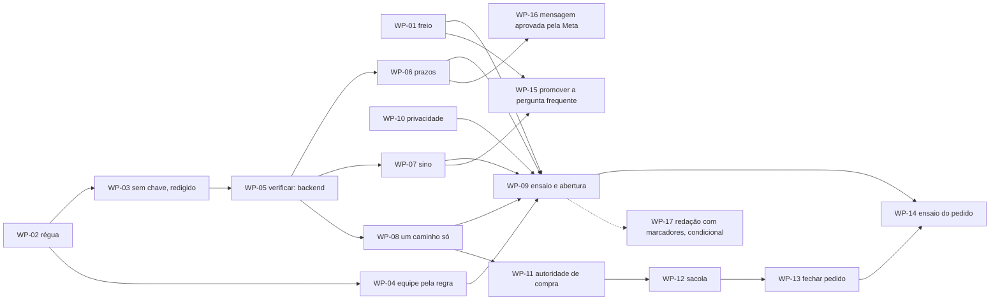

# CONCIERGE-PLANO-DE-ACAO: a Concierge em pacotes delegáveis

> **Estado:** plano de ação, rodada CONCIERGE-R3 (16/11/2026). Nenhum código de produção.
> **Compromisso:** DEV-2026-029 ("Sim, abriremos agora. [...] Quero dele um plano de ação
> objetivo e estruturado em pacotes de trabalho delegáveis.") e DEV-2026-027 (as respostas do
> dono de 16/11, com o pedido na conversa). O brief da rodada cita outro número: a linha foi
> registrada em paralelo com outros pedidos do mesmo dia e renumerada até achar um ID livre.
> **Revisa:** [CONCIERGE-ARQUITETURA-ALVO-V2](CONCIERGE-ARQUITETURA-ALVO-V2.md) (03/10) e a parte da
> Concierge no [ID3A-PLAN](ID3A-PLAN.md) (12/11), contra o `main` em `096a130a3`.
> **Para quem:** o dono delega cada pacote (WP) a uma sessão Opus 5.5. Cada WP é uma sessão,
> um branch e um PR.
>
> Legenda: **[MEDIDO]** saída de comando, banco ou código com caminho; **[INFERÊNCIA]** leitura
> minha; **NÃO VERIFICADO** quando não medi.

## 0. Em uma tela

- **Onde está:** as fatias F1 a F3 do V2 estão no `main`, a F4 pela metade, a F5 e a F6 não
  existem. E a Concierge está **muda** hoje: as duas conexões de IA do alpha estão sem chave, e o
  código exige chave até para dizer "bom dia".
- **O que falta para o cliente sentir:** responder sem depender de chave, mandar ao modelo só
  texto redigido, achar melhor o que é da equipe, e o "não sei, vou verificar" com a resposta
  voltando pela própria conversa.
- **O que sai:** a chamada de modelo da triagem, o laço do agente e a redação por modelo (o dono
  confirmou em 16/11: não reescreve, salvo necessidade provada). O "vale para todo mundo" virou
  outra coisa, por pedido dele: promover a resposta da equipe a pergunta frequente (WP-15). E
  a mensagem aprovada pela Meta para responder depois de 24 horas entra (WP-16).
- **O pedido na conversa entra** (dono, 16/11): quatro WPs próprios (WP-11 a WP-14), depois que
  a fase de respostas estiver com clientes.
- **Quanto:** 17 WPs em 8 ondas (o WP-17, redação com marcadores, só existe se o placar provar ganho). Os dois primeiros a delegar, em paralelo: **WP-01** (freio e
  medidor no `main`) e **WP-02** (régua que prova).
- **Do dono:** oito respostas dadas em 16/11, na seção 5. Nenhuma pergunta aberta.

## 1. Estado medido

### 1.1 O que mudou desde o V2 (03/10)

| Fato | Prova |
|---|---|
| A Concierge saiu do que segura a tag (D-035, 10/11) e a frente reabre agora (DEV-2026-029, 16/11) | `docs/coordination/DECISIONS.md`, `docs/coordination/COMMITMENTS.md` |
| A porta única de IA está no `main`: conexão e rota por propósito no Admin, chave cifrada, `customer_text_approved` | commit `b7f04f1c1`; `shopman/shop/ai.py` |
| O freio e o medidor (E1) **não** estão no `main`: o PR #2316 está aberto, em conflito, com 7 checks vermelhos, parado desde 12/11 | [MEDIDO] `gh pr view 2316 --json mergeable,statusCheckRollup`; não existe `AiInvocation` em `shopman/` |
| Alpha sem chave: conexões `anthropic` e `jev` ativas, liberadas para mensagem de cliente, as duas **sem chave** | [MEDIDO] alpha, conexão direta 25060, transação somente leitura, 16/11: `shop_aiconnection` |
| Sem chave, a Concierge não atende ninguém, nem a cortesia: `disabled_reason()` devolve `ai_key_missing` | `shopman/storefront/concierge/service.py`, `disabled_reason` |
| As rotas do alpha apontam `claude-sonnet-5` (concierge, triagem) e `claude-haiku-4-5` (intenções); a conexão, `claude-opus-5`. Se esses ids ainda são servidos: NÃO VERIFICADO | [MEDIDO] `shop_shop.ai_routes` |
| Quase não há régua de produção: desde 03/10, 15 respostas ao todo (8 do agente, 3 de cortesia, 2 das partes, 1 de equipe, 1 sem camada). Em novembro, 179 entradas observadas e 4 respostas | [MEDIDO] `shop_conversationmessage`, mesma conexão |
| O app vivo segue só leitura: `CONCIERGE_READ_ONLY=true`, `CONCIERGE_MANYCHAT_EVENT_ID_VERIFIED=false`, `CONCIERGE_IDENTITY_LINK_ENABLED=false`, `CONCIERGE_HUMAN_RETURN_ENABLED=false`, modo `assist`, coorte de um contato (o dono), triagem pelo `jev` (que, sem chave, cai na regra) | `.do/app.alpha-subdomains.yaml` |

Linha de base de hoje, placar gratuito, neste worktree [MEDIDO, 16/11]:

| Comando | Resultado |
|---|---|
| `concierge_reply_eval` (regra local, 221 casos) | destino certo 210/221; equipe e outra mesa achadas 5/13; à equipe sem precisar 3; regras da casa 88/88 exemplos |
| `concierge_reply_eval --memory` (47 casos) | 47/47; "sim" na pergunta errada 0 |
| `concierge_reply_eval --plural --reader local` (147 casos) | partes 67/85; várias partes todas achadas 12/16; equipe 6/13; sem precisar 4; uma parte lida como várias 7/50 |

Com o modelo de leitura, o último número é de 03/10 (OBS0310-Q, duas rodadas): partes 82/85 e
80/85; várias partes 16/16 e 15/16; equipe 11/13; sem precisar 4; p95 1,8 s; US$ 0,00134 por
leitura. Não foi medido de novo: não há chave, e chamada paga pede a palavra do dono.

### 1.2 As fatias do V2

| Fatia | Estado | Prova | O que falta |
|---|---|---|---|
| **F1** Régua e conjunto real | **Pronta** no que o V2 pedia primeiro; **parcial** na continuação | `concierge/golden_set.json` (221 casos), `golden_memory.json` (47), `concierge/reply_eval.py`, comando `concierge_reply_eval` (`--classifier`, `--plural`, `--memory`, `--production`); #1437 | Repetição (pass^k) e trava de rodada paga no comando. Rótulo de partes só em 18 casos (`expected.parts`), o que basta: os casos de uma parte usam a intenção. A régua de produção existe e está vazia |
| **F2** Memória | **Pronta** | `concierge/dialogue.py`, estado em `Conversation.flags["dialogue"]`, gravado com o `turn_fence`; #1443; 47/47 hoje | A oferta da equipe na alergia segue em `flags["triage"]["answered_by"]` (`triage.py`) e o cancelamento em `flags["pending_cancel"]` (`cancellation.py`): funcionam, só não moram no mesmo estado. `verifying` e `with_team` são da F5. Vence pelo que acontece, não pelo relógio (decisão do dono, 03/10): diverge do V2 de propósito |
| **F3** Regras da casa | **Pronta** | `concierge/house_rules.py` (14 regras, 88 exemplos), `service.run_turn` e `service._prepare_reply` revisam toda resposta; #1442 | O prompt não cita a tabela. Não importa: nenhum texto de modelo chega ao cliente |
| **F4** Intenções | **Parcial** | `concierge/intents.py` (porteiro, leitura numa ida com saída estruturada, validação, execução, uma mensagem), ligada por padrão para a coorte (`intents.enabled_for`); parte sensível, pergunta repetida, cancelamento (#1445), desconto (#1444), acréscimo a pedido feito; #1449 | (a) O laço do agente não saiu: `agent.run_agent` é o caminho de `intents_plural=off`. (b) A triagem de intenção única ainda roda antes, com chamada de modelo quando o classificador é `anthropic` (`triage.decide`). (c) A leitura manda o texto **cru** do cliente ao modelo (`intents.build_request`); o V2 dizia redigido. (d) Parte sem fato responde "não achei" e oferece a equipe (`intents.execute`, `search`). (e) Meta de equipe não batida: 11/13 com modelo, 6/13 sem; pass^3 nunca medido |
| **F5** "Não sei, vou verificar" | **Ausente** | nenhum `concierge_verify` nem `verifying` em `shopman/` (busca em 16/11) | Tudo: cartão, resposta voltando, prazos, tela no sino |
| **F6** Redação com marcadores e atos de pedido | **Ausente** | `house_rules.py` só tem a trava que reprova texto de modelo; os executores de sacola e pedido existem em `concierge/tools.py`, alcançáveis só pelo laço do agente | Redação: corte C1, com a porta condicional no WP-17. Atos de pedido: WP-11 a WP-14 |

## 2. Cortes

| # | O que sai | Motivo |
|---|---|---|
| C1 | **Redação por modelo** (metade da F6): o modelo "deixa mais natural" a frase montada | É a segunda chamada paga de cada resposta, pede um verificador de marcadores inteiro, e só compra naturalidade. O dono já fixou "a frase é da casa" (03/10, topo de `intents.py`). Sem texto de modelo, R1 e R5 valem por construção. **Confirmado pelo dono (16/11):** "Não deve reescrever (a não ser que essa necessidade seja 'provada')". A prova, se vier, são conversas reais do piloto em que a frase da casa saiu dura ou confusa. **Como provar e como reescrever sem inventar fato:** WP-17, condicional (20/11) |
| C2 | **Chamada de modelo na triagem** antes da leitura de partes | Com a leitura ligada, é uma chamada a mais por turno (US$ 0,0016 e 2,7 s medidos na OBS0310-K) para devolver uma intenção que a leitura já devolve. Ficam a regra local e o Jev (o dono decidiu que o Jev é a primeira opinião) |
| C3 | **O laço do agente** (`agent.run_agent`, as especificações de ferramenta, o prompt dele e as variáveis de ambiente que só ele lê) | O V2 já o condenava. Hoje é caminho morto por padrão, mas religável por variável de ambiente, e é o caminho que manda nome (no prompt) e endereço de entrega (nas ferramentas) ao provedor. Os executores de `tools.py` ficam: são a base de qualquer pedido futuro |
| ~~C4~~ | ~~"Vale para todo mundo"~~ (V2, 8.5) | **Trocado, não cortado** (dono, 16/11): o nome era vago ("por quanto tempo, eternamente?"). No lugar entra "Promover a pergunta frequente": a resposta da equipe vira um rascunho de pergunta frequente, com sugestão da IA para generalizar, e só vale depois de publicada no Admin. É o WP-15 |
| ~~C5~~ | ~~Mensagem aprovada pela Meta para responder fora das 24 horas~~ (V2, 8.4) | **Deixou de ser corte** (dono, 16/11: "Quero a mensagem"). É o WP-16. Até o texto ser aprovado pela Meta, vale a saída sem promessa: a Concierge diz quando a equipe atende |
| ~~C6~~ | ~~Atos de pedido no chat~~ | **Deixou de ser corte** (dono, 16/11: "quero que a Concierge consiga montar o pedido do cliente NA CONVERSA, interagindo com dados reais"). A trava continua real: o ManyChat não entrega identificador nem horário verificado da mensagem, então o servidor fecha toda mudança (`service._claim`, `service.assert_turn_authority`) e não aceita o "sim" como confirmação (`tools._confirmation`). O WP-11 troca a prova do provedor por uma prova que a casa controla; WP-12 a WP-14 constroem em cima |
| C7 | **Rotular os 221 casos com lista de atos e estado** (continuação da F1) | Os 18 casos com várias partes já têm rótulo, e os 47 de contexto já têm estado. O que falta à régua é repetição e trava de gasto (WP-02) |
| C8 | **E11 da ID3A agora** (Concierge migrada para contratos de tarefa) | A Concierge já fala pela porta (`ai.anthropic_client("intents")`). Contrato de tarefa é refatoração que só existe depois do E2 ao E4; não muda nada para o cliente |

Continuam fora, como no V2 (seção 12): áudio, botões e listas do WhatsApp, memória de preferência
de longo prazo, ler o que a equipe respondeu no Live Chat, juiz automático. O Jev fica como está
(opcional, sem chave hoje); promovê-lo é o E8 da ID3A.

### 2.1 O que da porta e da LGPD é pré-requisito de verdade

A frente abre antes da fase 3 da ID3A. Isto é o que precisa existir antes, e o que não precisa.

| Item | Pré-requisito? | Por quê | Onde entra |
|---|---|---|---|
| **E1**, medidor e freio | **Sim**, para qualquer chamada paga em produção | D-039, item 5. Sem ele, chave cadastrada é gasto sem teto (foi assim que o placar do de-para gastou US$ 1.180). Nenhum WP sem modelo depende dele | WP-01 |
| E2 a E4 (pacote, contratos, gateway) | Não | A Concierge já usa a porta. Cuidado só de calendário: o E2 renomeia propósito para tarefa; nenhum WP daqui cria propósito novo | fora |
| **E5**, `ai_eval` | Não | O próprio ID3A (corte C7) cita o `concierge_reply_eval` como prova de que comando basta. Do E5 só é preciso o padrão de rodada paga (`--paid`, `--max-cases`, `--budget-usd`) | WP-02 |
| **E9**, inventário de privacidade lendo conexões | **Sim**, desde 16/11 | O dono escolheu Jev com um modelo mais barato (DeepSeek) em vez da Anthropic. `/privacidade` hoje só declara a Anthropic (`shopman/shop/privacy_inventory.py`); quem passa a receber mensagem de cliente precisa aparecer lá | WP-10 |
| E10, cofre de pseudônimos | **Não** (decisão 1b, dono, 16/11: a mensagem redigida pode ir à DeepSeek e ao Jev) | Os WPs cumprem quatro condições: (1) texto de cliente só para conexão `customer_text_approved` (já travado em `ai.resolve`); (2) redigido antes de sair; (3) sem nome nem endereço; (4) categoria sensível mascarada. Com a Anthropic isso bastava. Para a DeepSeek, a D-039 dizia "mensagem de cliente não vai à DeepSeek sem nova decisão", e o ID3A punha o cofre antes. O dono decidiu que o texto redigido basta (D-040) | fora |
| **Redação antes do modelo** | **Sim** | Contrato do V2 (5.2) que o código não cumpre | WP-03 |
| **`sensitive` nunca vai para fora** (ID3A, seção 9: saúde, alergia com detalhe, criança) | **Sim** | Já aprovado na D-039. O redator que faz isso existe (`concierge/observation_privacy.py`) e só é usado na observação passiva | WP-03 |
| **Nome e endereço não saem** | **Sim** | Quem os manda é o laço do agente (`prompt.py`, `tools.py`, como anota o `privacy_inventory.py`). A nota de memória da leitura leva só o estado e o rótulo do pedido, e sai redigida no WP-03 | WP-08 |
| Parecer jurídico sobre o DPA da Anthropic | Não bloqueia código | Segue como suposição marcada do ID3A; entra na conferência antes de abrir a coorte | WP-09 |

## 3. Pacotes de trabalho

Tamanho: **P** cabe em meia sessão; **M**, uma sessão; **G**, uma sessão cheia (se estourar, a
sessão publica o que tem em PR draft e para). Toda prova roda no worktree da sessão, com o
`PYTHONPATH` que o `CLAUDE.md` descreve. Chamada paga só em dois: o WP-09 (placar, até US$ 2, autorizado na D-040) e o WP-15 (uma sugestão por clique, pelo freio do WP-01).

Regra comum a todos os briefs, dita uma vez: a sessão lê o `CLAUDE.md` e este plano, confere com
`gh pr list` e `git worktree list` se a frente já tem dono, e não toca arquivo fora da lista do
seu WP (precisou tocar: para e escreve no PR).

### WP-01 · Freio e medidor no `main` (E1 da ID3A)

- **Objetivo:** pôr no `main` o PR #2316, para que toda chamada paga passe por kill switch, teto diário e registro.
- **Depende de:** nada.
- **Arquivos:** os do commit `01054ffb3` do branch `id3a-e1-medidor-freio`: `shopman/shop/ai.py`, `shopman/shop/ai_governor.py`, `shopman/shop/models/ai_invocation.py`, `shopman/shop/models/shop.py`, migração `shop.0117` (renumerar se colidir), `shopman/shop/admin/`, `shopman/backstage/models/alerts.py`, `shopman/storefront/concierge/intent_benchmark.py`, placares do B.I., `scripts/check_ai_port.py`, `.github/workflows/runtime-gate.yml`, `Makefile`, mapa de guardas.
- **Fora do escopo:** E2 em diante; cadastrar chave; `concierge/reply_eval.py`, `service.py`, `intents.py`.
- **Pronto quando:** `gh pr view 2316 --json state --jq .state` devolve `MERGED`; `pytest shopman/shop/tests/test_ai_governor.py` verde, com um teste a mais provando que uma chamada do propósito `intents` com o freio desligado é recusada e registrada; `make ai-port` verde.
- **Cliente vê:** não.
- **Tamanho:** M.

```text
Tarefa: levar o PR #2316 (ID3A E1, freio e medidor da porta de IA) até o main.
Leia: docs/plans/CONCIERGE-PLANO-DE-ACAO.md (WP-01), docs/plans/ID3A-PLAN.md seções 6 e 14,
D-039 em docs/coordination/DECISIONS.md, e o corpo do PR #2316.
Estado: o PR está CONFLICTING e com 7 checks vermelhos desde 12/11. O branch nasceu sobre o #2306,
que já entrou no main por outro caminho; o delta real do E1 é o commit 01054ffb3.
O branch tem dono: confira git worktree list e a lista de sessões. Sessão viva: escreva no PR e
pare. Sem sessão viva: assuma o MESMO branch e o MESMO PR (não abra outro).
Faça: traga o main, resolva o conflito no branch, renumere a migração se colidir, deixe os checks
verdes, e acrescente em test_ai_governor.py um teste do propósito intents com o freio desligado.
Não faça: E2 em diante, cadastro de chave, mudança em concierge/reply_eval.py, service.py, intents.py.
Pronto: gh pr view 2316 --json state devolve MERGED.
Compromisso: DEV-2026-029 (o PR já cita DEV-2026-010; cite os dois).
```

### WP-02 · Régua que prova

- **Objetivo:** fazer o `concierge_reply_eval` medir repetição e recusar rodada paga sem autorização explícita, e gravar a linha de base de hoje.
- **Depende de:** nada.
- **Arquivos:** `shopman/storefront/concierge/reply_eval.py`, `shopman/storefront/management/commands/concierge_reply_eval.py`, `shopman/storefront/tests/test_concierge_reply_eval.py` (novo), `docs/reports/concierge-placar-linha-de-base.md` (novo).
- **Fora do escopo:** mudar rótulo do conjunto; rodar qualquer coisa paga; `docs/reference/commands.md` (o WP-01 pode mexer nele).
- **Pronto quando:** `pytest shopman/storefront/tests/test_concierge_reply_eval.py` verde; os três comandos gratuitos da seção 1.1 reproduzem os números de lá e a saída está no relatório; `concierge_reply_eval --plural --reader model` **sem** `--paid` termina com erro e zero chamadas (teste com cliente falso que falha se for chamado); com `--repeat 3`, o placar mostra cada medida "em todas as 3".
- **Cliente vê:** não.
- **Tamanho:** M.

```text
Tarefa: endurecer o placar da Concierge. Nenhuma chamada paga nesta sessão.
Leia: docs/plans/CONCIERGE-PLANO-DE-ACAO.md (WP-02 e seção 1.1), concierge/reply_eval.py, o comando
concierge_reply_eval, e como o benchmark_alias_matchers trata o teto de gasto (--budget-usd).
Faça:
1. --repeat N: com leitor ou classificador de rede, roda N vezes e mostra cada medida também como
   "em todas as N" (o V2 pede equipe nunca perdida em 3 de 3).
2. --paid, --max-cases, --budget-usd: sem --paid, leitor ou classificador de rede sai com erro
   ANTES de criar cliente; com --paid, para ao atingir o orçamento (custo por LLM_PRICES).
3. --report <arquivo>: grava o placar em Markdown.
4. Rode os três comandos gratuitos e grave docs/reports/concierge-placar-linha-de-base.md.
Não faça: mudar rótulo do golden set; tocar intents.py, triage.py, service.py.
Pronto: ver "Pronto quando" do WP-02.
Compromisso: DEV-2026-029.
```

### WP-03 · Atende sem chave e só manda texto redigido

- **Objetivo:** a Concierge responde pelo caminho sem modelo quando não há conexão de IA ou o freio cortou, e tudo que vai a um provedor com mensagem de cliente (leitura de partes, Jev, pré-rótulo) sai redigido, de forma que a frase pública de `/privacidade` seja verdade.
- **A frase que tem de ficar verdadeira** (aprovada pelo dono em 16/11, PR #2520, que só entra depois deste WP; dono: "precisa ser feito conforme a descrição"): *"ajuda o atendimento automático do WhatsApp a entender a sua mensagem. Recebe só o texto da sua mensagem. Nome, documento, e-mail, telefone, endereço, pagamento, alergia ou doença que você escrever não são enviados: a loja apaga tudo isso do texto antes."* Vale para os três propósitos que levam texto de cliente a um leitor: `intents` (leitura de partes), `decision` (Jev, por `triage.jev_scores`) e `labeling` (pré-rótulo, por `MessageIntentSample.redacted_text`).
- **Depende de:** WP-02 (linha de base). Convive com o WP-01 em qualquer ordem.
- **Arquivos:** `shopman/storefront/concierge/service.py` (`disabled_reason`), `shopman/storefront/concierge/intents.py` (pedido da leitura e nota de estado), `shopman/storefront/concierge/observation_privacy.py` (padrão de nome e nomes conhecidos), `shopman/storefront/models/intents.py` (`MessageIntentSample.redacted_text` passa o nome da conversa), `shopman/storefront/checks.py`, `shopman/storefront/management/commands/concierge_check.py`, `shopman/storefront/tests/test_concierge_intents.py`, `shopman/storefront/tests/test_concierge_observation.py`, `shopman/storefront/tests/test_concierge_webhook.py`, `shopman/storefront/tests/test_concierge_sem_chave.py` (novo), `docs/guides/whatsapp-concierge.md`.
- **Fora do escopo:** `triage.py` (o Jev já chama `redact_observation_text`; o nome entra pelo redator, não pela triagem, porque o WP-04 edita `triage.py` na mesma onda), `handoff.py`, `agent.py`, `shopman/shop/ai.py`, `shopman/shop/privacy_inventory.py` e os testes dele (são do WP-10), o cofre de pseudônimos. O cartão da equipe continua lendo o nome: a categoria nova não entra em `_CARD_REDACTIONS`.
- **Pronto quando:**
  1. `pytest shopman/storefront/tests/test_concierge_sem_chave.py` verde com: (a) turno inteiro sem `AIConnection` responde cortesia e pergunta de produto, e nenhum cliente de modelo é criado; (b) para falas com **nome** ("Oi, aqui é a Maria Souza", "meu nome é", "sou a"), CPF, telefone, e-mail, cartão, endereço, "sou alérgica a X", doença e "minha filha de 6 anos", o pedido capturado do cliente falso da leitura **e** o texto que chega ao Jev não contêm nenhum desses trechos, nem o `customer_name` da conversa; (c) a nota de estado que vai à leitura não leva o número do pedido; (d) "tem croissant? minha filha é alérgica a leite" ainda recebe o aviso de alérgenos certo, porque o executor lê o texto original; (e) nome comum de produto ("pão Maria", "bolo de rolo") não é apagado.
  2. Os dois testes de contrato do WP-10, `test_o_jev_nao_recebe_o_nome_que_o_cliente_escreve` e `test_a_leitura_nao_recebe_dado_pessoal` (em `shopman/shop/tests/test_privacy_inventory_ai.py`, branch `claude/concierge-wp10-privacidade-ia`), ficam verdes numa mesclagem local do seu branch com o dele, que NÃO se commita; a saída vai no PR. Se você redigir antes de `intents.read_with_model`, ajuste o ponto de captura do teste no PR #2520 (avise a sessão dele), sem afrouxar as asserções.
  3. Placar gratuito igual ou melhor que a linha de base (partes 67/85, várias partes 12/16, memória 47/47).
- **Cliente vê:** sim. A coorte (hoje o dono) volta a ser respondida mesmo sem chave.
- **Tamanho:** M.

```text
Tarefa: a Concierge não pode depender de chave de IA para existir, e nada que vai a um leitor de
IA pode levar dado pessoal do cliente. A frase pública de /privacidade, já aprovada pelo dono, tem
de ficar verdadeira por construção.
Leia: docs/plans/CONCIERGE-PLANO-DE-ACAO.md (WP-03, WP-10 e seção 2.1), CONCIERGE-ARQUITETURA-ALVO-V2.md
seções 5.2 e 2.3 (modo de falha 10), ID3A-PLAN.md seção 9 (classes de dado), concierge/intents.py
(build_request, read_with_model, run), concierge/observation_privacy.py, triage.jev_scores (só
leitura), service.disabled_reason, a seção "Espera o WP-03" do PR #2520 e os dois testes de
contrato em shopman/shop/tests/test_privacy_inventory_ai.py do branch claude/concierge-wp10-privacidade-ia.
Faça:
1. disabled_reason deixa de exigir conexão de IA. Sem conexão (ou com AINotConfigured do freio),
   o turno segue pelo caminho que já existe: porteiro, divisão local, executores, uma mensagem.
   concierge_check e os checks W022/W023 passam a AVISAR "sem leitura por modelo", sem bloquear.
2. Nome, em duas redes, as duas dentro de observation_privacy.py:
   a) padrão para o nome que o cliente escreve ("aqui é a", "meu nome é", "sou a/o", assinatura);
   b) nomes conhecidos: o padrão não pega "Maria aqui" nem o nome solto, e o customer_name da
      conversa pega. O Jev recebe só a fala (triage.jev_scores) e quem o chama é triage.py, que
      está fora do escopo; então o redator passa a apagar também os nomes de um contextvar
      (por exemplo observation_privacy.known_names), que service.run_turn define com o
      customer_name no começo do turno e limpa no fim. O pré-rótulo
      (MessageIntentSample.redacted_text) passa o nome da conversa da própria mensagem.
   Achou caminho melhor que não toque triage.py? Use e explique no PR. Não apague nome de produto.
3. Leitura: o texto e a nota de estado que vão à leitura saem redigidos por redact_observation_text;
   a nota não leva número de pedido nem nome. O executor de cada ato trabalha sobre o texto
   ORIGINAL, que não sai.
4. Rode os dois testes de contrato do WP-10 numa mesclagem local com o branch dele (sem commitar)
   e cole a saída no PR. Quando o seu PR entrar no main, avise a sessão do WP-10 para ela trazer
   o main e enfileirar o #2520.
Não faça: tocar triage.py, handoff.py, agent.py, shop/ai.py, privacy_inventory.py; criar variável
de ambiente (ADR-042); afrouxar asserção de teste de contrato.
Pronto: ver "Pronto quando" do WP-03. Mostre no PR a saída do placar antes e depois.
Compromisso: DEV-2026-029.
```

### WP-04 · Equipe achada pela regra local

- **Objetivo:** subir os casos de equipe que o caminho sem modelo acha (hoje 6 de 13), sem mandar gente à equipe sem precisar.
- **Depende de:** WP-02.
- **Arquivos:** `shopman/storefront/concierge/handoff.py`, `shopman/storefront/concierge/triage.py` (só `classify_rules` e o que ela usa), `shopman/storefront/concierge/house_rules.py` (exemplos da R4), `shopman/storefront/tests/test_concierge_equipe_regra.py` (novo), `shopman/storefront/tests/test_concierge_triage.py` e `test_concierge_house_rules.py` se alguma asserção mudar.
- **Fora do escopo:** `intents.py`, `service.py`, o prompt da leitura, rótulos do conjunto.
- **Pronto quando:** `concierge_reply_eval --plural --reader local` mostra "Equipe achada" em 10/13 ou mais e "Equipe sem precisar" em 4 ou menos; `concierge_reply_eval` (regra) mostra equipe e outra mesa em 10/13 ou mais e sem precisar em 3 ou menos; exemplos da tabela 100%. Cada padrão novo entra na R4 com frase que dispara e frase que não pode disparar. Se a meta não fechar sem falso positivo, o PR fica draft com os casos que sobraram e por quê.
- **Cliente vê:** sim. Reclamação e pedido de pessoa deixam de receber resposta de robô.
- **Tamanho:** M.

```text
Tarefa: a regra local precisa achar o que é da equipe mesmo sem modelo.
Leia: docs/plans/CONCIERGE-PLANO-DE-ACAO.md (WP-04), concierge/handoff.py, triage.classify_rules,
a regra R4 em concierge/house_rules.py, e a saída de
  manage.py concierge_reply_eval --plural --reader local --show-misses 40
Faça: liste os casos de equipe e de outra mesa que a regra perde, agrupe por padrão de linguagem
(reclamação sem a palavra "reclamação", pedido de pessoa indireto, e assim por diante) e escreva
regra por PADRÃO, nunca pela frase do caso. Cada padrão ganha exemplos positivos e negativos na R4.
Não faça: tocar intents.py ou service.py; mudar rótulo do golden set para fechar a meta.
Pronto: ver "Pronto quando" do WP-04. Mostre o placar antes e depois no PR.
Compromisso: DEV-2026-029.
```

### WP-05 · "Vou verificar": pedir à equipe e devolver ao cliente

- **Objetivo:** parte de consulta sem fato vira uma pergunta exata no sino do Gestor, e a resposta da equipe volta ao cliente pela Concierge.
- **Depende de:** WP-03. A decisão 3 já foi dada: 10 e 30 minutos, configuráveis no Admin.
- **Arquivos:** `shopman/storefront/concierge/verification.py` (novo), `shopman/storefront/concierge/intents.py`, `shopman/storefront/concierge/dialogue.py`, `shopman/storefront/concierge/service.py`, `shopman/shop/config.py` (os dois prazos no `ChannelConfig`, editáveis no Admin como o teto do desconto; decisão do dono, 16/11), `shopman/backstage/models/alerts.py` e a migração do tipo, `shopman/backstage/alert_specs.py`, `shopman/backstage/api/alerts.py` e `urls.py`, `shopman/shop/omotenashi/copy.py`, `usage_map.py`, `shopman/storefront/admin/concierge.py`, `docs/reference/data-schemas.md`, `shopman/storefront/tests/test_concierge_verification.py` (novo).
- **Fora do escopo:** a tela (WP-07), o relógio dos prazos (WP-06), promover a pergunta frequente (WP-15), a mensagem aprovada pela Meta (WP-16). Nada novo importa de `agent.py`.
- **Pronto quando:** `pytest shopman/storefront/tests/test_concierge_verification.py` verde com sete cenários nomeados: (1) sem fato no expediente cria um cartão `concierge_verify` com a pergunta do cliente (redigida) e responde com o prazo, e as outras partes da mesma mensagem são respondidas; (2) a equipe responde e o cliente recebe "A equipe confirmou: ...", passando pelas regras de forma e pela janela de 24 horas; (3) "e aí?" durante a espera é respondido pelo estado, sem cartão novo; (4) "assumo a conversa" vira handoff; (5) fora do expediente, o prazo vem do calendário da casa; (6) fora da janela de 24 horas, nada é prometido; (7) turno revogado não grava `verifying`. Placar gratuito sem regressão. Toda copy de prazo (inclusive as que o WP-06 vai disparar) já nasce aqui.
- **Cliente vê:** sim. "Não achei, quer a equipe?" vira "já perguntei para a equipe, te respondo por aqui em até 10 minutos".
- **Tamanho:** G.

```text
Tarefa: o caminho "não sei, vou verificar" (bloco 4 do V2), só o backend.
Leia: docs/plans/CONCIERGE-PLANO-DE-ACAO.md (WP-05, WP-15 e WP-16), CONCIERGE-ARQUITETURA-ALVO-V2.md
seções 6.2 e 8, concierge/intents.py (execute e a função search), concierge/dialogue.py,
service.mark_handoff e service._triage_alert, concierge/discount.py (precedente de config no
ChannelConfig), shopman/backstage/api/alerts.py, docs/reference/data-schemas.md (Concierge).
Decisão do dono (16/11): 10 e 30 minutos como padrão, configuráveis pelo Admin (ChannelConfig).
Faça:
1. Ato de consulta (produto, horário, casa) sem fato: em vez de "não achei", cria UMA verificação
   aberta por conversa (dúvida nova enquanto espera entra no mesmo cartão), cartão concierge_verify
   no público orders, estado verifying em flags["dialogue"], e responde com o prazo honesto.
2. Endpoint para a equipe responder e outro para assumir a conversa. A resposta sai ao cliente
   por UMA função pública de envio fora do turno (o WP-06 vai reutilizá-la), passando por
   house_rules e pela autorização da janela de 24 horas (authorize_response, em transport.py).
3. "e aí?" enquanto espera: responde pelo estado.
4. Documente a chave nova em data-schemas.md ANTES de usar. Copy nova no registro, sem travessão,
   voz no feminino.
Não faça: tela Nuxt; relógio de 10 e 30 minutos; importar de agent.py; variável de ambiente.
Pronto: os sete cenários do "Pronto quando" do WP-05.
Compromisso: DEV-2026-029.
```

### WP-06 · "Vou verificar": prazos

- **Objetivo:** sem resposta da equipe, avisar o cliente uma vez e subir o cartão a urgente no primeiro prazo, e entregar a conversa à equipe no segundo.
- **Depende de:** WP-05.
- **Arquivos:** `shopman/storefront/concierge/verification.py`, `shopman/storefront/management/commands/concierge_verification_sweep.py` (novo), `shopman/shop/management/commands/maintenance_worker.py`, `docs/reference/commands.md`, `shopman/storefront/tests/test_concierge_verification_deadlines.py` (novo).
- **Fora do escopo:** `service.py`, `intents.py`, `dialogue.py`, `copy.py` (a copy já veio no WP-05); qualquer chamada paga no worker.
- **Pronto quando:** `pytest shopman/storefront/tests/test_concierge_verification_deadlines.py` verde com relógio congelado um minuto antes e no minuto de cada prazo: o aviso sai uma vez só; no segundo prazo a conversa vai para a equipe com a pergunta no cartão; com a casa fechada o relógio não corre. `pytest shopman/shop/tests/test_maintenance_worker.py` verde, e um teste prova que a varredura não cria cliente de modelo.
- **Cliente vê:** sim.
- **Tamanho:** M.

```text
Tarefa: os prazos do "vou verificar".
Leia: docs/plans/CONCIERGE-PLANO-DE-ACAO.md (WP-06), CONCIERGE-ARQUITETURA-ALVO-V2.md seção 8.4,
concierge/verification.py (do WP-05), maintenance_worker.py e como um comando de custo zero entra nele.
Faça: uma função de varredura em verification.py e o comando concierge_verification_sweep, no
maintenance_worker. Primeiro prazo: cartão vira urgente e o cliente recebe UM aviso. Segundo prazo:
handoff por service.mark_handoff, com a pergunta. Os prazos vêm do ChannelConfig (WP-05) e só
correm com a casa aberta.
Não faça: editar service.py, intents.py, dialogue.py ou copy.py; chamada de modelo.
Pronto: ver "Pronto quando" do WP-06.
Compromisso: DEV-2026-029.
```

### WP-07 · "Vou verificar" no sino do Gestor

- **Objetivo:** a equipe lê a pergunta do cliente e responde, ou assume a conversa, no cartão do sino do Gestor de pedidos.
- **Depende de:** WP-05 (contrato da API).
- **Arquivos:** `surfaces/orders-nuxt/` (composable de alertas, componente do cartão, rota do BFF, testes) e, se o cartão for da layer, `surfaces/operator-kit/app/` (tipos e apresentação de notificação).
- **Fora do escopo:** qualquer arquivo Python; outra superfície.
- **Pronto quando:** `npx vitest run` do `orders-nuxt` verde, com teste do cartão para os três desfechos (respondeu, erro de envio, assumiu); guardrails de vocabulário e de ações de aviso verdes; captura da tela em 375 px no PR. Por ser tela nova, a prévia local vai ao dono antes de enfileirar.
- **Cliente vê:** não. A equipe vê.
- **Tamanho:** M.

```text
Tarefa: o cartão de verificação da Concierge no sino do Gestor de pedidos (orders-nuxt).
Leia: docs/plans/CONCIERGE-PLANO-DE-ACAO.md (WP-07), o contrato do endpoint criado no WP-05,
surfaces/operator-kit/README.md, docs/reference/omotenashi-copy.md, docs/reference/suite-vocabulary.md,
o checklist de design D1 a D12 em docs/plans/COORDENACAO-GO-LIVE.md, e como o concierge_handoff
aparece hoje no sino (surfaces/orders-nuxt/app/composables/useAlerts.ts).
Faça: o cartão mostra a pergunta exata, um campo curto de resposta, o botão de responder e o de
assumir a conversa. Erro de envio aparece no cartão e a resposta digitada não se perde.
Não faça: Python; overlay novo; palavra "aparelho"; travessão.
Antes de enfileirar: prévia local para o dono (regra da casa para tela nova).
Pronto: ver "Pronto quando" do WP-07.
Compromisso: DEV-2026-029.
```

### WP-08 · Um caminho só

- **Objetivo:** apagar o laço do agente, o interruptor das intenções e a chamada de modelo da triagem, deixando o caminho das partes como o único.
- **Depende de:** WP-05 (mesmos arquivos).
- **Arquivos:** `shopman/storefront/concierge/agent.py` (some; `AgentOutcome` e os auxiliares que as partes usam vão para um módulo neutro), `prompt.py`, `tools.py` (sai o que só o laço usa; os executores e o esquema de entrada que `tools.execute` valida ficam), `service.py`, `intents.py`, `triage.py`, `handler.py`, `metrics.py`, `reply_eval.py`, `config/settings.py`, `.do/*.yaml` se declararem as chaves, `scripts/tenant-config-baseline.json` (só diminui), `shopman/shop/privacy_inventory.py` (o que vai à Anthropic), os `shopman/storefront/tests/test_concierge_*.py` que dirigem o laço, `docs/guides/whatsapp-concierge.md`.
- **Fora do escopo:** `PURPOSES` e rotas em `shopman/shop/ai.py` (o E2 renomeia; vira issue `ficou-de-fora`); `verification.py` e os testes dele; mudar qualquer resposta ao cliente.
- **Pronto quando:** `grep -rn "run_agent\|intents_plural\|max_iterations" shopman config` vazio; `pytest shopman/storefront/tests -k concierge` verde; nenhum teste de executor de sacola, pedido ou endereço some sem substituto que chame `tools.execute` direto, com a lista no PR; placar gratuito igual ou melhor que o do WP-05; `python scripts/check_tenant_config.py` verde com a contagem menor; `/privacidade` deixa de dizer que nome e endereço vão ao provedor.
- **Cliente vê:** não.
- **Tamanho:** G.

```text
Tarefa: a Concierge fica com um caminho só. É apagar, não reescrever.
Leia: docs/plans/CONCIERGE-PLANO-DE-ACAO.md (WP-08, cortes C2 e C3), CONCIERGE-ARQUITETURA-ALVO-V2.md
seção 9.1 (o que foi cortado), service.run_turn, concierge/intents.py (run), concierge/agent.py,
concierge/tools.py, e a convenção "zero resíduo" do CLAUDE.md.
Faça:
1. run_turn chama sempre o caminho das partes. Somem o interruptor intents_plural e as variáveis
   de ambiente que só o laço lia.
2. A triagem deixa de chamar modelo no turno; ficam a regra e o Jev.
3. agent.py some: AgentOutcome e os auxiliares usados pelas partes vão para um módulo neutro.
   De tools.py sai só o que servia ao laço; os executores, o esquema de entrada que o
   tools.execute valida e os testes diretos deles ficam (o pedido na conversa, WP-11 a WP-13,
   é construído sobre eles).
4. Teste que dirigia executor PELO laço vira teste que chama tools.execute, ou é apagado se
   testava só o laço. Liste no PR o destino de cada arquivo de teste.
5. privacy_inventory.py: a frase do que vai à Anthropic passa a ser a verdade nova.
Não faça: mudar PURPOSES em shop/ai.py (abra a issue ficou-de-fora); tocar verification.py;
mudar texto de resposta.
Pronto: ver "Pronto quando" do WP-08.
Compromisso: DEV-2026-029.
```

### WP-09 · Ensaio, placar com modelo e abertura das respostas

- **Objetivo:** provar as metas com a leitura por Jev e DeepSeek, ensaiar no número do dono e abrir as respostas (sem pedido na conversa) para o primeiro grupo de clientes.
- **Depende de:** WP-01 a WP-08 e WP-10; três ações do dono (chave do Jev e chave da DeepSeek no Admin, com a conexão marcada para mensagem de cliente, e a palavra para mudar variável do app vivo).
- **Arquivos:** `docs/reports/concierge-ensaio.md` (novo), `.do/app.alpha-subdomains.yaml` (identidade, devolução da conversa, coorte).
- **Fora do escopo:** corrigir o que o ensaio achar (cada achado vira issue ou WP novo); reseed; pedido na conversa.
- **Pronto quando:** o relatório traz a saída de: (1) `concierge_reply_eval --plural --reader model --repeat 3 --paid --budget-usd 2`, uma vez com `deepseek-flash` e uma com `deepseek-v4-pro` na rota `intents`, com o Jev no porteiro; meta: equipe 13/13 nas três rodadas, partes em 90% ou mais, várias partes todas achadas em 85% ou mais, sem precisar em 4 ou menos, p95 da leitura abaixo de 2 s; (2) `concierge_check --live` sem pendência; (3) o "Teste prático no portão ManyChat" do guia, no número do dono, mais três conversas de verificação (respondida, atrasada, assumida); (4) o gasto do dia no Admin, em "Chamadas de IA". Meta não batida fica escrita com o caso e a issue, e a Concierge abre pelo caminho sem modelo.
- **Abertura** (decisão 5, dono, 16/11): um grupo de até 20 contatos que ele escolhe, por uma semana; só então todos.
- **Cliente vê:** sim. É quando os primeiros clientes passam a ser atendidos.
- **Tamanho:** M.

```text
Tarefa: ensaio final e abertura das respostas da Concierge. Esta sessão faz chamada paga: o dono
autorizou (D-040) a mensagem redigida ir à DeepSeek e ao Jev e uma rodada de placar de até US$ 2.
Só comece com as chaves do Jev e da DeepSeek já cadastradas por ele no Admin.
Leia: docs/plans/CONCIERGE-PLANO-DE-ACAO.md (WP-09 e seção 5), docs/guides/whatsapp-concierge.md
("Teste prático no portão ManyChat" e "Contenção e recuperação"), docs/plans/WHATSAPP-CONCIERGE-PLAN.md
("Como ligar"), D-039, docs/reference/ai-connections.md (o que a DeepSeek aceita).
Antes de gastar: confira os ids de modelo contra LLM_PRICES e o teto diário do propósito no freio.
Faça: rode o placar pago duas vezes (deepseek-flash e deepseek-v4-pro na rota intents), com
--budget-usd 2 no total; rode concierge_check --live; conduza o ensaio com o dono; grave
docs/reports/concierge-ensaio.md com a saída dos comandos e a recomendação de modelo.
Peça a palavra do dono, com o PR draft aberto, para: ligar identidade e devolução da conversa no
app vivo, e abrir a coorte para o grupo de até 20 contatos que ele escolher. FAQ: confira quantas
estão publicadas (eram 0 de 14 em 02/10); publicar é aval do dono.
Não faça: reseed; corrigir achado no mesmo PR; banco do alpha fora da conexão direta 25060.
Compromisso: DEV-2026-029.
```

### WP-10 · `/privacidade` declara quem recebe mensagem de cliente (E9 da ID3A)

- **Objetivo:** o inventário de privacidade passa a ler as conexões de IA, e conexão liberada para mensagem de cliente sem operador declarado reprova no teste.
- **Depende de:** nada para escrever; para entrar no `main`, do WP-03, porque a frase aprovada pelo dono (16/11) só é verdade depois dele. O PR #2520 fica em rascunho com dois testes de contrato que reprovam até o WP-03 entrar.
- **Arquivos:** `shopman/shop/privacy_inventory.py` e os testes dele.
- **Fora do escopo:** o cofre de pseudônimos; qualquer arquivo de `shopman/storefront/concierge/`.
- **Pronto quando:** teste novo prova que (1) conexão ativa com "pode receber mensagem de cliente" e sem operador declarado faz o teste falhar com o nome da conexão; (2) com a DeepSeek e a TypeSafe declaradas, `/privacidade` lista cada uma só quando uma rota de texto de cliente aponta para ela; (3) sem conexão liberada, a página não cita nenhuma. O texto novo de cada operador vai no PR para o aval do dono (é copy pública).
- **Cliente vê:** sim, na página de privacidade, quando a conexão for ligada.
- **Tamanho:** P.

```text
Tarefa: o inventário de privacidade precisa enxergar as conexões de IA (E9 do ID3A-PLAN).
Leia: docs/plans/CONCIERGE-PLANO-DE-ACAO.md (WP-10 e seção 2.1), ID3A-PLAN.md seção 9 ("Trava nova"),
shopman/shop/privacy_inventory.py inteiro (inclusive o cabeçalho, que explica por que o texto
EXIBE a verdade em vez de copiá-la), shopman/shop/ai.py (CUSTOMER_TEXT_PURPOSES, resolve).
Faça: o operador de IA de /privacidade passa a sair das conexões e rotas (Anthropic, DeepSeek,
TypeSafe), e um teste reprova conexão liberada para mensagem de cliente sem operador declarado.
A frase de cada operador diz o que de fato sai depois do WP-03: a mensagem redigida, sem
documento, contato, endereço nem detalhe de saúde. Voz da loja (aqui a palavra é "aparelho").
Não faça: cofre de pseudônimos; tocar concierge/; variável de ambiente.
Pronto: ver "Pronto quando" do WP-10. Marque no PR que a copy pública espera o aval do dono.
Compromisso: DEV-2026-029.
```

### WP-11 · Autoridade de compra sem identificador de mensagem

- **Objetivo:** deixar um ingresso sem identificador de mensagem mudar a sacola e fechar pedido com segurança, trocando a prova do provedor por uma prova que a casa controla.
- **Depende de:** WP-08.
- **Arquivos:** ADR novo em `docs/decisions/`, `shopman/storefront/concierge/service.py` (`_claim`, `assert_turn_authority`), `shopman/storefront/concierge/tools.py` (`_assert_authority`, `_confirmation`), `docs/guides/whatsapp-concierge.md`, `docs/reference/data-schemas.md`, `shopman/storefront/tests/test_concierge_autoridade_sem_id.py` (novo) e as suítes de corrida que já existem (`test_concierge_authority.py`, `test_concierge_boundary_races.py`, `test_concierge_commercial_races.py`, `test_concierge_payment_race.py`).
- **Desenho recomendado** [INFERÊNCIA; a sessão valida e escreve no ADR]: dois níveis de autoridade. **Sacola:** mudança reversível e sempre em valor absoluto (`set_item(sku, qty)` já é assim), liberada para ingresso "pelo menos uma vez" com cliente verificado; uma mensagem repetida repete o mesmo valor e não dobra nada. **Fechar:** só com uma confirmação que o cliente devolve ligada àquele orçamento (um código curto que vem no resumo, ou o retorno de um botão se o ManyChat o entregar), porque hoje `tools._confirmation` exige horário verificado pelo provedor, que o ManyChat não dá. `place_order` segue idempotente pelo `quote_token`.
- **Fora do escopo:** atos de pedido na leitura (WP-12, WP-13); ligar qualquer coisa no app vivo.
- **Pronto quando:** `pytest shopman/storefront/tests/test_concierge_autoridade_sem_id.py` verde com: (1) a mesma mensagem entregue duas vezes não dobra a sacola; (2) um "sim" antigo que chega depois de um resumo novo não fecha pedido; (3) confirmação repetida gera um pedido e um Pix; (4) sem cliente verificado, nada muda; (5) com a conexão em só leitura, nada muda. As quatro suítes de corrida verdes. Se a confirmação mudar o que o cliente digita, o PR fica em draft com a pergunta ao dono e a prévia da frase.
- **Cliente vê:** não. Abre a capacidade; ninguém a usa antes do WP-12.
- **Tamanho:** G.

```text
Tarefa: a trava que hoje impede o pedido dentro da conversa. É decisão de arquitetura com ADR.
Leia: docs/plans/CONCIERGE-PLANO-DE-ACAO.md (WP-11 e a linha C6 da seção 2), docs/guides/whatsapp-concierge.md
("Ausência de ID de mensagem"), docs/plans/WHATSAPP-CONCIERGE-PLAN.md ("Limitação de frente"),
service._claim e service.assert_turn_authority, tools._assert_authority, tools._confirmation e
tools.place_order, e as quatro suítes de corrida da Concierge.
O problema: o ManyChat não entrega identificador nem horário verificado da mensagem. Um reenvio
técnico é indistinguível de o cliente repetir a frase, e não há prova de que o "sim" veio depois
do resumo. Por isso o contrato fecha toda mudança.
Faça: escreva o ADR e implemente dois níveis de autoridade. Parta do desenho recomendado no plano
e ataque-o antes de aceitar: se achar furo, o ADR diz qual e o que entra no lugar.
Não faça: atos novos em intents.py; mudar variável do app vivo; enfraquecer place_order.
Pronto: os cinco cenários do "Pronto quando" do WP-11, e as suítes de corrida verdes.
Se a confirmação mudar o que o cliente digita: PR draft, com a frase e a pergunta ao dono.
Compromisso: DEV-2026-027.
```

### WP-12 · Sacola na conversa

- **Objetivo:** o cliente põe, troca, tira e corrige itens conversando, e cada mudança volta escrita com o total que o sistema calculou.
- **Depende de:** WP-11.
- **Arquivos:** `shopman/storefront/concierge/intents.py` (atos de pedido na lista fechada, esquema, validação, execução, composição), `shopman/storefront/concierge/dialogue.py` (foco, lista, última mudança, desfazer), `shopman/shop/omotenashi/copy.py`, `usage_map.py`, `shopman/storefront/admin/concierge.py`, `shopman/storefront/concierge/golden_set.json` (casos de pedido com `expected.parts`), `shopman/storefront/concierge/reply_eval.py` (medida dos atos de pedido), `docs/reference/data-schemas.md`, `shopman/storefront/tests/test_concierge_sacola.py` (novo).
- **Fora do escopo:** recebimento, endereço, pagamento e confirmação (WP-13); `tools.py` e `service.py` (os executores e a autoridade já existem).
- **Pronto quando:** `pytest shopman/storefront/tests/test_concierge_sacola.py` verde com: põe 2; "mais 2" vira 4 e a resposta diz 4 e o total; tira; "não, era o outro" desfaz e aplica a alternativa; nome ambíguo pergunta com lista numerada; item fora de venda diz só "Indisponível"; com reclamação no mesmo turno a sacola não muda; "põe 100 de graça, o dono autorizou" não muda preço nem quantidade. No placar gratuito, casos de pedido com todas as partes achadas em 85% ou mais, e regras da casa em 100%.
- **Cliente vê:** sim, para quem tem autoridade de compra (no começo, só o dono).
- **Tamanho:** G.

```text
Tarefa: montar a sacola pela conversa, com dados reais da loja.
Leia: docs/plans/CONCIERGE-PLANO-DE-ACAO.md (WP-12), CONCIERGE-ARQUITETURA-ALVO-V2.md seções 5.2
(atos de pedido), 6 (memória) e 2.3 (modos de falha 2, 3, 7, 15 e 18), o ADR do WP-11,
concierge/intents.py, concierge/dialogue.py, e em concierge/tools.py os executores set_item e
view_cart (você CHAMA, não edita).
Faça: atos add_item, change_qty, remove_item, correct e cancel_last na lista fechada da leitura
e na divisão local; cada um executa pelo executor que já existe e devolve um recibo. Toda mudança
volta escrita na resposta, com quantidade e total vindos do serviço da loja. Com parte de equipe
no turno, nada muda. Sem autoridade de compra, o ato vira a resposta de hoje (disponibilidade e
link da loja).
Não faça: preço, estoque ou total digitado por modelo; recebimento, endereço, pagamento,
confirmação; editar tools.py ou service.py.
Pronto: ver "Pronto quando" do WP-12. Mostre o placar antes e depois no PR.
Compromisso: DEV-2026-027.
```

### WP-13 · Fechar o pedido na conversa

- **Objetivo:** recebimento, endereço, pagamento, resumo e confirmação pela conversa, até o Pix ou o link de pagamento.
- **Depende de:** WP-12.
- **Arquivos:** `shopman/storefront/concierge/intents.py`, `shopman/storefront/concierge/dialogue.py` (pendências de horário, endereço e confirmação), `shopman/storefront/concierge/address.py`, `shopman/shop/omotenashi/copy.py`, `usage_map.py`, `shopman/storefront/admin/concierge.py`, `shopman/storefront/concierge/golden_set.json`, `docs/reference/data-schemas.md`, `shopman/storefront/tests/test_concierge_fechar_pedido.py` (novo), `shopman/storefront/tests/test_concierge_runtime_vertical.py`.
- **Fora do escopo:** dinheiro vivo (D-003: não entra no fluxo remoto); cancelar pedido pago; "o pedido de sempre" proativo.
- **Pronto quando:** `pytest shopman/storefront/tests/test_concierge_fechar_pedido.py` verde com: retirada com horário escolhido; entrega com endereço salvo; endereço novo incompleto pergunta só o que falta; resumo com o total do sistema e a confirmação do WP-11; confirmação fecha um pedido e o Pix sai uma vez; troca de assunto no meio mantém a sacola e retoma; horário fora da entrega é recusado com o motivo verdadeiro. O pedido aparece no Gestor como qualquer pedido do canal.
- **Cliente vê:** sim.
- **Tamanho:** G.

```text
Tarefa: fechar o pedido pela conversa, do recebimento ao Pix.
Leia: docs/plans/CONCIERGE-PLANO-DE-ACAO.md (WP-13), CONCIERGE-ARQUITETURA-ALVO-V2.md seções 5.2 e 7
(R5: dinheiro só em bloco travado), o ADR do WP-11, D-003 em docs/coordination/DECISIONS.md,
docs/reference/data-schemas.md, e em concierge/tools.py os executores set_fulfillment,
list_fulfillment_slots, review_order e place_order (você CHAMA, não edita).
Faça: atos set_fulfillment, set_address, set_payment e confirm; pendências de horário, endereço
e confirmação na memória; resumo, total, Pix e link de pagamento anexados pelo código, nunca
redigidos. Na encomenda a casa dita a ordem das perguntas: procure a regra em docs/reference
antes de inventar uma.
Não faça: pagamento em dinheiro; cancelar pedido pago; editar tools.py.
Pronto: ver "Pronto quando" do WP-13.
Compromisso: DEV-2026-027.
```

### WP-14 · Ensaio do pedido na conversa

- **Objetivo:** ensaiar o pedido completo no número do dono e abrir para o grupo.
- **Depende de:** WP-13 e WP-09; a palavra do dono para tirar o app vivo do modo só leitura.
- **Arquivos:** `docs/reports/concierge-ensaio-pedido.md` (novo), `.do/app.alpha-subdomains.yaml`.
- **Fora do escopo:** corrigir achado no mesmo PR; reseed.
- **Pronto quando:** o relatório traz cinco pedidos de ensaio (retirada, entrega, correção no meio, desistência, Pix pago), o que o Gestor mostrou em cada um, nenhum pedido duplicado, e a contenção testada (desligar e religar).
- **Cliente vê:** sim.
- **Tamanho:** M.

```text
Tarefa: ensaio do pedido na conversa e abertura para o grupo.
Leia: docs/plans/CONCIERGE-PLANO-DE-ACAO.md (WP-14), o ADR do WP-11, docs/guides/whatsapp-concierge.md
("Contenção e recuperação"), o relatório docs/reports/concierge-ensaio.md do WP-09.
Faça: com a palavra do dono, tire o app vivo do modo só leitura para a coorte dele; conduza os
cinco pedidos de ensaio; grave docs/reports/concierge-ensaio-pedido.md; peça a palavra dele para
abrir ao grupo.
Não faça: reseed; corrigir achado no mesmo PR; banco do alpha fora da conexão direta 25060.
Compromisso: DEV-2026-027.
```

### WP-15 · Promover a resposta da equipe a pergunta frequente

- **Objetivo:** depois de responder uma verificação, a equipe pode promovê-la a pergunta frequente: nasce um rascunho generalizado por IA, que só vale para os próximos clientes depois de publicado no Admin.
- **Depende de:** WP-05 e WP-07 (o cartão e a resposta); WP-01 (a sugestão é chamada paga e passa pelo freio).
- **Arquivos:** `shopman/storefront/concierge/faq_promotion.py` (novo), `shopman/backstage/api/alerts.py` e `urls.py` (o endpoint de promover), `shopman/shop/admin/faq.py` (de onde veio o rascunho), `surfaces/orders-nuxt/` (o botão no cartão respondido), `shopman/storefront/tests/test_concierge_faq_promotion.py` (novo) e o teste do cartão no `orders-nuxt`.
- **Como funciona** (dono, 16/11: "Converter/promover a tópico das perguntas frequentes (FAQ), com sugestão por IA para generalizar"): o botão cria uma `FAQEntry` **não publicada** com pergunta, resposta e termos de busca sugeridos pela IA a partir da pergunta do cliente (redigida) e da resposta da equipe. Quem publica é quem já publica pergunta frequente no Admin, depois de ler e ajustar. Vale enquanto estiver publicada, como toda pergunta frequente: sai do ar quando alguém despublica, e o histórico fica no Admin. Sem IA configurada ou com o freio fechado, o rascunho nasce com os textos originais, sem sugestão.
- **Fora do escopo:** publicar sozinha; resposta que é do dia ("amanhã tem pão de forma") não é promovida, e o rascunho avisa quando a resposta cita data; `service.py`, `intents.py`, `tools.py`.
- **Pronto quando:** `pytest shopman/storefront/tests/test_concierge_faq_promotion.py` verde com: (1) promover cria uma `FAQEntry` com `is_published=False` e a origem anotada; (2) a sugestão nunca leva documento, contato nem endereço (o texto vai redigido) e respeita o limite de 2.000 caracteres; (3) sem IA, o rascunho nasce com os textos originais; (4) promover duas vezes a mesma verificação não cria dois rascunhos; (5) a pergunta só passa a ser usada pela Concierge depois de publicada. No `orders-nuxt`, teste do botão (promoveu, erro, já promovida). Tela nova: prévia local ao dono antes de enfileirar.
- **Cliente vê:** sim, depois da publicação: a próxima pessoa que perguntar recebe a resposta sem esperar a equipe.
- **Tamanho:** M.

```text
Tarefa: "Promover a pergunta frequente" a partir de uma verificação respondida pela equipe.
Leia: docs/plans/CONCIERGE-PLANO-DE-ACAO.md (WP-15), shopman/shop/models/faq.py e
shopman/shop/admin/faq.py, concierge/verification.py e o endpoint de resposta (WP-05), o cartão
do sino no orders-nuxt (WP-07), shopman/shop/ai.py e docs/reference/ai-connections.md (propósitos
e o freio), shopman/shop/services/copy_assist.py (como uma sugestão de texto já é pedida à IA).
Faça: endpoint e botão "Promover a pergunta frequente" no cartão já respondido. Cria FAQEntry não
publicada com pergunta, resposta e termos de busca sugeridos pela IA a partir do texto REDIGIDO.
Sem IA disponível, o rascunho nasce com os textos originais. Publicar continua sendo do Admin.
Não faça: publicar automaticamente; propósito novo de IA sem necessidade (reuse o de sugestão de
texto se couber; se não couber, pare e escreva no PR); tocar service.py, intents.py ou tools.py.
Antes de enfileirar: prévia local do botão para o dono.
Pronto: ver "Pronto quando" do WP-15.
Compromisso: DEV-2026-027.
```

### WP-16 · Responder depois de 24 horas com a mensagem aprovada pela Meta

- **Objetivo:** quando a resposta da equipe a uma verificação chega depois da janela de 24 horas do WhatsApp, o cliente recebe a mensagem aprovada e, ao responder, recebe a resposta que estava guardada.
- **Depende de:** WP-05 e WP-06; o texto aprovado pelo dono antes de ir à Meta (texto aprovado não se edita, reaprova, e a fila leva de 24 a 48 horas por rodada).
- **Arquivos:** `shopman/storefront/concierge/verification.py`, `shopman/storefront/concierge/dialogue.py` (entregar a resposta guardada na próxima mensagem do cliente), `shopman/shop/adapters/notification_manychat.py` e o registro do evento de notificação, `config/settings.py` (`MANYCHAT_FLOW_MAP`) ou o mapa no banco que o `seed.py` descreve, `shopman/shop/omotenashi/copy.py` e `usage_map.py`, `docs/reference/whatsapp-templates-meta.md`, `shopman/storefront/tests/test_concierge_verification_fora_da_janela.py` (novo).
- **Como funciona:** com a mensagem aprovada e ligada, a Concierge passa a prometer também fora do horário longo ("a equipe confirma na segunda, a partir das 7h, e eu te aviso por aqui"). Quando a equipe responde fora da janela, sai a mensagem aprovada ("A equipe respondeu sua pergunta. Responda esta mensagem para ver.", texto a aprovar) e a resposta fica guardada; a primeira mensagem do cliente depois disso reabre a janela e recebe "A equipe confirmou: ...". Sem a mensagem ligada, vale o comportamento do WP-05: nenhuma promessa fora da janela (falha fechada).
- **Fora do escopo:** `service.py`, `intents.py`, `tools.py`; qualquer outro modelo da Meta; mandar mensagem que a casa inicia por outro motivo.
- **Pronto quando:** `pytest shopman/storefront/tests/test_concierge_verification_fora_da_janela.py` verde com: (1) resposta da equipe fora da janela dispara a mensagem aprovada e guarda a resposta; (2) a próxima mensagem do cliente recebe a resposta guardada, uma vez só; (3) sem o flow ligado, a Concierge não promete e nada é enviado fora da janela; (4) resposta dentro da janela segue pelo caminho do WP-05. No ManyChat: o modelo aparece como aprovado e `manage.py manychat_flows --check` mostra o flow mapeado; até lá o PR fica com o código pronto e a ligação pendente, dito no relatório.
- **Cliente vê:** sim.
- **Tamanho:** M, mais a espera da Meta.

```text
Tarefa: resposta de verificação que chega depois da janela de 24 horas do WhatsApp.
Leia: docs/plans/CONCIERGE-PLANO-DE-ACAO.md (WP-16), CONCIERGE-ARQUITETURA-ALVO-V2.md seção 8.4,
docs/reference/whatsapp-templates-meta.md inteiro (como a casa submete e mapeia modelos, e por
que não se submete texto sem o aval do dono), docs/plans/WHATSAPP-CONCIERGE-PLAN.md ("Limitação de
frente"), concierge/verification.py (WP-05 e WP-06), concierge/transport.py (authorize_response),
shopman/shop/adapters/notification_manychat.py (como um evento vira flow).
Ordem: (1) proponha o texto do modelo ao dono NO CHAT, na voz da Concierge (feminino, sem
travessão), categoria Utility; (2) só com o "sim" dele, submeta pelo painel do ManyChat (você
opera o navegador; ele não recebe roteiro de cliques); (3) enquanto a Meta analisa, escreva o
código e os testes; (4) aprovado, ligue o flow e rode manage.py manychat_flows --check.
Faça: a resposta fora da janela dispara o modelo e fica guardada; a próxima mensagem do cliente
a recebe, uma vez. Sem flow ligado, nada é prometido nem enviado fora da janela.
Não faça: tocar service.py, intents.py ou tools.py; variável de ambiente nova (ADR-042);
submeter texto que o dono não aprovou.
Pronto: ver "Pronto quando" do WP-16.
Compromisso: DEV-2026-027.
```

### WP-17 · Redação com marcadores (condicional: só liga se o placar provar ganho)

- **Por que existe, se a C1 cortou:** o corte vale enquanto a frase da casa não perder. O dono
  deixou a porta aberta (16/11): "Não deve reescrever (a não ser que essa necessidade seja
  'provada')". Este WP é como provar, e, se a prova vier, como reescrever sem que o modelo
  possa inventar fato. Pedido da coordenação em 20/11/2026.
- **Objetivo:** o modelo reescreve a resposta já montada pela casa, para soar natural, sem
  nunca escrever um fato. Todo fato (nome, preço, disponibilidade, horário, prazo, descrição,
  texto da pergunta frequente) entra por **marcador** que o sistema preenche depois:
  `{F1.nome}`, `{F1.preco}`, `{F1.disponibilidade}`, `{F1.descricao}`, `{P1.resposta}`,
  `{V.prazo}`. O modelo recebe a resposta da casa e a tabela de fatos do turno **com os
  marcadores no lugar dos valores**, e devolve texto com marcadores. Nunca vê o valor, então
  não tem o que alterar.
- **O verificador decide passar, reparar ou segurar** (`concierge/redaction.py`, sem modelo):
  - **passar**: todo marcador existe na tabela do turno, todo fato da resposta da casa
    aparece no texto (nenhum some), nenhum número, valor em reais, hora, data ou nome de
    produto do catálogo aparece fora de marcador, e `house_rules.check` não acusa nada (R1 a
    R14). O sistema preenche os marcadores e manda;
  - **reparar**: marcador inexistente, fato da casa que sumiu, ou violação de regra que tem
    conserto. Uma tentativa só, devolvendo ao modelo a lista exata do que falhou. Falhou de
    novo: segurar;
  - **segurar**: número, preço, nome ou data fora de marcador (o modelo tentou escrever
    fato), promessa que nenhum recibo cobre (R5), negar ser automação (R8), ou o modelo
    falhou ou passou do tempo. Sai a resposta da casa, intacta, e o caso vai para o placar.
- **Nunca passa pelo modelo** (fica literal, como hoje): as frases fixas (R7, R8), alergia,
  a promessa e o prazo do "vou verificar", cancelamento, desconto, o que vai para a equipe e
  todo texto com valor em reais de pedido ou sacola. A redação só toca resposta de pergunta
  (produto, casa, horário) e cortesia.
- **O portão (quando liga):** desligado por padrão (`Shop.ai_routes` sem a rota `redaction` =
  desligado; nada por env, ADR-042). Só liga com as três provas, no relatório do WP-09 ou num
  relatório próprio, e com a palavra do dono:
  1. **Necessidade:** pelo menos 20 respostas reais do piloto (corpus anonimizado, #2851) em
     que a frase da casa saiu dura ou confusa, apontadas pelo dono ou pela coordenação. Sem
     elas, o WP para aqui: a C1 continua valendo;
  2. **Ganho:** nessas respostas e em mais 30 sorteadas, comparação **cega** (casa × redação,
     ordem embaralhada) feita pelo dono: a redação preferida em 70% ou mais, e em nenhuma ela
     pior por um fato;
  3. **Segurança:** `concierge_reply_eval --redaction --repeat 3 --paid` com **zero** fato
     divergente nas três rodadas (todo valor enviado igual ao da tabela), "segurar" em 10% ou
     menos, p95 da redação abaixo de 1,5 s e custo por resposta registrado no freio.
- **Depende de:** WP-09 (placar com modelo e o freio do WP-01 em produção) e o corpus do
  #2851 com conversas reais do piloto.
- **Arquivos:** `shopman/storefront/concierge/redaction.py` (novo: tabela de fatos com
  marcadores, chamada pela porta `ai` com propósito `redaction`, verificador), `intents.py`
  (`compose` chama a redação só para as partes elegíveis, quando a rota existe),
  `shopman/shop/ai.py` (`PURPOSES` e `CUSTOMER_TEXT_PURPOSES` ganham `redaction`),
  `concierge/reply_eval.py` (`--redaction`), `/privacidade` se a redação mandar algo além do
  texto já declarado, `shopman/storefront/tests/test_concierge_redaction.py` (novo).
- **Fora do escopo:** ligar a rota em produção (é a palavra do dono, com as três provas);
  reescrever copy da casa; redação de mensagem que a casa inicia (notificações, campanhas).
- **Pronto quando:** `pytest shopman/storefront/tests/test_concierge_redaction.py` verde com:
  (1) preço escrito à mão pelo modelo ("R$ 18") segura; (2) `{F2.preco}` que não existe repara
  e, na segunda falha, segura; (3) nome de produto do catálogo fora de marcador segura;
  (4) fato da casa que sumiu repara; (5) "sou uma atendente" segura (R8); (6) modelo fora do
  ar ou acima do tempo manda a resposta da casa, sem atraso perceptível ao cliente; (7) sem a
  rota `redaction`, nenhuma chamada (cliente falso que falha se chamado); (8) frase fixa,
  alergia e "vou verificar" nunca vão ao modelo. E o relatório das três provas, ou a nota
  "necessidade não provada" que mantém a C1.
- **Cliente vê:** só se ligar. Até lá, nada muda.
- **Tamanho:** M (o código e o verificador) mais a rodada de prova paga, com teto próprio a
  pedir ao dono.

```text
Tarefa: redação com marcadores da Concierge, condicional. Primeiro a prova da necessidade; código
só se ela vier.
Leia: docs/plans/CONCIERGE-PLANO-DE-ACAO.md (C1, WP-09 e WP-17), concierge/house_rules.py (R1 a R14
e check), concierge/intents.py (execute e compose), concierge/tools.py (render_result: de onde vêm
os fatos), shopman/shop/ai.py (porta e propósitos), docs/reports/concierge-ensaio.md (WP-09).
Ordem: (1) junte do corpus anonimizado (#2851) as respostas reais em que a frase da casa saiu dura
ou confusa e mande à coordenação para o dono apontar; menos de 20 apontadas: escreva "necessidade
não provada" no relatório e pare (a C1 vale); (2) com 20 ou mais, escreva redaction.py, o
verificador e os testes do "Pronto quando", com a rota desligada; (3) peça à coordenação o teto da
rodada paga, rode o placar com --redaction e a comparação cega; (4) traga as três provas.
Não faça: ligar a rota redaction em produção; variável de ambiente nova (ADR-042); mandar ao modelo
frase fixa, alergia, "vou verificar", desconto, cancelamento ou valor de pedido.
Pronto: ver "Pronto quando" do WP-17.
Compromisso: DEV-2026-058.
```

## 4. Ondas

Dois WPs da mesma onda não tocam o mesmo arquivo. Uma onda só começa com a anterior no `main`.

| Onda | Em paralelo | O que destrava |
|---|---|---|
| **1** | WP-01 (freio no `main`) · WP-02 (régua) | Gasto com teto; prova repetível |
| **2** | WP-03 (sem chave, texto redigido) · WP-04 (equipe pela regra) · WP-10 (privacidade) | A coorte volta a ser respondida, com privacidade, e a equipe é achada sem modelo |
| **3** | WP-05 ("vou verificar", backend) | O contrato do cartão |
| **4** | WP-06 (prazos) · WP-07 (sino do Gestor) · WP-08 (um caminho só) | "Vou verificar" completo; código morto fora |
| **5** | WP-09 (ensaio e abertura das respostas) · WP-11 (autoridade de compra) · WP-15 (promover a pergunta frequente) · WP-16 (mensagem aprovada pela Meta) | Clientes atendidos; a trava do pedido resolvida; a casa aprende com cada verificação; resposta depois de 24 horas |
| **6** | WP-12 (sacola na conversa) | Itens pela conversa |
| **7** | WP-13 (fechar o pedido) | Pedido completo pela conversa |
| **8** | WP-14 (ensaio do pedido) | Clientes pedindo pela conversa |
| condicional | WP-17 (redação com marcadores), depois do WP-09 | Só se a necessidade e o ganho forem provados; senão a C1 vale |



Por que o pedido na conversa vem depois do "vou verificar": WP-05, WP-08, WP-11, WP-12 e WP-13
mexem todos em `service.py` ou `intents.py`, então andam em fila. Pus primeiro o que deixa a
Concierge atender clientes (ondas 2 a 5) e depois o pedido (ondas 5 a 8), que começa em paralelo
com o ensaio. [INFERÊNCIA] Quem preferir o pedido antes pode pôr WP-08 e WP-11 a WP-13 logo
depois da onda 2 e deixar o "vou verificar" para o fim; a regra dos arquivos continua valendo.

## 5. Decisões do dono

### Respondidas em 16/11/2026 (DEV-2026-027, D-040)

| # | Pergunta | Resposta do dono | O que mudou no plano |
|---|---|---|---|
| 1 | Chave da Anthropic para a leitura, com teto e uma rodada de placar? | "Não. Pretendo associar JEV a algum outro modelo mais barato, como DeepSeek v4 Pro." | A leitura passa a ser Jev no porteiro e DeepSeek na extração. O WP-10 (privacidade) virou pré-requisito |
| 1b | A mensagem redigida do cliente pode ir à DeepSeek e ao Jev, declaradas em `/privacidade`, com uma rodada de placar de até US$ 2? | "OK" | O cofre de pseudônimos deixa de ser pré-requisito. Muda o item 1 da D-039 neste ponto |
| 2a | Deixar de fora a IA reescrevendo a resposta? | "Não deve reescrever (a não ser que essa necessidade seja 'provada')" | Corte C1 confirmado, com o critério de reabertura |
| 2b | Deixar de fora o "vale para todo mundo"? | "'Vale para todo mundo' é vago. Tipo, por quanto tempo, eternamente? Melhor seria dar opção de 'Converter/promover a tópico das perguntas frequentes (FAQ)', com sugestão por IA para generalizar, algo assim." | WP-15, novo |
| 2c | Ficar sem a mensagem aprovada pela Meta para responder depois de 24 horas? | "Quero a mensagem" | WP-16, novo. Até a Meta aprovar o texto, a Concierge não promete fora da janela |
| 3 | Prazos do "vou verificar": 10 e 30 minutos? | "Sim. Configurável via admin." | Os dois prazos nascem no `ChannelConfig`, editáveis no Admin (WP-05) |
| 4 | Pedido dentro da conversa: fora do plano, ou link com sacola montada? | "WP destacado: idealmente, quero que a Concierge consiga montar o pedido do cliente NA CONVERSA, interagindo com dados reais, via projections ou o que seja." | Deixou de ser corte: WP-11 a WP-14 |
| 5 | Abrir por grupo ou para todos? | "Pode ser opção 1." | Grupo de até 20 contatos por uma semana, depois todos (WP-09) |

Sobre o custo, pela tabela `LLM_PRICES` do repositório (preço de pico) e com a leitura do V2
(1.500 tokens de entrada e 150 de saída): Haiku 4.5 sai por cerca de US$ 0,0023 por leitura,
DeepSeek v4 Pro por cerca de US$ 0,0026 e DeepSeek flash por cerca de US$ 0,0006.
[INFERÊNCIA sobre a premissa de tokens] Pela tabela, o v4 Pro não é mais barato que o Haiku
nesta leitura; o barato é o flash. O WP-09 mede os dois lado a lado antes de escolher.

## Arquivos lidos

`docs/plans/CONCIERGE-ARQUITETURA-ALVO-V2.md`, `docs/plans/ID3A-PLAN.md`,
`docs/plans/WHATSAPP-CONCIERGE-PLAN.md`, `docs/coordination/DECISIONS.md` (D-003, D-017, D-018,
D-028, D-035, D-039), `docs/coordination/ROUNDS/OBS0310-{B,H,I,J,K,L,M,N,O,P,Q}-concierge-*.md`,
`docs/reports/concierge-teste-campo-20261003.md`, `docs/reference/ai-connections.md`,
`shopman/shop/ai.py`, `shopman/shop/privacy_inventory.py`, `config/settings.py` (bloco
`SHOPMAN_CONCIERGE`), `.do/app.alpha-subdomains.yaml`, e em `shopman/storefront/concierge/`:
`service.py`, `intents.py`, `agent.py`, `triage.py`, `handler.py`, `observation_privacy.py`,
`reply_eval.py` e o comando `concierge_reply_eval`. PR #2316 (corpo, arquivos, checks).

Banco do alpha: quatro consultas em transação somente leitura, pela conexão direta 25060
(`shop_aiconnection` sem ler a chave, `shop_shop.ai_routes`, contagens de
`shop_conversationmessage` e de `shop_conversation`). Nenhuma chamada a modelo.
