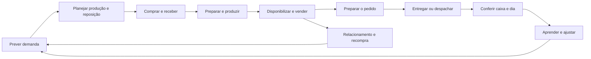

# Revisão de produto e UX dos apps Nuxt do Shopman

**Estado: análise e prévias locais para discussão. Nenhuma variante aprovada.**

Data: 29/10/2026. Base de análise: `origin/main`, commit `7288b44624d195d5cbf37431184fe49ee71a43e0`.
Worktree: `shopman-ux-product-review`, branch `codex/shopman-ux-product-review`.

O Shopman já tem uma infraestrutura de apresentação compartilhada relevante. O problema
mais claro desta revisão está na relação entre essa infraestrutura e a organização do
trabalho: atividades importantes recebem nomes genéricos, assuntos atravessam apps e a
entrada da operação mistura recortes por domínio, por posto e por etapa do processo.
Uma segunda barra lateral pode tornar essa relação mais clara, desde que a hierarquia
venha das tarefas e não da quantidade de opções que passa a caber na tela.

O foco são os apps Nuxt, conforme reforçado pelo dono. Admin/Unfold entra apenas como
fronteira de configuração excepcional ou destino de uma travessia. Não há proposta de
redesenhar o Admin nesta frente.

## 1 Escopo e limites de autorização

O pedido estabelece três etapas distintas:

1. Análise adversarial e planejamento, agora.
2. Aprovações contra prévias locais, autorizadas depois da análise em 29/10/2026.
3. Implementação e deploy somente com autorização explícita posterior do dono.

Aprovar uma hipótese, uma árvore de navegação ou uma prévia não autoriza a etapa 3.
Esta branch contém documentação e prévias locais isoladas, autorizadas pelo dono.
A publicação em PR draft preserva a análise para
revisão; não se pede merge automático, não se entra na fila e não se faz deploy.

O Core mantém suas responsabilidades. Uma categoria de menu não determina um pacote
Python, um modelo ou um novo serviço. Toda eventual reorganização deve preservar:

- regras e invariantes nos cores;
- coordenação no orquestrador;
- leitura por projections e apresentação própria de cada superfície;
- intenções de escrita nas APIs e serviços existentes;
- permissões no servidor, idempotência e reconciliação;
- SSE como sinal para refazer a leitura canônica;
- BFF e componentes comuns no `operator-kit`;
- marca, linguagem e navegação próprias da Loja.

Não há recomendação de mudar DNS, consolidar serviços de deploy ou criar novos apps
antes de validar a arquitetura de informação.

As [prévias de Gestor e Compras](../previews/navigation-2026-10-29/README.md) comparam
lateral única e dois níveis, incluindo navegação móvel, cabeçalho, Central e travessia
entre apps. A preferência visual ainda aguarda avaliação do dono.

## 2 Evidência e grau de confiança

Esta é uma análise de arquitetura de informação e cobertura funcional baseada no código,
com amostra de observação em navegador. Não equivale a um ensaio operacional completo.

| Camada | Evidência desta rodada | O que permite concluir |
|---|---|---|
| Estrutura atual | Registro de superfícies, arquivos de páginas, declarações de seções, shell e subnavegação | Quais destinos existem no código e como são agrupados |
| Capacidades | APIs, projections, busca da suíte, filas da Central e navegação entre registros | Recursos já disponíveis que a proposta deve aproveitar |
| Navegador | Árvore acessível da página de Catálogo do alpha; home pública da Loja com imagem e árvore acessível | Exemplos atuais de conteúdo e hierarquia; não prova de todos os estados |
| Referência Sentry | Especificação pública, anúncio oficial e imagem da navegação em dois níveis | Anatomia e intenção do padrão; login interativo não foi necessário |
| Histórico | Planos da suíte, inventários anteriores e briefing da PR #2047 | Hipóteses e decisões anteriores que precisam ser reconciliadas |
| Concorrência | `git worktree list`, branches remotas, PRs e `make inflight` | Frentes a não duplicar |

As tabelas distinguem **fato estrutural**, **risco inferido** e **hipótese a testar**.
Não se atribui nota numérica aos apps sem ensaio representativo. Não se afirma que um
recurso não existe apenas porque falta uma rota com seu nome: muitos fluxos vivem em
componentes, diálogos ou recortes de uma mesma página.

O [inventário de páginas](SHOPMAN-UX-ROUTE-INVENTORY-2026-10-29.md) lista os 100 arquivos
`.vue` em `app/pages` das 11 superfícies registradas, além da Central em `app.vue`.
São arquivos, não 100 tarefas ou 100 URLs únicas: há páginas pai, índices e detalhes
aninhados. Pagamento do PDV, por exemplo, não precisa de uma rota para ser uma função.

### Reconciliação do trabalho existente

Os diagnósticos de setembro não descrevem integralmente outubro. A suíte já tem
`OperatorSuiteShell`, navegação lateral aberta/compacta/oculta, barra rápida móvel,
busca da suíte, fila na Central, links entre apps e navegação contextual entre registros.
Não repetir os antigos diagnósticos de que essas capacidades não existem.

Na conferência inicial, a PR #2016 já tratava Compras e componentes comuns, com aprovação
visual registrada. A PR #2042 reconciliava a grade de Catálogo; a #2047 preservava estudos
antigos de PDV, Gestor e showroom para esta revisão. Revalidar seus estados antes de
qualquer prévia, pois a base se move. Não portar stacks históricas nem regenerar
baselines de outra sessão.

O plano antigo separava operação e ajustes por decisão do dono. Esta revisão questiona
a adequação dessa separação para algumas tarefas, como o novo pedido autoriza. Isso
abre uma hipótese para aprovação, sem revogar silenciosamente decisões anteriores.

## 3 O produto visto pelo trabalho

O ciclo operacional atravessa as superfícies:



Esse ciclo não é a sequência obrigatória de toda venda. Revenda, produção na hora,
produção em lote, retirada e entrega têm caminhos próprios. Ele serve para identificar
as passagens em que uma pessoa hoje precisa descobrir o próximo app.

### Quatro mapas que precisam coexistir

| Mapa | Pergunta humana | Exemplo |
|---|---|---|
| Posto | O que faço aqui agora? | Balcão, estação de preparo, recebimento |
| Assunto | Onde cuido deste tema? | Produtos, clientes, estoque, canais |
| Processo | Em que etapa está este trabalho? | Planejamento, produção, qualidade |
| Objeto | O que aconteceu com este registro? | Pedido, produto, lote, entrada de compra |

Um app pode expressar mais de um mapa. O erro seria exigir que cada app corresponda a
um domínio técnico ou que toda pessoa navegue pelo mesmo mapa. A cozinheira precisa de
uma fila de estação; a gestora precisa entender o pedido inteiro. São leituras distintas
do mesmo processo, sem criar dois donos para o mesmo estado.

### Postos e momentos

| Pessoa ou posto | Prioridade no momento | O que deve estar à mão | O que não deve dominar a tela |
|---|---|---|---|
| Caixa no balcão | Concluir o atendimento com segurança | Comanda, total, pagamento, troco, falha recuperável | Cadastros extensos e análises |
| Atendimento no salão | Registrar e acompanhar consumo | Mesa/comanda, itens, envio à cozinha, transferência | Saúde de equipamentos de outro posto |
| Cozinha | Preparar corretamente e na ordem certa | Estação, prazo, quantidades, restrições, cancelamento | CRM, preço e configuração comercial |
| Expedição | Entregar o pedido certo à pessoa certa | Pronto, retirada/entrega, cobrança pendente, confirmação | Catálogo completo |
| Produção | Executar lote sem perder o contexto | Receita/versão, etapa, quantidade, timer, bloqueio | B.I. geral |
| Liderança de produção | Preparar o próximo período | Demanda, capacidade, insumo faltante, plano | Controles repetidos de execução |
| Recebimento | Conferir a entrega física | Compra/nota, material, quantidade, unidade, divergência | Precificação de todo o catálogo |
| Compradora | Repor na quantidade e no prazo certos | Sugestão, fornecedor, custo, entrega esperada | Complexidade contábil não contratada |
| Gestora ou dona | Resolver exceções e decidir | Pendências acionáveis, consequência, origem do número | Todos os avisos com o mesmo peso |
| Cliente | Saber o que pode pedir e quando recebe | Oferta real, preço, disponibilidade, prazo, acompanhamento | Modelo interno de lote ou estoque |

O mesmo usuário pode trocar de posto. Preferência visual não concede permissão; posto
não é sinônimo de pessoa ou dispositivo. Uma atribuição física deve orientar a entrada,
sem tornar impossível mudar de tarefa quando houver autorização.

## 4 Diagnóstico adversarial macro

### Achados com evidência estrutural

| ID | Fato e origem | Risco para o trabalho | Prioridade de estudo |
|---|---|---|---|
| U01 | O Gestor põe Histórico, Catálogo, Clientes, Rotinas, Canais e Postos sob Ajustes, em `gestorSections.ts` | Procurar uma atividade de negócio exige adivinhar uma categoria de configuração | Alta |
| U02 | O Marketing põe Campanhas, Modelos e Ofertas e cupons sob Ajustes, em `useMarketingSections.ts` | A pessoa pode entender o app como uma caixa de aprovação sem encontrar a criação e manutenção de campanhas | Alta |
| U03 | A Base do Compras reúne Insumos, Fornecedores, Custos e Contagem | A categoria descreve armazenamento; Contagem é trabalho operacional e Custos pode ser consulta ou manutenção | Alta |
| U04 | O Gestor se apresenta como gestão de pedidos, mas também é a casa de catálogo e clientes; há persona `catalogOnly` | O nome do app comunica menos do que ele contém; múltiplos públicos recebem mapas diferentes | Alta |
| U05 | O B.I. nivela assuntos como Vendas/Clientes e ferramentas como Explorar/Projeção/Cenários | O usuário escolhe entre tema e modo de análise sem uma hierarquia explícita | Média |
| U06 | A Produção nivela cinco etapas do lote com Timers, Receitas, Relatórios e Letreiro | A navegação mistura execução, instrumento, cadastro, análise e monitor | Média |
| U07 | A Saída da Cozinha leva ao quadro do Gestor; Pedidos e Saída são recortes do mesmo quadro | A travessia pode parecer troca de sistema; a sobreposição visual pode ser útil, desde que o dono do ato permaneça único | Alta |
| U08 | No PDV, Fim do dia aparece na barra rápida e fica dentro de Caixa no desktop; há telas sem shell para fechamento e relatório | Um mesmo destino tem formas distintas de descoberta; o corredor de foco precisa ter retorno inequívoco | Média |
| U09 | O selo do app é também link de volta à Central e troca de imagem em hover/foco | Identidade e navegação dividem um símbolo; em toque o significado precisa ser perceptível sem hover | Média |
| U10 | Busca da suíte tem fontes por tipo e tolera falha de uma fonte retornando lista vazia | Sem indicação adicional, resultado parcial pode parecer ausência de registros; verificar a experiência antes de mudar o contrato | Alta |

Fontes principais: [Gestor](../../surfaces/orders-nuxt/app/presentation/gestorSections.ts),
[Marketing](../../surfaces/marketing-nuxt/app/composables/useMarketingSections.ts),
[Compras](../../surfaces/purchase-nuxt/app/presentation/purchaseSections.ts),
[B.I.](../../surfaces/bi-nuxt/app/presentation/biSections.ts),
[Produção](../../surfaces/production-nuxt/app/presentation/productionSections.ts),
[Cozinha](../../surfaces/kds-nuxt/app/presentation/sections.ts),
[PDV](../../surfaces/pos-nuxt/app/presentation/sections.ts),
[selo](../../surfaces/operator-kit/app/components/OperatorAppSeal.vue),
[busca](../../shopman/backstage/projections/suite_search.py).

### Questões de produto que o menu sozinho não resolve

**Estoque tem um mapa humano único?** Receber e contar insumos, finalizar lote, contar
vitrine, acompanhar disponibilidade e pausar venda aparecem em contextos diferentes.
Isso pode ser correto. A lacuna a testar é conseguir responder, a partir de um SKU:
quanto existe, onde, quanto está comprometido, o que pode ser vendido e por que a loja
mostra outra coisa. Não propor um segundo estoque nem um novo core para essa pergunta.

**Catálogo e ficha de compra expressam a mesma coisa física sem confundir papéis?**
Permitir compra e Permitir revenda são gestos já decididos. A experiência deve mostrar
a conexão entre cadastros de mesmo SKU e unidade, preservando o estoque compartilhado.
Não inferir vendabilidade por existir compra, nem duplicar o cadastro para contornar a UI.

**O dia termina em qual lugar?** Fechar turno, conferir dinheiro, contar vitrine,
registrar perda e avaliar produção são tarefas relacionadas, com ciclos diferentes.
Uma entrada coordenada pode antecipar dependências e apontar o responsável por cada
pendência. Não deve fundir turno de caixa, dia da loja e ciclo do lote.

**Cliente tem uma continuidade reconhecível?** PDV identifica, Gestor mantém cadastro e
resolve unificações, Marketing usa públicos e B.I. analisa comportamento. O operador
precisa reconhecer o mesmo cliente e chegar ao detalhe autorizado sem recriar busca.
Cadastro, segmentação e relatório não precisam virar quatro CRMs.

**Aviso significa ação?** Na amostra do Catálogo, o nome acessível de Avisos indicava
231 itens que pediam atenção e o selo dizia `9+`. É um retrato do ambiente de testes,
não uma taxa de falha do produto. Ainda assim, é um bom cenário de estresse: a interface
precisa distinguir urgente, tarefa atribuída, informação e causa repetida. Um sino
ocupado permanentemente deixa de ajudar a decidir.

**O que Shopman promete como micro ERP?** Não presumir escopo de contabilidade completa,
folha, contas a pagar ou receber, conciliação bancária ou logística de frota por comparar
com Odoo. A revisão precisa classificar cada necessidade como tarefa atual mal exposta,
capacidade parcial, hipótese de produto ou fora do escopo. “Não achei no menu” não é
evidência suficiente de ausência funcional.

### Escopo já decidido e funcionalidades sem app próprio

O [corte de produto v1](PRODUCT-V1-SCOPE-BACKLOG.md) registra Marketing e B.I. fora do
go-live e inclui os demais fluxos, inclusive entrega por parceiro e Concierge fase 1.
Esta revisão cobre Marketing e B.I. como produto, sem transformar seu redesenho em
novo bloqueio de lançamento. Não reabre esse corte nem declara prontidão das integrações.

Algumas funcionalidades não correspondem a um app ou a uma página. Precisam entrar
na análise e nas futuras prévias pelo ponto em que afetam o trabalho:

| Família | Como aparece na experiência | Questão adversarial |
|---|---|---|
| WhatsApp e Concierge | Entrada conversacional, identificação e continuidade do atendimento | O cliente ou operador consegue retomar sem repetir contexto? Onde chega a exceção humana? |
| Entrega por parceiro | Promessa, cotação/contratação quando aplicável, despacho e acompanhamento | Quem resolve atraso, recusa ou resultado incerto sem alternar portais por adivinhação? |
| Fiscal e documentos | Identificação fiscal, emissão posterior à venda, comprovantes e recuperação | Venda concluída e emissão pendente estão distintas? Onde o operador autorizado resolve a falha? |
| Impressão e periféricos | Leitor, balança, gaveta, impressora, maquininha e monitores | A falha do equipamento informa o impacto na tarefa e preserva o resultado já confirmado? |
| Contas e relações comerciais | Grupo, condições e vínculos de cliente; conta da casa/staff quando contratada | Quem consulta, concede e corrige, sem confundir benefício com forma de pagamento? |
| Fidelidade e recompra | Vantagem do cliente, histórico, oferta e retorno | O benefício é compreensível antes de confirmar e tem a mesma origem em todas as portas? |
| Perecibilidade | Lote, validade, perda, aproveitamento e disponibilidade | O que vence logo pode ser priorizado sem misturar saldo físico, reserva e promessa? |
| Importação e edição em lote | CSV, tabelão e atualização de catálogo/cadastros | A pessoa entende o alcance, os erros por registro e o que foi aplicado parcialmente? |
| Rotinas e passagem de turno | Checklist, episódio e pendência atribuída | O sistema antecipa a tarefa e entrega contexto a quem assume, sem virar checklist paralelo? |
| Notificações | Aviso na tela, som, push e mensagem ao cliente | O destinatário recebe informação acionável, no momento certo e sem duplicação de causa? |
| Identidade e confiança | PIN, bloqueio, troca de operador e autorização excepcional | A tela mantém autoria inequívoca quando várias pessoas usam o mesmo dispositivo? |

Esses itens são perguntas de revisão, não alegações de defeitos encontrados. O nome
da funcionalidade não autoriza ampliar a fase do Concierge, introduzir serviços de
pagamento ou criar um módulo financeiro completo.

## 5 Alternativas de organização do produto

| Alternativa | Como a pessoa encontra o trabalho | Ganho | Custo e risco |
|---|---|---|---|
| A Apps atuais com hierarquia corrigida | Escolhe app, seção e destino contextual | Menor ruptura; aproveita entrada por posto e apps instalados | Mantém a necessidade de conhecer a divisão entre apps |
| B Gestão por assuntos e operação por postos | Uma entrada de gestão dá acesso a produtos, clientes, estoque, canais e análises; balcão/cozinha/produção continuam focados | Melhor continuidade para quem administra; preserva concentração operacional | Exige mapa canônico de destinos e clareza para não criar outro gestor concorrente |
| C Experiência inteira por postos | Cada posto recebe seu conjunto de tarefas e destinos | Forte adequação à rotina e ao dispositivo | Uma mesma pessoa muda de papel; cadastros e análises transversais podem ficar difíceis de localizar |

**Recomendação para explorar:** comparar A e B nas prévias, usando postos para priorizar
o trabalho em ambas. C serve como contraponto adversarial, mas não é a primeira aposta
para substituir toda a navegação. Nenhuma alternativa exige unificar fisicamente apps,
alterar domínios do Core ou mudar hostnames.

Em B, “Gestão” é uma hipótese de organização, não um nome aprovado para um novo app.
A Central pode oferecer a entrada transversal usando destinos já existentes. Antes de
criar uma superfície, medir se links e uma navegação comum resolvem o problema.

### Dono principal e entradas contextuais

| Assunto | Casa funcional proposta para explorar | Entradas contextuais legítimas | Duplicação a impedir |
|---|---|---|---|
| Venda e comanda | PDV | Cliente, mesa, encomenda | Outro editor de venda com regras diferentes |
| Pedido e expedição | Gestor | PDV, estação, Central, acompanhamento autorizado | Duas confirmações de entrega independentes |
| Catálogo e preço | Área explícita de Produtos, inicialmente no Gestor | Compra, receita, canal, PDV em consulta | Reprecificação autônoma em cada app |
| Cliente | Área explícita de Clientes, inicialmente no Gestor | Busca no PDV, público no Marketing, B.I. | Unificação ou edição concorrente com semântica diferente |
| Produção em lote e receitas | Produção | Falta de estoque, encomenda, B.I. | Planejar ou baixar produção no frontend de outro app |
| Suprimentos | Compras | Falta de insumo no plano, produto comprável | Receber mercadoria pelo catálogo de venda |
| Estoque | Leitura transversal com ações no contexto responsável | SKU, lote, recebimento, vitrine | Ledger ou saldo paralelo |
| Campanhas e comunicação | Marketing | Produto, disponibilidade, público | Cupons independentes de regras do orquestrador |
| Caixa e conferência | PDV para turno; visão gerencial em análise | Pendência do dia, pedido, comprovante | Tratar análise como alteração do livro-caixa |
| Aprendizado | B.I. | Produto, plano, campanha, cliente | Número com fórmula diferente em cada painel |

## 6 Navegação em dois níveis

### O modelo sugerido pelo dono

É uma barra primária **dentro do app** e uma segunda barra lateral que muda conforme
a opção primária selecionada. As duas podem ser recolhidas independentemente. Não é
apenas um submenu em cascata, nem uma barra de apps acompanhada de outra lista plana.

```text
Trocar app: controle da suíte, separado da hierarquia abaixo

Barra primária       Barra contextual           Área de trabalho
Produtos             Produtos                  Catálogo
Clientes             Coleções                  Busca, filtros e visão
Pedidos              Disponibilidade           Lista ou detalhe
Canais               Preços
                     Visualizações favoritas

Recolher primária    Recolher contextual        Ação da tarefa permanece aqui
```

O exemplo é conceitual: nomes e agrupamentos precisam de aprovação. A imagem oficial
do Sentry mostra áreas principais em uma faixa estreita e, ao lado, uma coluna com
título da área, destinos e visualizações favoritas. A especificação descreve a segunda
barra recolhível e adaptação para telas menores. Não tomar a implementação React do
Sentry como recomendação técnica para o Shopman.

### Por que pode ajudar

- Expõe relações que hoje estão em Ajustes ou numa faixa de abas distante.
- Mantém o lugar da área principal ao alternar destinos irmãos.
- Dá espaço a visualizações frequentes sem confundi-las com módulos novos.
- Permite reduzir o peso da navegação durante uma tarefa concentrada.

### Como pode piorar

- Duas colunas largas podem comprimir tabela, conta e fila justamente no momento crítico.
- Ícones em dois níveis podem exigir memorização e tooltips em toque.
- Repetir os mesmos destinos na barra, em abas e em cards cria três mapas concorrentes.
- Criar grupos só para preencher a barra aumenta profundidade sem agregar sentido.
- Esconder a barra sem deixar um controle persistente de recuperação desorienta.

### Contrato comportamental a validar nas prévias

1. Primária aberta, compacta ou oculta; secundária aberta ou recolhida. Não adicionar
   uma segunda coluna de ícones sem significado inequívoco apenas por simetria.
2. Controles separados dizem qual barra recolhem e qual é o próximo estado. O atalho
   `C` atual não pode passar a controlar duas barras de forma ambígua.
3. O destino atual continua indicado no título e na trilha, mesmo com ambas recolhidas.
4. Selecionar uma área revela seus destinos. O comportamento de abrir o último destino
   ou uma visão inicial deve ser comparado; link direto sempre vence memória local.
5. Sem filhos úteis, não montar uma segunda barra vazia ou com um único link redundante.
6. Menu de navegação contém destinos; filtros ficam na barra de trabalho; ações como
   cobrar, cancelar, confirmar recebimento e publicar ficam no contexto do objeto.
7. Uma visualização salva é um recorte nomeado, com filtros explícitos. Não pode virar
   outra fonte de verdade, alterar permissão ou esconder um estado crítico por padrão.
8. Desktop largo pode mostrar ambas. Desktop baixo e tablet deitado priorizam a área
   de trabalho; testar primária compacta e contextual sob demanda.
9. Tablet em pé e celular usam uma gaveta hierárquica com retorno visível e barra rápida
   orientada às tarefas. Duas barras permanentes não são pré-requisito de padronização.
10. Kiosk e telas públicas/passivas não herdam menu de gestão. O posto pode entrar direto
    na fila e oferecer navegação secundária apenas quando fizer sentido.
11. Toque, teclado, leitor de tela e foco recebem os mesmos destinos autorizados.
    `Escape` fecha a camada aberta e devolve foco; abrir menu não dispara escrita.
12. Larguras e recolhimento são preferências visuais. Filtros compartilháveis e destino
    são contexto de navegação; rascunho e seleção têm tratamento próprio.

### Comparação a preparar depois desta análise

| Variante | Estrutura | Pergunta do teste |
|---|---|---|
| A1 | Uma lateral com grupos e filhos expandidos | A árvore é pequena o suficiente para dispensar a segunda barra? |
| A2 | Primária e contextual independentes, como a sugestão | A separação melhora descoberta e alternância sem prejudicar trabalho? |
| B1 | Entrada gerencial por assuntos mais a contextual | Reduz busca entre apps ou apenas acrescenta uma camada? |

Usar as mesmas tarefas e dados nas variantes. Não comparar uma tela bonita com outra
sem acabamento. A2 é uma candidata forte para gestão, Compras e B.I.; PDV e Cozinha
precisam provar benefício antes de ganhar mais navegação permanente.

## 7 Revisão por app

As estruturas abaixo são hipóteses para prévias, não renomeações aprovadas.

### Central

**Vocação:** orientar a pessoa ao trabalho disponível e às pendências em que pode agir.
A Central já tem fila, estado e próximo item por app. A proposta deve melhorar essa
capacidade, sem construir outro quadro de operação.

Explorar uma primeira leitura por urgência e posto, com acesso previsível a todos os
apps liberados. Separar “precisa de ação” de “abrir ferramenta”. Preservar o acesso aos
demais destinos mesmo quando não há pendências. Trocar de app deve ser explícito, sem
depender de descobrir que o logotipo é uma volta.

**Provar:** começar um turno, assumir outro posto, abrir uma pendência exata e voltar;
nenhum app liberado; app indisponível; pendência que outra pessoa já resolveu.

### PDV

**Cobertura:** comandas, mesas/salão, venda, produtos por peso e opções, cliente,
agendamento/entrega, encomendas, envio à cozinha, transferência de itens, descontos,
pagamento parcial, PIX, maquininha, resultado/troco, caixa, fechamento, relatórios,
impressão e tela do cliente, diagnóstico e ajustes do terminal.

O principal problema a testar é a competição entre operar a conta e administrar o
posto. Na venda, a comanda, o total e o próximo ato precisam continuar inequívocos.
Não sacrificar área da conta para oferecer navegação de tarefas raras.

Hipótese: manter Comandas, Encomendas e Caixa como entradas fortes. Usar a contextual
em Caixa e configuração do posto; na venda ativa, comparar a contextual recolhida com
ausência dela. A comanda selecionada não é um submenu. Pagamento é etapa da transação,
com resultado conhecido, rejeitado ou em reconciliação, não uma opção de navegação.

O estudo preservado na #2047 propõe seleção explícita e rodapé compacto. Comparar com
o main atual em contas com 3, 10 e 20 itens, teclado e toque. Não recuperar atalhos
antigos: a navegação e seleção atuais já existem e têm decisões posteriores.

**Provar:** interromper venda para consultar encomenda e retornar; trocar operador;
transferir parte e tudo; item por peso; dividir pagamento; PIX ainda pendente; falha de
impressão depois da venda; conexão perdida. Nova navegação não pode perder rascunho,
trocar comanda silenciosamente nem sugerir repetir cobrança com resultado desconhecido.

### Gestor de pedidos

**Cobertura:** Entrada/Preparo/Saída, recortes do quadro, atendimento e atribuição,
negociação iFood, cancelamento/devolução, despacho/retirada, histórico e detalhe,
catálogo e vínculos por canal, clientes/grupos/unificações, rotinas e postos.

Separar visualmente o posto operacional da gestão de cadastros é correto. Esconder
Histórico e Catálogo em Ajustes pode ser o preço errado para obter essa separação.
Quem só expede deve continuar com um mapa pequeno; a gestora não precisa receber o
mesmo menu reduzido.

Hipótese A: Pedidos → Fila, Saída, Histórico; Produtos → Catálogo, Coleções e contexto
de preço/disponibilidade; Clientes → Cadastro e Grupos; Canais → Operação e catálogo;
Rotinas e Postos com localização própria conforme papel. Algumas capacidades de
produto são hoje modos/componentes: agrupar não significa criar novas páginas.

Hipótese B: retirar a obrigação de lembrar “Gestor de pedidos” para cuidar de produtos
e clientes por uma entrada gerencial transversal. Preservar um único editor funcional
para cada registro. Não duplicar Saída na Cozinha.

**Provar:** expedir no pico; achar pedido concluído; corrigir preço; entender por que um
SKU não vende num canal; tratar cliente duplicado; abrir a partir da busca e retornar
ao recorte original. Os casos iFood têm origem e limitações próprias visíveis.

### Cozinha

**Cobertura:** índice de estações, fila da estação, ticket e itens, prazo, cancelamento,
Pronto/Desfazer, som/densidade, painel de retirada e atalho para Saída.

A estação pelo nome da casa é uma boa unidade de navegação já decidida. A segunda
barra só tem justificativa se oferecer recortes úteis da estação, sem transformar
estado do ticket em módulo. Uma estação fixa pode não precisar de barra contextual.

O atalho para Saída deve comunicar que abre a expedição no Gestor e preservar o
retorno. Painel de retirada é tela pública; não mostrar sessão ou ações do operador.

**Provar:** nova pessoa na estação; cancelamento enquanto prepara; ticket pronto por
outro dispositivo; atraso com muitos tickets; luva/toque; reconexão. Não priorizar
apenas pelo número maior ou por ordenação que salta sob o dedo.

### Produção

**Cobertura:** planejamento, preparação de insumos, execução e etapas, finalização,
qualidade, timers, receitas e versões/comparação/revisão, relatórios e letreiro.

O ciclo de cinco etapas é útil, mas navegação linear e trabalho simultâneo não são a
mesma coisa. A operadora pode acompanhar vários lotes em etapas diferentes. Agrupar
tudo em “Execução” também pode esconder a etapa frequente e custar um toque a mais.

Comparar: ciclo atual agrupado visualmente numa só barra; e primária Hoje/Planejamento/
Receitas/Resultados com contextual das tarefas pertinentes. “Hoje” é hipótese de nome,
sem revogar Produção/Finalização/Qualidade nem renomear estados do lote.

Timer continua um instrumento acessível durante o trabalho, inclusive quando a pessoa
consulta receita. Receita e versão são contexto do lote, com vínculo explícito. Uma
falta de insumo deve levar ao item no Compras com contexto autorizado, sem a pessoa
ter de copiar o nome e refazer busca.

**Provar:** preparar dois lotes; alterar plano; lote bloqueado por insumo; timer tocando
fora da sua tela; perda na finalização; avaliação de vários lotes; receita editada
depois de o lote começar. Distinguir plano, previsão e realizado.

### Compras

**Cobertura:** painel, reposição/Comprar, recebimento por nota/chave/QR, identificação
e conversão de material, volumes, divergência/recusa, confirmação de entrada,
materiais e fornecedores, custos, contagem e ferramentas CSV.

“Base” é a categoria menos explicativa da navegação. Contagem é operação; fornecedor
é cadastro; custo pode ser fato de compra ou manutenção. Hipótese: Reposição,
Recebimentos, Estoque e Cadastros como áreas, com contextual. Comparar com a alternativa
mais conservadora que apenas expõe Insumos e Fornecedores e desloca Contagem para um
destino operacional. Evitar inventar módulos sem tarefa distinta.

A PR #2016 já simplifica o CRUD humano. Usá-la como base assim que integrada e não
restaurar formulários antigos. A página do material deve distinguir unidade de compra,
unidade de estoque, custo e eventual vínculo vendável.

**Provar:** receber parcialmente com divergência e material desconhecido; retomar
conferência; contar sem contaminar a contagem com saldo esperado; revisar custo sem
sobrescrever história; consultar fornecedor mantendo o recebimento. Pedido de compra,
aprovação e contas a pagar completos precisam de verificação de capacidade e escopo,
nunca de uma promessa implícita de ERP completo.

### Marketing

**Cobertura:** decisões, detalhe de anúncio, segundo controle, agendados, enviados,
campanhas, modelos, ofertas/cupons, plataformas e estado de conexão.

O app mistura fluxo editorial e máquina de automação. “Decisões” pode ser uma ótima
entrada diária, mas não explica como criar uma campanha, mudar público e acompanhar
resultado. Ofertas comerciais e anúncios também não são o mesmo objeto.

Hipótese: Publicações → Para revisar, Agendadas, Enviadas; Campanhas → Campanhas e
Modelos; Ofertas e cupons com entrada reconhecível; Conexões em ajustes quando raras.
Comparar nomes com o vocabulário canônico, sem voltar a tratar público como faixa de
preço nem chamar plataforma de canal comercial indiscriminadamente.

**Provar:** criar e revisar campanha; prever quem recebe e por quê; conteúdo que ficou
velho por esgotamento; conexão perdida; publicação com resultado ainda incerto; autoria
e segunda aprovação. A navegação não pode tornar “publicar” um link sem contexto.
Métrica de resultado deve apontar origem e período, sem duplicar fórmulas do B.I.

### B.I.

**Cobertura:** produção e lotes no período, vendas, caixa, clientes, entregas, perfis,
exploração, projeção, cenários e visualizações salvas.

Há dois eixos misturados: assunto analisado e ferramenta usada para analisar. A barra
contextual é uma candidata forte: Análises → Produção/Vendas/Caixa/Clientes/Entregas;
Exploração → recortes e favoritos; Planejamento → Projeção/Cenários. É preciso testar
se “Planejamento” colide com o planejamento operacional da Produção.

Período, comparação e filtros devem continuar explícitos. Já há query de janela e
visualizações salvas: aproveitar esses contratos. Favoritar um recorte não pode apagar
o fato de que ele exclui dados. Uma conclusão deve permitir examinar a causa e abrir
o contexto de ação, mantendo a separação entre leitura analítica e escrita operacional.

**Provar:** entender sobra/falta e abrir o plano; comparar períodos equivalentes;
investigar divergência de fonte; voltar de um detalhe ao gráfico com recorte preservado;
consulta sem dados e dados incompletos. Número zero não é equivalente a falha de carga.

### Loja

**Cobertura:** home, cardápio/coleções/busca, produto/oferta, favoritos, alertas de
reposição, sacola, checkout e pagamento, login/retomada, acompanhamento, conta,
endereços/preferências/segurança, pedidos, FAQ e documentos legais.

A Loja tem audiência e voz próprias. A lateral em dois níveis não é a hipótese
principal para o cliente. Preservar descoberta, compra e acompanhamento com navegação
curta; conta pode ter subnavegação simples. Padronização aqui é consistência de
promessa, disponibilidade e estado do pedido, não copiar o shell de operador.

Na home pública observada, “Direto do forno” apresentou três produtos indisponíveis.
Isso pode refletir o dado de testes ou a seleção da coleção. A hipótese de UX é
verificar se a primeira oferta ajuda a comprar agora ou faz a loja parecer sem opção.
O aviso recorrente é útil para quem quer aquele produto, mas não substitui uma
alternativa comprável. A foto grande da fachada estabelece marca, porém ocupa quase
toda a primeira tela no desktop observado; testar o equilíbrio entre hospitalidade,
orientação e acesso à oferta. Não concluir conversão sem medir.

**Provar:** cliente novo, recompra, produto esgotado, prazo futuro, área não atendida,
endereço incompleto, PIX pendente, retorno do login, perda de conexão e pedido atrasado.
Horário de loja, horário de entrega e promessa do pedido precisam ser distintos e
coerentes. Não pedir de novo o que o sistema já conhece com confiança.

### Status público e Kitchen Sink

Status deve informar impacto, atualização e próximo caminho sem exigir login; preservar
sua independência de infraestrutura. Não colocar navegação gerencial em página de falha.
Kitchen Sink é superfície interna: deve demonstrar os estados do padrão escolhido,
inclusive móvel, teclado, erro, vazio e permissão. Não tratá-lo como app de negócio nem
usar aparência do showroom como prova de adequação à operação.

## 8 Padrões transversais a avaliar

| Tema | Regra de experiência proposta | Prova necessária |
|---|---|---|
| Destino e retorno | Título e trilha identificam área, objeto e origem quando útil | Link direto, voltar do navegador, nova aba e retorno cross-app |
| Contexto | Busca, filtro, período e modo reaparecem ao voltar | Recorte reproduzível por URL; foco/scroll restaurados quando pertinente |
| Busca | Escopo e tipo do resultado são claros | Distinguir vazio, ausência de permissão e leitura parcial |
| Seleção | Selecionar, abrir e expandir têm gestos inequívocos | Teclado e toque com 1/10/20 registros e ação em lote |
| Densidade | Depende da tarefa e do alcance da mão | Tabela no escritório, conta no balcão e ticket na parede |
| Ação principal | A próxima ação legítima é reconhecível | Rótulo de resultado, consequência e bloqueio no contexto |
| Erro | Diz o que aconteceu e como retomar | Criado, rejeitado e desconhecido não compartilham o mesmo “tente de novo” |
| Atualização | Estado ao vivo não rouba foco ou muda alvo durante toque | SSE, eventos concorrentes e reconexão |
| Avisos | Prioridade, objeto, responsável e destino têm sentido | Causa repetida, expiração, resolução por outro operador |
| Permissão | Cada papel encontra seus destinos legítimos | Perfil mínimo, múltiplos papéis, troca de operador e link direto negado |
| Beleza | Hierarquia, alinhamento, contraste e respiro tornam a tarefa legível | Texto longo, tema claro/escuro, zoom e dados reais |
| Interrupção | Sair e retomar preserva trabalho ou explica consequência | Rascunho, seleção, pagamento em curso e bloqueio do dispositivo |

Não confundir minimalismo com esconder atos indispensáveis em reticências. Nem
consistência com uniformizar uma cozinha e uma análise financeira. Um nome por conceito,
destinos previsíveis e consequência explícita têm precedência sobre simetria visual.

## 9 Benchmarks e o que aproveitar

As aplicações ao Shopman abaixo são inferências de design, não prova de superioridade
dos produtos citados. Referências consultadas em 29/10/2026.

| Referência primária | O que a fonte estabelece | Aplicação possível no Shopman |
|---|---|---|
| [Sentry, projeto de stacked navigation](https://github.com/getsentry/sentry/issues/84016) e [componentes](https://github.com/getsentry/sentry/issues/84018) | Áreas principais com subnavegação e visualizações; suporte a recolhimento e adaptação | Separar seção de destinos contextuais, com componentes comuns |
| [Sentry, anúncio com imagem oficial](https://sentry.io/changelog/new-nav-issue-views-ga/) | Nova navegação e visualizações que guardam recortes de consulta | Favoritos úteis, sem transformar cada filtro em módulo |
| [Shopify, navegação do Admin](https://help.shopify.com/en/manual/shopify-admin/shopify-admin-overview) | Pedidos, produtos, clientes, análises e extensões; busca e ações urgentes | Assuntos de negócio reconhecíveis e caminhos diretos para resolver pendências |
| [Shopify, orientação de navegação](https://shopify.dev/docs/apps/design/navigation) | Navegação centrada nas tarefas e poucas categorias compreensíveis | Não organizar apenas pela estrutura do código ou por conveniência de layout |
| [Odoo, PDV](https://www.odoo.com/documentation/19.0/applications/sales/point_of_sale/overview/getting_started.html) | Operação de loja/restaurante, recursos de salão e hardware no contexto do PDV | Comparar completude do atendimento e continuidade em condições adversas |
| [Odoo, reposição](https://www.odoo.com/documentation/19.0/applications/inventory_and_mrp/inventory/warehouses_storage/replenishment.html) | Diferentes mecanismos para repor conforme o processo | Mostrar motivo e caminho da reposição; não automatizar compra sem escopo aprovado |
| [ERPNext, workspace](https://docs.frappe.io/erpnext/workspace) e [ordem de produção](https://docs.frappe.io/erpnext/work-order) | Entradas por módulo e ligação entre planejamento, ordem e execução | Separar visão do planejador e foco da operadora mantendo o mesmo objeto |
| [iFood, ferramentas do parceiro](https://parceiros.ifood.com.br/restaurante/como-funciona/ferramentas) | Gestor acompanha pedidos; Portal configura e acompanha negócio | Distinguir operação de pico e gestão sem obrigar reaprendizado |

O benchmark não é uma lista de funcionalidades obrigatórias. Copiar a amplitude de um
ERP pode aumentar trabalho numa padaria pequena. Copiar apenas o visual do Sentry pode
embelezar a mesma taxonomia confusa. A pergunta comum é o que o trabalhador deixa de
precisar lembrar, procurar, redigitar ou conferir sozinho.

## 10 Plano de prévias e decisões

### Rodada 1 Arquitetura de informação

Entregar árvores comparáveis A e B, com mapa atual → destino proposto e dono funcional.
Fazer teste de localização com tarefas concretas, antes de polir telas. Exemplos:
“um produto sumiu da Loja”, “preciso alterar o preço”, “chegou farinha com quantidade
errada”, “o cliente veio retirar”, “o lote atrasou”, “quero saber por que sobrou”.

Registrar primeiro destino escolhido, retornos, dúvidas de rótulo e conclusão da tarefa.
Não usar somente opinião sobre qual menu é mais bonito. Aprovação esperada: fronteiras,
nomes e hierarquia candidatos para a rodada visual.

### Rodada 2 Navegação e anatomia local

Produzir prévias isoladas com dados sintéticos, sem credenciais ou conexão de escrita
com alpha. Comparar barra única agrupada, duas laterais e entrada gerencial transversal.
Representar no mínimo Gestor/Catálogo, Compras/Recebimento, B.I., Produção e PDV para
não aprovar um padrão com base apenas no app em que ele fica mais bonito.

Usar 1440×900, 1280×720, 1024×768, 768×1024 e 390×844 como perfis iniciais de teste,
sem tratar esses números como breakpoints aprovados. Incluir zoom de 200%, teclado,
toque e rótulos longos. Medir área útil, rolagens concorrentes, alvos encobertos,
descoberta do recolhimento e retorno depois de navegar.

Não construir nesta etapa uma fachada navegável para cada rota do inventário sem
validar primeiro o padrão. A aprovação deve registrar variante, cenário, perfil e
eventuais condições, evitando um “aprovado geral” que não identifica o que foi visto.

### Rodada 3 Jornadas completas por app e entre apps

| Jornada de prévia | Passagens obrigatórias |
|---|---|
| Venda imediata | Comanda → itens → cozinha quando aplicável → pagamento → resultado → nova venda |
| Encomenda | Cliente → data/promessa → disponibilidade → cobrança → preparo → retirada |
| Expedição | Pedido → itens prontos → impedimento de cobrança/entrega → confirmação e retorno |
| Reposição | Falta prevista → SKU → fornecedor → recebimento divergente → saldo disponível |
| Produção | Demanda → plano → insumo → lote/receita → timer → finalização → qualidade |
| Comercial | Produto → preço/canal → oferta → anúncio → aprovação → resultado |
| Cliente | Identificação no balcão → detalhe autorizado → histórico → público, quando permitido |
| Encerramento | Turno → conferência → vitrine/perda → pendências do dia → próximo responsável |
| Aprendizado | Indicador → origem → registro/recorte → ação no app responsável → retorno |
| Loja | Descoberta → escolha → indisponibilidade/alternativa → checkout → acompanhamento |

Cada jornada inclui carregando, vazio, erro, leitura desatualizada, permissão limitada,
conflito com outro operador e interrupção. Pagamentos e publicações são simulados.
Incluir também os monitores: tela do cliente, painel de retirada, letreiro e cardápio
de parede, sem conceder a eles navegação de operador.

### Condições para aprovar o desenho

- Toda função atual recebe destino ou decisão explícita de retirada; nenhum sumiço
  acidental por mudança de menu. Registrar por dispositivo e papel.
- A tarefa frequente tem entrada reconhecível e não depende de hover ou memorização.
- A navegação não introduz perda de contexto ou risco transacional.
- Ação, estado, filtro e destino têm aparência e linguagem adequadas ao seu significado.
- A pessoa explica onde está, o que ocorreu e o próximo ato sem completar contexto.
- Redução de passos não elimina uma decisão de negócio necessária.
- O dono aprova o que viu e as pendências ficam nomeadas.

Não há meta numérica de redução de cliques inventada antes da linha de base. Medir
tempo para localizar, conclusão sem ajuda, erro de destino, redigitação e recuperação.
Registrar dados por cenário e perfil; esta rodada não contém resultados desses testes.

### Implementação futura somente depois de autorização explícita

A sequência candidata é contrato de navegação no kit, piloto gerencial, Compras/B.I./
Marketing, Produção/Cozinha e PDV com ensaios próprios. A Loja segue trilha separada.
Essa ordem é planejamento, não despacho para executar.

Antes de cada frente, conferir main e PRs novamente. Uma frente tem branch e PR próprios;
alteração do kit exige conferir consumidores. Validar componentes, tipos, testes dos
fluxos, acessibilidade, perfis e retratos com o browser da CI. Preservar gates de tema,
vocabulário e contratos. Se uma proposta exigir mudar regra de domínio, separar a
decisão e trazê-la ao dono antes de ampliar o escopo de UI.

### Priorização por efeito no trabalho

| Ordem de discussão | Problema a resolver | Dependência para avançar |
|---|---|---|
| 1 | Achar a tarefa e reconhecer sua casa: U01 a U04 | Árvore de informação e papéis aprovados |
| 2 | Atravessar assuntos sem refazer busca: estoque, SKU, cliente e pedido | Dono funcional e contrato de contexto definidos |
| 3 | Comparar uma ou duas barras sem perder área útil | Mesmos cenários e dados nas variantes |
| 4 | Agir e recuperar sob pressão: avisos, conflitos e resultado desconhecido | Estados reais representados nas prévias |
| 5 | Refinar densidade, tipografia, cor e acabamento | Hierarquia e gestos aprovados |

Essa ordem evita gastar a primeira aprovação com uma paleta enquanto o usuário ainda
precisa adivinhar em que app a tarefa mora. Acabamento visual participa desde a prévia;
o aceite da aparência não compensa uma tarefa perdida ou um estado ambíguo.

## 11 Decisões para discutir a partir desta análise

1. O Shopman deve continuar se apresentando principalmente como apps, ou oferecer uma
   entrada gerencial por assuntos mantendo apps de operação por posto?
2. Catálogo, Clientes, Histórico e Campanhas devem ganhar localização explícita fora
   de Ajustes? Qual agrupamento torna a rotina mais reconhecível?
3. A leitura de estoque merece uma entrada transversal antes de cogitar um app próprio?
4. Em quais áreas a segunda lateral ajuda de fato? Quais exigem foco sem ela?
5. Como a gestora alterna trabalho gerencial e operação sem receber menus excessivos
   nem perder acesso a tarefas permitidas?
6. O que pertence à promessa atual do micro ERP e o que é expansão de produto?

Essas perguntas organizam a conversa. Não bloqueiam o planejamento, não demandam
resposta em lote e não constituem pedido de autorização para implementar.

## 12 Fontes internas para a continuidade

- [Registro das superfícies](../../surfaces/registry.json).
- [Shell atual](../../surfaces/operator-kit/app/components/OperatorSuiteShell.vue) e
  [contrato de seções](../../surfaces/operator-kit/app/presentation/appBar.ts).
- [Fila da Central](../../shopman/backstage/projections/hub.py),
  [busca da suíte](../../shopman/backstage/projections/suite_search.py) e
  [navegação entre registros](../../surfaces/operator-kit/app/components/OperatorRecordNav.vue).
- [Guia de UX dos apps de operador](../guides/operator-surface-ux.md),
  [vocabulário](../reference/suite-vocabulary.md) e
  [clareza da copy](../reference/omotenashi-copy.md).
- [Omotenashi](../omotenashi.md) e
  [régua de excelência](../reference/surface-excellence-review-framework.md).
- [Plano anterior da suíte](SUITE-UX-V2-PLAN.md) e
  [cobertura funcional histórica](suite-ux-v2/funcoes/cobertura.md).
- [Fronteira Admin e superfícies](../reference/admin-surface-boundary.json).
- [Briefing preservado na PR #2047](https://github.com/nelsonboulangerie/django-shopman/pull/2047).

Os documentos anteriores são contexto, não autorização acumulada de execução. As
mudanças propostas aqui só passam a ser decisões quando o dono as aprovar na etapa
correspondente.
