# Cenários de pedido: o mapa de ponta a ponta

**O que é:** os cinco jeitos de um pedido nascer na casa (balcão do PDV, encomenda imediata
no PDV, encomenda agendada no PDV, loja online/WhatsApp e iFood), cada um com **retirada** e
com **entrega**. Para cada um: o caminho feliz (quem faz o quê, em qual tela), as exceções e
uma matriz *requisito → como o sistema atende → onde está → OK / LACUNA / ATRITO*. No fim, a
lista priorizada do que corrigir e as perguntas que só o dono responde.

**Medido em:** `origin/main` em `e4d5ce73e` (13/10/2026), por leitura do código e, onde está
dito, por execução (pytest). Linha de código envelhece: quando o número não bater, procure o
nome da função.

**Legenda:** **OK** funciona e é liso · **ATRITO** funciona, mas cobra esforço, atenção ou
memória de alguém · **LACUNA** não existe, ou existe e falha. As prioridades (P0/P1/P2) estão
na §8.

**Premissas do dono que este mapa não reabre:**

- Não existe entregador da casa: toda entrega dos canais próprios sai pela **TaOn**, inclusive
  a cobrada na porta (valor e troco vão na observação da corrida). No iFood quem entrega é o
  **iFood**, sempre (`deliveredBy=IFOOD`).
- Encomenda: a casa dita o fluxo (cliente → recebimento → quando → produtos).
- "Via Recibo primeiro, Nota depois": a NFC-e acompanha a **saída** da mercadoria.
- Entrega sem CPF é aceita em todo canal e a nota sai presencial (ADR-035, 13/10/2026).
- Expedição sem NFC-e só avisa, nunca segura a sacola.
- KDS: dois gestos (Iniciar, Pronto), desfazer de 5 s, cancelamento com alarde.

**Já em voo, não repetido aqui como lacuna** (só referenciado):

| Frente | PR |
|---|---|
| Chamar entregador desde o aceite + "Marcar pronto" primário na entrega | #1712 |
| Chamar entregador (TaOn) no PDV | #1711 |
| Endereço do PDV: Enter leva ao próximo campo vazio | #1710 |
| Lembrete temporário de chamar o entregador durante o preparo | #1704 |
| "O quanto antes" no PDV; cotação da TaOn em destaque; TaOn em tempo real e dados extras; formulário de endereço do PDV igual ao da loja | outras frentes, sem PR no momento da medição |

---

## 1. As peças comuns

### 1.1 Os canais, como o seed os configura

`config/management/commands/seed.py:6333-6540` (`_seed_channels`).

| Canal | Confirmação | Pagamento | Preparo começa | Avisos ao cliente |
|---|---|---|---|---|
| `pdv` | `immediate` (encomenda vira manual: `lifecycle.py:776`) | `external`; formas do PDV: R dinheiro, P Pix, C crédito, D débito, L link, E em conta | sozinho (`prep_start` padrão) | ManyChat → e-mail → SMS |
| `web` (loja online) | `manual`, alerta de pedido parado em 10 min | Pix e cartão, `post_commit`, prazo 10 min | **o operador** dá "Iniciar preparo" (`prep_start=operator`) | ManyChat → SMS → e-mail |
| `whatsapp` | `manual`, alerta em 10 min | Pix e cartão, `at_commit`, prazo 10 min | sozinho | ManyChat → SMS → e-mail |
| `ifood` | `manual`, alerta em 5 min, SLA do iFood 8 min | `external` | sozinho | nenhum (o telefone é a central do iFood) |

Nenhum canal declara `fulfillment.courier="auto"` (padrão `"none"`, `shopman/shop/config.py:173`):
a corrida da TaOn é sempre chamada por uma pessoa.

### 1.2 Status e transições

`packages/orderman/shopman/orderman/models/order.py:37-71`. O PDV assa no snapshot um mapa
próprio que acrescenta `accepted→completed` (venda de balcão), `ready→cancelled` e
`completed→cancelled` (`seed.py:6383-6400`).

```mermaid
stateDiagram-v2
    [*] --> new: pedido criado (PDV, loja, WhatsApp, iFood)
    new --> accepted: Aceitar (Gestor) · immediate (PDV) · iFood confirma
    new --> cancelled: Recusar (Gestor, com motivo) · Pix venceu · sem estoque · iFood CAN
    accepted --> completed: venda de balcão já entregue (system:counter_handoff, só PDV)
    accepted --> preparing: KDS Iniciar · "Iniciar preparo" (Gestor, loja online) · despertador 00:05 da encomenda
    accepted --> ready: (existe no mapa; nenhum botão usa)
    preparing --> ready: último ticket Pronto (KDS) · "Marcar pronto" (Gestor)
    ready --> preparing: Desfazer o Pronto · reabrir ticket
    ready --> completed: RETIRADA: "Marcar como retirado" (Gestor/Saída) · "Entregar" (Encomendas do PDV) · iFood CON
    ready --> dispatched: ENTREGA: "Marcar saída" (Gestor/Saída) · TaOn coletou (E) · iFood DSP
    dispatched --> delivered: TaOn finalizou (F) · "Recebi meu pedido" (cliente) · "Marcar como entregue" (Gestor) · prazo de entrega vencido · iFood CON
    delivered --> completed: automático (_complete_after_handoff)
    accepted --> cancelled: Cancelar (Gestor/PDV, motivo + gerente se pago)
    preparing --> cancelled: Cancelar
    dispatched --> returned: devolução
    delivered --> returned: devolução
    completed --> returned: devolução
    completed --> [*]
    cancelled --> [*]
    returned --> [*]
```

O que cada fase faz (`shopman/shop/lifecycle.py:324-737`):

| Fase | Efeitos |
|---|---|
| `on_commit` | cliente garantido, reserva de estoque, decisão de disponibilidade gravada, cupom contado, Pix/cartão iniciado se `at_commit`, aviso `order_received` (fora do `immediate`) |
| `on_accepted` | cobra se o pagamento digital ainda não entrou (Pix nasce **aqui** na loja online); encomenda futura agenda o despertador; KDS (se o preparo começa sozinho); baixa de estoque; aviso `order_accepted` (nunca no balcão já entregue) |
| `on_paid` | pago depois de cancelado → estorno + alerta; NFC-e do PDV pela regra "na saída"; aviso `payment_confirmed` |
| `on_preparing` | tickets do KDS; aviso `order_preparing` |
| `on_ready` | NFC-e da entrega da casa (sacola pronta); aviso `order_ready_pickup` / `order_ready_delivery` |
| `on_dispatched` | NFC-e se cobra na porta; rede da NFC-e da entrega; aviso `order_dispatched` com o link do entregador |
| `on_delivered` | aviso `order_delivered`; conclui sozinho |
| `on_completed` | pontos de fidelidade; NFC-e da retirada (e rede para o resto) |
| `on_cancelled` | tickets cancelados com alarde, estoque devolvido, cupom devolvido, Pix/cartão cancelado ou estornado, nota cancelada, corrida da TaOn cancelada, pontos revogados, aviso `order_cancelled` |
| `on_returned` | estoque revertido, estorno, nota cancelada, pontos revogados, aviso `order_returned` |

⚠️ `docs/guides/lifecycle.md` ainda fala em `CONFIRMED`; o status é `accepted` (§8, P2-20).

### 1.3 Quando a NFC-e nasce

Regra única em `shopman/shop/services/fiscal.py:338-420` (`emission_waits_for_handoff`,
`emit_on_payment`, `emit_for_delivery_handoff`):

| Saída da mercadoria | Momento da nota | Onde |
|---|---|---|
| Balcão (leva agora) | no fechamento (dinheiro, maquininha) ou na captura (Pix, cartão de gateway) | `pos.py:604-606`, `lifecycle.py:558-563` |
| Retirada (encomenda, loja, WhatsApp) | quando o cliente leva (`completed`) | `lifecycle.py:656-663` |
| Entrega da casa (TaOn) | quando a sacola fica pronta (`ready`), despacho como rede; DANFE impressa no despacho | `lifecycle.py:615-647` |
| Cobrança na porta | no despacho, junto com a sacola | `lifecycle.py:643-645` |
| iFood | na conclusão (`CON`) | `lifecycle.py:656-663` |

**Se** a nota sai é outra pergunta: os *resolvers* de `SHOPMAN_FISCAL_EMISSION_RESOLVER`. No ar
(`.do/app.alpha-subdomains.yaml:361`, mantido no go-live) estão `on_request_or_tax_id`,
`eletronic_payment`, `deferred_settlement` e `on_requested_receipt`: sai nota quando há CPF ou
pedido de documento, quando o pagamento é Pix/cartão, quando o dinheiro se liquida depois
(cobrança na porta, conta na casa). Dinheiro no balcão sem CPF não emite (política fiscal
decidida, E013). **O iFood (`external`) não cai em nenhum dos quatro** (§8, P0-3).

Sem CPF na entrega, a nota sai presencial (`indPres=1`, taxa da casa em `vOutro`,
`fiscal.py:503-528`). Cancelar nota só em 30 min e com a mercadoria na casa
(`cancellation_path`, `fiscal.py:194`); fora disso o caminho legal é nota de estorno, que o
sistema não emite (§8, P1-12).

### 1.4 Pagamento

| Forma | Gateway | Confirma como | Cancelamento devolve como |
|---|---|---|---|
| Dinheiro (R) | não | o operador recebe | pendência "devolver em dinheiro" na gaveta (`payment.py:858`, `refund_cash :1031`), OK |
| Crédito/débito na maquininha (C/D) | não | o operador atesta | ⛔ o livro registra o estorno sozinho e ninguém é mandado estornar na maquininha (§8, P0-2) |
| Pix (P) | Efí (alpha: mock) | webhook da Efí; o PDV consulta | estorno automático pelo gateway (`payment.py:688`), OK |
| Cartão online | Stripe | autoriza no pedido, captura no aceite | estorno automático, OK |
| Link (L) | o mesmo do cartão | webhook | estorno automático, OK; vale 120 min ou até o compromisso (`seed.py:6345`) |
| Em conta (E) | não | cliente habilitado no Admin | a dívida morre com o pedido, OK; sem limite de crédito (§8, P2) |
| Cobrar na entrega/retirada | não | dinheiro ou maquininha; troco em `payment.change_for_q`; a maquininha sai com o entregador da TaOn | custódia volta quando a corrida falha (#1708), OK |
| iFood | do iFood | `prepaid` do iFood | estorno é do iFood, OK |

Preço: modificadores em ordem `LotDiscount` 15 (D1/Xepa de lote) → `Discount` 20 (promoção e
cupom, o maior vence) → `Employee` 60 → `HappyHour` 65 → `DeliveryFee` 70 → `LoyaltyRedeem` 80
→ `ManualDiscount` 85 (`shopman/shop/modifiers.py`). O total que o cliente viu é travado no
commit por `expected_total_q` (`packages/orderman/.../services/commit.py:355-362`), **exceto no
balcão sem comanda** (§8, P0-1).

Taxa de entrega: zona `exclude` → zona `override` → faixa de distância → padrão; frete grátis
por limiar ou promoção (`modifiers.py:1096-1261`); vira a linha `__DELIVERY_FEE__`, que é o que
se cobra. Pedido mínimo e zona checados no commit (`shopman/shop/rules/validation.py:241-308`).
A cotação da TaOn é custo interno da casa (`services/courier.py:227`), não entra no preço.

### 1.5 Avisos ao cliente

Eventos (`notification.send`), cadeia por canal na §1.1. Textos em
`shopman/shop/notification_copy.py`, sobrescritíveis no Admin. Os críticos (`payment_link_sent`,
`order_accepted`) seguem para o próximo canal se o primeiro não comprovar entrega
(`services/notification.py:49`; contrato em `comprovante-de-entrega.md`).

| Evento | Quando | Situação |
|---|---|---|
| `order_received` | pedido criado (fora do `immediate`) | OK |
| `order_accepted` | aceite (não no balcão já entregue) | OK |
| `payment_requested` / `payment_link_sent` | cobrança aberta | OK |
| `payment_confirmed` | pagamento entrou | OK; template Meta não submetido (`whatsapp-templates-meta.md`) |
| `order_preparing` | preparo começou | OK; template não submetido |
| `order_ready_pickup` / `order_ready_delivery` | pronto | OK |
| `order_dispatched` | saiu, com link do entregador (#1690) | OK; modelo Meta com rastreio espera medir o link da TaOn |
| `order_delivered` | entregue | OK |
| `order_cancelled` | cancelado | OK; o motivo do operador vai literal (§8, P1-10) |
| `payment_expired` | Pix venceu | ATRITO: chega junto com `order_cancelled` (dois avisos) |
| `payment_refunded` | estorno | LACUNA: texto existe, ninguém envia (§8, P1-9) |
| `order_returned` | devolução | LACUNA: sem texto (§8, P1-9) |
| `order_rescheduled`, `preorder_reminder`, `order_updated` | encomenda reagendada, véspera, editada | OK (templates de encomenda esperam a revisão do dono) |
| `payment_reminder` | lembrete antes de o Pix vencer | LACUNA: nunca é agendado (§8, P1-5) |

Ao operador: `OperatorAlert` no Gestor (com som insistente para pedido novo, até "Visto",
`surfaces/orders-nuxt/app/composables/useOrdersBoard.ts:121-224`); críticos também por e-mail
(`services/critical_alerts.py`, um por TIPO a cada 15 min, §8, P2).

### 1.6 Tempo real

| Canal SSE | Quem ouve | Reserva |
|---|---|---|
| `backstage-orders` | Gestor, PDV (lista e, com #1711, detalhe da encomenda) | poll 30 s |
| `backstage-alerts` | Gestor | poll |
| `backstage-kds-<estação>` | KDS | poll 15 s |
| `backstage-cash`, `backstage-tabs` | PDV | poll |
| `pickup-board` (público) | Painel de retirada | poll 30 s |
| `order-<ref>` | página do pedido na loja | poll |
| `backstage-production` | **ninguém**: a Produção vive de poll de 60 s (§8, P2) | — |

Toda tela de operador diz se está ao vivo ou em "Atualiza sozinho a cada N s".

### 1.7 Volumes e picking

- **Declarar volumes:** quem embala diz quantas sacolas/caixas (`operator_orders.save_volumes`,
  `:1813`; `Order.data["volumes"]`), no Gestor, na Saída ou na estação do KDS. OK.
- **Via Pedido por volume:** uma via por sacola, com "Volume k de N" em letra grande
  (`backstage/services/order_ticket.py:194-213`, `receipt_escpos.py:518-604`). OK.
- **Via do entregador:** é a Via Pedido com o filtro de identidade (iFood: "iFood #id" no lugar
  do nome, localizador do relé sobrevive). OK.
- **Conferência no despacho:** LACUNA. O QR da Via Pedido é o link do cliente
  (`receipt_escpos.py:706`), não um código de conferência; nada confere "N de N sacolas deste
  pedido" na hora de entregar ao entregador ou ao cliente (§8, P1-13).
- **Itens:** a Saída não confere item a item (o KDS já separou por estação).

### 1.8 Entrega da casa (TaOn)

`shopman/shop/services/courier.py` + `adapters/courier_machine.py` + `webhooks/machine.py`.

- Chamar: "Chamar entregador" no painel do pedido do Gestor, com confirmação e a custódia
  (troco, maquininha) registrada (#1688, #1698). Hoje só com o pedido **pronto** ou
  **despachado** (`courier.py:341`); desde o aceite e no PDV são #1712/#1711; o lembrete é #1704.
- Status: webhook + poll de 60 s convergem em `apply_status` (`:587`). **E** (coletou) despacha
  o pedido; **F** (finalizou) entrega; **N/C** alerta e devolve a custódia (#1708).
- Cobrança na porta: valor, troco e cartão na observação da corrida (`door_charge_note`,
  `:119-167`). ATRITO: congelada no POST da corrida; edição posterior não atualiza.
- Rastreio: link no aviso de saída (#1690). LACUNA: não aparece na página do pedido (§8, P1-11).
- Cancelar o pedido cancela a corrida antes da coleta; depois dela, alerta crítico (#1693).

---

## 2. Cenário 1: pedido de balcão no PDV

### 2.1 Caminho feliz (retirada imediata: "leva agora", comanda ou mesa)

1. **PDV, venda.** O operador toca os produtos (peso e escolhas abrem diálogo). Na venda comum
   não há comanda (`allows_direct_checkout_without_tab: true`,
   `backstage/projections/pos.py:2052`); com comanda/mesa, "Enviar à cozinha" manda os itens com
   receita às estações (`pos.py:2199`, `Envio: Auto · Manual`).
2. **Cobrar.** `prepareCheckout` (`surfaces/pos-nuxt/app/composables/usePosSale.ts:2920`) revisa
   no servidor (`pos/sale/review/`); o operador escolhe a forma (R/P/C/D/E, dividir a conta,
   troco só da linha em dinheiro) e **Validar** (`submitSale`, `:3114` → `pos/sale/close/`).
3. **Servidor.** `close_sale` (`shopman/shop/services/pos.py:311`) confere total, aprovação de
   desconto, cliente, pagamento completo, conta na casa; `commit_session`; liquida a gaveta;
   NFC-e se o resolver diz sim (`pos.py:605`).
4. **Status.** `new → accepted` na hora; mercadoria já na mão → `completed`
   (`system:counter_handoff`, `lifecycle.py:532`). Pix/cartão de gateway esperam a captura
   (`lifecycle.py:548`). Item com receita vira ticket do KDS; pão de prateleira não
   (`services/kds.py:108`).
5. **KDS.** Iniciar → Pronto; a comanda ganha o selo **Tudo pronto** e sobe no quadro do PDV
   (#1701). O cliente é chamado no balcão.
6. **Cliente.** Nenhum aviso (quem levou a mercadoria não recebe "pedido confirmado",
   `lifecycle.py:513-521`). Via Recibo e, se pedida/devida, DANFE.

### 2.2 Entrega

Não existe no modo balcão por desenho (`pos_sales_mode.py:78-84`): entrega é **encomenda** (§3).

### 2.3 Exceções

| Situação | Como o sistema reage | Onde | Estado |
|---|---|---|---|
| Xepa/Happy Hour ativa, venda sem comanda | a tela soma o preço cheio da vitrine; o servidor reprecifica com o desconto e reescreve o pagamento em silêncio (troco fictício, maquininha acima da nota). **Provado por execução** | `pos.py:559`, `:3888-3949`; `backstage/projections/pos.py:1160` | **LACUNA (P0-1)** |
| Cancelar venda paga na maquininha | livro marca "estornado", ninguém estorna no cartão | `payment.py:1123-1139`, `:957` | **LACUNA (P0-2)** |
| Cancelar venda em dinheiro | pendência "devolver" na gaveta | `payment.py:858` | OK |
| Cancelar dentro de 5 min | PIN, desfazer | `pos.py:2427-2516` | OK |
| Cancelar venda de cliente identificado | envia "pedido cancelado" a quem estava no balcão | `lifecycle.py:700-704` | ATRITO (P2) |
| Pix no pagamento misto | liquida pela palavra do operador | `pos.py:3967-3971` | ATRITO (P1-7) |
| Desconto manual acima do teto | PIN de gerente; o teto inclui a taxa de entrega no subtotal | `pos.py:3247`, `:3471` | ATRITO (P2) |
| Sem conexão | fila local, dinheiro/maquininha offline, envio na volta, preço da hora da venda | #1634, #1635 | OK |
| Cupom | não há campo de cupom no PDV | `surfaces/pos-nuxt/app` | LACUNA (P2) |
| Devolução depois da venda | só no Gestor | — | ATRITO (P2) |

### 2.4 Matriz

| Requisito | Como atende | Onde | Estado |
|---|---|---|---|
| Cobrado = exibido = nota | trava de total compara a conta do payload, não a do motor de preço | `pos.py:559` | **LACUNA** |
| Formas de pagamento e troco | R/P/C/D/E, misto, troco da linha em dinheiro | `presentation/payment.ts:458`, `pos.py:4356` | OK |
| Cozinha só do que tem receita | `prep_only` | `kds.py:108` | OK |
| Fechar sozinho o que já saiu | `counter_handoff` | `lifecycle.py:532` | OK |
| NFC-e | no fechamento, se o resolver diz sim | `pos.py:605` | OK |
| Tempo real | SSE de comandas e caixa; Pix por poll | `usePosEvents.ts:16-25` | OK |
| Cancelamento com dinheiro de volta | dinheiro OK; maquininha não | `payment.py` | **LACUNA** |

---

## 3. Cenário 2: encomenda imediata no PDV ("o quanto antes")

Pedido por telefone ou no balcão para **hoje**, assim que der. Hoje não há marca "o quanto
antes": é o modo Encomendas com data **Hoje** e janela **A combinar**
(`PosSchedulePicker.vue:108`, `presentation/schedule.ts:86`). A marca própria está em voo (ver
o topo).

### 3.1 Caminho feliz, retirada

1. **PDV, Encomendas.** Funil `PosOrderEntry` (`PosOrderEntry.vue:39,148`): **cliente**
   (cadastro obrigatório, `pos_sales_mode.py:87-113`) → **recebimento** (Retirada) →
   **quando** (Hoje · horário a combinar) → **Montar encomenda**.
2. **Produtos e cobrança.** Igual ao balcão. A encomenda pode ficar **a receber** (cobrar na
   retirada) ou ser paga agora (R/P/C/D/E/L). Link só aqui (`pos.py:1267`), exige telefone ou
   e-mail.
3. **Status.** `new → accepted`. Pago, ou cobrança no balcão: KDS na hora; **todo** item vira
   ticket, inclusive o de prateleira (separação). Pix/link pendente: não vai à cozinha e o
   cliente recebe o Pix/link (`lifecycle.py:477-491`).
4. **KDS.** Estações preparam; a estação **Encomendas** separa; último Pronto → `ready`, aviso
   `order_ready_pickup`.
5. **Cliente chega.** PDV › Encomendas › busca "Cliente veio buscar" → **Entregar**
   (`hand_over_at_counter`, `operator_orders.py:1451`): recebe o que falta e conclui. A NFC-e
   nasce aqui (`lifecycle.py:656`).

### 3.2 Caminho feliz, entrega (TaOn)

1. Funil com **Entrega**: endereço (CEP, número, bairro; geocodifica), taxa calculada pela
   faixa de distância/zona e mostrada na revisão; CPF opcional (ADR-035); pedido mínimo checado
   no fechamento (`pos.py:1441`).
2. Pagamento: pago agora, em conta, link, ou **cobrar na entrega** (dinheiro com "troco para",
   ou maquininha que sai com o entregador).
3. KDS prepara → `ready` → NFC-e da sacola (`lifecycle.py:622`), aviso
   `order_ready_delivery`.
4. **Gestor**, painel do pedido: **Chamar entregador** (hoje só depois do Pronto; desde o aceite
   em #1712; no PDV em #1711). A corrida leva valor e troco na observação.
5. TaOn coleta (E) → `dispatched`, aviso com link do entregador; DANFE e Via Pedido (com
   identidade, um papel por volume) na sacola. TaOn finaliza (F) → `delivered` → `completed`.
6. **Entregador voltou / Maquininha voltou / Acertar entrega** no Gestor (`CourierBackDialog`).

### 3.3 Exceções

| Situação | Como reage | Onde | Estado |
|---|---|---|---|
| Entregar no balcão exige `ready`; o PDV não marca pronto | depende da estação fechar o ticket, do Gestor ou do leitor do QR da Via Cozinha | `operator_orders.py:1419-1427`; `order_queue.py:727` | ATRITO (P1-8) |
| Fora da área de entrega | a revisão diz "não bloqueia", o fechamento recusa, e taxa digitada à mão não resolve | `pos.py:898-910`; `validation.py:270` | ATRITO (P1-6) |
| Pix de encomenda | vence no prazo do Pix (10 a 60 min) e cancela a encomenda, avisando o cliente | `payment_efi.py:340-345`; `handlers/payment_timeout.py` | ATRITO (P2) |
| Entrega no balcão não imprime a DANFE sozinha | reimprimir à mão | `usePosPreorderActions` | ATRITO (P2) |
| Promoção de frete grátis | ignorada no PDV | `pos.py:3634` | ATRITO (P2) |
| Corrida não atendida (N) ou cancelada (C) | alerta, custódia volta, "Chamar de novo" | `courier.py:587-660`, #1696, #1708 | OK |
| Cancelar com corrida aberta | corrida cancelada antes da coleta; depois, alerta crítico | `courier.py:501` | OK |
| Editar a encomenda | comanda virtual; diferença a mais vira saldo, a menos volta no mesmo meio; com nota autorizada, "Cancelar e refazer" | `order_edit.py:1-40`; `ops:3012-3058` | OK |
| Edição depois de chamar a corrida | a observação da TaOn (valor/troco) não acompanha | `courier.py:119-167` | ATRITO (P2) |

### 3.4 Matriz

| Requisito | Como atende | Onde | Estado |
|---|---|---|---|
| Afirmar cliente, recebimento e quando antes dos produtos | funil | `PosOrderEntry.vue` | OK |
| "O quanto antes" explícito | "Hoje · a combinar" | `schedule.ts:86` | ATRITO (em voo) |
| Endereço e taxa | motor de taxa + linha manual | `pos.py:3541-3646` | OK |
| Cotação da TaOn à vista | custo interno, no Gestor | `courier.py:227` | ATRITO (em voo) |
| CPF | opcional; inválido recusado | `pos.py:1378-1412` | OK |
| Cobrar na porta com troco e maquininha | observação da corrida + custódia | `courier.py:119-167`, #1698 | OK |
| Chamar entregador | Gestor, só no Pronto | `courier.py:341` | ATRITO (em voo: #1712, #1711, #1704) |
| Marcar pronto | Gestor (no menu quando há ticket aberto) | `operator_orders.py:2167` | ATRITO (em voo: #1712) |
| Identificar volumes | declarar + "Volume k de N" | §1.7 | OK; conferência é LACUNA |
| NFC-e na saída | `ready` (entrega), `completed` (retirada) | §1.3 | OK |
| Tempo real | SSE dos pedidos no PDV e no Gestor | §1.6 | OK |

---

## 4. Cenário 3: encomenda agendada (dia e horário) no PDV

### 4.1 Caminho feliz, retirada

1. **Funil** como na §3.1, com **data e janela** (`pos/schedule/`, `ops:2758`). O servidor
   recusa passado, além de `max_preorder_days`, dia fechado e janela inválida
   (`pos.py:1187-1247`).
2. **Cobrança.** Política da casa: "encomenda cobra antes" (28/08/2026), com "a receber" ainda
   possível no PDV (`payment.ts:290`). Na encomenda paga antes sai **só a Via Recibo**.
3. **Status.** `new → accepted`, aviso `order_accepted`. Estoque vira **demanda** com
   `target_date`; a sugestão de produção soma (`craftsman/.../contrib/demand/backend.py:127`) e o
   lote mostra os pedidos que esperam por ele (`projections/production.py:3019`).
4. **Na véspera:** `preorder_reminder` ao cliente (`reschedule.py:452`).
5. **No dia, 00:05:** o despertador `preorder.activate` (`lifecycle.py:983-1018`) dá a baixa e
   cria os tickets do KDS ("Encomenda · cliente" no card).
6. **KDS** prepara e separa → `ready` → aviso de pronto.
7. **PDV › Encomendas** (Dia/Semana, "A receber × Pagas", "Falta imprimir", "Imprimir N vias"):
   **Cliente veio buscar** → Entregar → `completed`, NFC-e.

### 4.2 Caminho feliz, entrega

Como §3.2, a partir do dia: pronto → NFC-e → Chamar entregador → coleta → entrega. A chamada
antecipada pelos marcos invertidos (horário − tempo de chegada) é pós-go-live
(`docs/plans/WP-ENTREGADOR-CHAMADA-ANTECIPADA.md`).

### 4.3 Exceções

| Situação | Como reage | Onde | Estado |
|---|---|---|---|
| Ticket do KDS nasce às 00:05, qualquer que seja a janela | a encomenda das 17h fica na cozinha desde a abertura, sem hora de começar | `lifecycle.py:983` | ATRITO (P2-16) |
| "Enviar à cozinha" no próprio dia com Pix/link pendente | vai à cozinha sem conferir pagamento | `pos.py:2199-2296` | ATRITO (P1-7) |
| Enviar à cozinha antes do dia | recusado | `pos.py:2251-2274` | OK |
| Reagendar | move o despertador, avisa o cliente | `orders/<ref>/reschedule/` | OK |
| Editar / cancelar | §3.3 | — | OK |
| Cancelar paga na maquininha | §2.3 | — | **LACUNA (P0-2)** |
| Pix de encomenda da semana que vem | vence em minutos e cancela | §3.3 | ATRITO (P2) |

### 4.4 Matriz

| Requisito | Como atende | Onde | Estado |
|---|---|---|---|
| Data, janela, dias fechados | grade do servidor | `pos.py:1187-1247` | OK |
| Cozinha só no dia | despertador 00:05 | `lifecycle.py:983` | OK (hora do dia: ATRITO) |
| Produção enxerga a demanda | holds com `target_date` | `contrib/demand/backend.py:127` | OK (sem tempo real: P2) |
| A receber × pago à vista | filtros da tela Encomendas | `ops:2807-2899` | OK |
| Lembrete ao cliente | véspera | `reschedule.py:452` | OK |
| Saída com nota | §1.3 | — | OK |

---

## 5. Cenário 4: loja online (site) e WhatsApp

### 5.1 Caminho feliz, loja online, retirada

1. **Loja.** Cardápio → sacola → **/finalizar** em seções com próximo foco (Contato,
   Recebimento, Endereço, Quando, Pagamento; `surfaces/storefront-nuxt/app/pages/finalizar.vue`).
2. **Identificação** por código no WhatsApp/SMS; o telefone é o do login
   (`shopman/storefront/api/views.py:121-133`).
3. **Quando:** horários de retirada pela prontidão dos produtos (`pickup_slots.py:304`).
4. **Pagamento:** Pix ou cartão (Stripe). Cartão **autoriza** no pedido; Pix **ainda não**.
5. **Pedido criado** (`new`), aviso `order_received`; o total visto é travado
   (`checkout.py:174-189`). O cliente vai a `/pedido/<ref>` (SSE).
6. **Gestor:** som insistente, card na Entrada; o operador **Aceita** (`confirm_order`,
   `operator_orders.py:136-161`). Sem ação em 10 min: alerta de pedido parado.
7. **No aceite:** cartão é capturado; o **Pix é gerado agora** e enviado (`payment_requested`)
   com **10 minutos** para pagar (`lifecycle.py:477-491`).
8. **Pago:** o Gestor mostra; o operador dá **Iniciar preparo** (`prep_start=operator`) → KDS →
   Pronto → `order_ready_pickup`.
9. **Cliente chega:** Gestor/Saída **Marcar como retirado** → `completed`, NFC-e.

### 5.2 Loja online, entrega (TaOn)

Como 5.1, com endereço, taxa e distância na tela (`finalizar.vue:1637-1645`), aviso de pedido
mínimo, CPF opcional. Depois do Pronto: NFC-e da sacola → **Chamar entregador** no Gestor →
coleta (E) → `dispatched` com link do entregador no aviso → TaOn finaliza ou o cliente toca
**Recebi meu pedido** → `delivered` → `completed`. A página mostra "Aguardando entregador" no
pronto e "Saiu para entrega" só depois da coleta (`shop/projections/order_tracking.py:1133-1160`).

### 5.3 WhatsApp

- **Com a concierge ligada** (hoje desligada por env, `config/settings.py:1501`): a conversa monta
  a sacola e chama o mesmo `checkout_service.process` (`storefront/concierge/tools.py:1246-1383`);
  o Pix copia-e-cola vai no chat **no pedido** (`at_commit`), e o aceite espera a captura.
  Grade de entrega conferida. Daí em diante, igual à loja.
- **Sem a concierge:** o cliente recebe um link de acesso e compra pelo site (o pedido entra
  como `web`), ou o atendente anota no PDV como encomenda e envia link de pagamento (§3, §4).

### 5.4 Exceções

| Situação | Como reage | Onde | Estado |
|---|---|---|---|
| Pedido feito de noite, aceito na abertura | o Pix nasce no aceite e vence em 10 min, sem lembrete; o cliente fora da tela perde o pedido | `lifecycle.py:477-491`; `payment_efi.py:340-345`; `payment_reminder` nunca agendado | **ATRITO grave (P1-5)** |
| Cartão autorizado e ninguém aceita | preso sem prazo; a autorização vence no Stripe (~7 dias) | `handlers/payment_timeout.py:62-63` | LACUNA (P1-4) |
| Pedido editado em `new` antes do Pix | o Pix sai com o total selado antigo | `payment.py:111` | **LACUNA a provar (P0-6)** |
| Pix venceu | cancela; dois avisos (vencido + cancelado) | `payment_timeout.py:85-97` | ATRITO (P2) |
| Pago depois de cancelado | estorno + alerta; o cliente não é avisado do estorno | `lifecycle.py:554-557` | ATRITO (P1-9) |
| Cliente quer cancelar | sozinho em `new`/`accepted` sem captura; pago vira solicitação ao gerente | `payment.py:1582-1595`; `cancellation_requests.py` | OK |
| Xepa | vale no WhatsApp, não no site; vitrine do WhatsApp copiada uma vez do site | `seed.py:8758-8765`; `bootstrap_whatsapp_channel.py:105-152` | ATRITO (P1-14) |
| `bootstrap_whatsapp_channel` | recria o canal com `auto_confirm`, contra a decisão da migração 0054 | `bootstrap_whatsapp_channel.py:32` | LACUNA (P1-15) |
| Pagar na entrega pelo site | não existe (`cash` fora dos métodos do canal) | `views.py:161-165`; `config.py:512` | decisão (Pergunta 2) |
| Horário de entrega do site | só confere "já passou", não a grade | `views.py:273-285` | ATRITO (P2) |
| Link do entregador na página do pedido | não aparece (só no aviso) | `order_tracking.py:1477-1482` | LACUNA (P1-11) |
| Texto residual "CPF obrigatório na entrega" | comentário e prompt da concierge | `checkoutPayload.ts:30`; `concierge/tools.py:1374` | ATRITO (P2) |

### 5.5 Matriz

| Requisito | Como atende | Onde | Estado |
|---|---|---|---|
| Checkout em seções com próximo foco | `finalizar.vue` | `:1095`, `:1126` | OK |
| Taxa e mínimo à vista antes de pagar | motor de taxa | `finalizar.vue:1568-1645` | OK |
| Total travado | `expected_total_q` + revisão | `checkout.py:91-189` | OK |
| Confirmação por pessoa | `manual` + alerta 10 min | `seed.py:6450` | OK |
| Pagar sem perder o pedido | Pix nasce no aceite com 10 min | `lifecycle.py:477-491` | **ATRITO** |
| Avisos por transição | §1.5 | — | OK, com lacunas de estorno/devolução |
| Pronto ≠ saiu | `order_tracking.py:1133-1160` | — | OK |
| Tempo real para o cliente | SSE `order-<ref>` | `pedido/[ref]/index.vue:183-217` | OK |
| Cancelar e estornar | serviço único + estorno automático | `lifecycle.py:707` | OK |

---

## 6. Cenário 5: iFood

### 6.1 Caminho feliz, entrega (o iFood entrega)

1. **Chegada:** `ifood_poll` a cada 30 s (`management/commands/ifood_poll.py:63-78`); dedupe por
   evento, por pedido e no banco (`ifood_events.py:275-295`). O ref é `IFOOD-AAMMDD-<displayId>`
   (`ifood_ingest.py:177-184`), então a busca acha pelo número que o cliente fala.
2. **Gestor:** card com o prazo do iFood ("confirmar até", 8 min a partir do `createdAt`), som
   insistente, alerta de esquecido em 5 min. **Aceitar** → `confirm` volta ao iFood
   (`ifood_callbacks.py:64-70`).
3. **KDS** na hora; Iniciar → `startPreparation`; último Pronto → `ready` → `readyToPickup` sai
   na hora (`kds.py:714-768`).
4. **Saída:** o despacho manual fica bloqueado ("Aguardando o iFood confirmar a retirada pelo
   entregador", `operator_orders.py:277-284`); o entregador mostra o **código de retirada**
   (card e Via do entregador). O evento DSP leva a `dispatched`; CON conclui.
5. **NFC-e** na conclusão, sem a taxa de entrega do iFood na base; com CPF, nota de entrega; sem
   CPF, **deveria** sair presencial (§1.3: hoje não sai; P0-3).
6. Via do entregador anônima ("iFood #id", localizador do relé sobrevive).

### 6.2 Retirada (takeout)

TAKEOUT/INDOOR viram retirada (`ifood_ingest.py:435-438`); `readyToPickup` é enviado; CON
conclui de `ready`. O código de retirada só aparece se o iFood mandar `delivery.pickupCode`, e o
`takeoutDateTime` não é lido (P2).

### 6.3 Exceções

| Situação | Como reage | Onde | Estado |
|---|---|---|---|
| Cliente pede cancelamento (HSD/HSS) | gravado com prazo, aceitar/recusar, alerta | `ifood_events.py:1066-1095` | OK |
| iFood cancela (CAN) | cancela local sem ecoar | `ifood_events.py:800-870` | OK |
| Loja cancela | motivos válidos ao vivo; pedido bloqueado até o CAN | `operator_orders.py:168-191`; `ifood_cancellation.py:37-65` | OK |
| iFood **recusa** o cancelamento (`CANCELLATION_REQUEST_FAILED`) | só alerta genérico; o pedido fica "cancelamento pendente" para sempre, sem aceitar nem avançar | `ifood_cancellation.py:29-34`; `ifood_events.py:220-233` | **LACUNA (P0-4)** |
| O `confirm` não chega ao iFood | o card perde o prazo fora de `new`; só o alerta genérico de tarefas; o iFood cancela em 8 min com a cozinha trabalhando | `handlers/ifood_status.py:74`; `order_queue.py:1673` | LACUNA (P1-3) |
| Cliente altera o pedido (ORDER_PATCHED) | itens ajustados; total, pagamento e benefícios do iFood não | `ifood_events.py:631-652`; `fiscal_intermediary.py:403-430` | **LACUNA a provar (P0-5)** |
| Mudança de endereço (DELIVERY_ADDRESS_CHANGE) | só alerta | `test_ifood_order_patched.py:407-418` | ATRITO (P2; quem entrega é o iFood) |
| SKU sem `externalCode` ou renomeado | sem reserva de estoque, alerta `stock_unknown_sku` | `ifood_orders.py:240` | ATRITO (P2) |
| Desfazer o Pronto e marcar de novo | `readyToPickup` reenviado | `kds.py` | ATRITO (P2) |
| Ref sorteado (sufixo ocupado) | o displayId sai das buscas | `order_queue.py:1658-1663` | ATRITO (P2) |
| iFood com entrega da loja (`MERCHANT`) | via anônima sem endereço | `order_helpers.py:142-147` | P2 (não acontece hoje) |

### 6.4 Matriz

| Requisito | Como atende | Onde | Estado |
|---|---|---|---|
| Não perder pedido | poll + dedupe + ACK depois de tratar | `ifood_events.py` | OK |
| Aceitar dentro do SLA | prazo no card + alerta 5 min + som | `order_queue.py:1666-1675` | OK |
| Saber que o iFood recebeu o aceite | — | — | LACUNA |
| Sinais de status ao iFood | confirm, startPreparation, readyToPickup | `ifood_callbacks.py` | OK |
| Código de retirada visível | card e via | `projections/ifood.py:137-145` | OK |
| Achar pelo número do iFood | ref com displayId | `ifood_ingest.py:177-184` | OK |
| NFC-e sem CPF | nenhum resolver emite | `fiscal_resolvers.py` | **LACUNA** |
| Taxa fora da nota | `deliveredBy=IFOOD` | `fiscal_intermediary.py:419` | OK |
| Cancelamento nos dois sentidos | CAN, HSD/HSS, cancelamento da loja | — | OK, menos a recusa |

---

## 7. Gestor, KDS e Painel de retirada: o que é automático e o que pede gente

| Gesto | Quem faz | Confirmação | Observação |
|---|---|---|---|
| Aceitar | Gestor (atalho de tecla) | não | OK |
| Recusar | Gestor | diálogo com motivo (iFood: lista de códigos) | OK |
| Ajustar itens/disponibilidade | Gestor, tela de edição com prévia | tela própria | OK |
| Iniciar preparo | Gestor (loja online) ou KDS | não | OK |
| Pronto | KDS (desfazer 5 s; reabrir pelo histórico) ou "Marcar pronto" no Gestor | não | OK; na entrega com ticket aberto fica no menu (#1712 traz para a frente) |
| Saída / Marcar como retirado / Marcar como entregue | Gestor ou Saída, desfazer 5 s | diálogo só com troco ou maquininha | OK |
| Chamar entregador / Chamar de novo / Cancelar corrida / Cotar | Gestor | pergunta com a custódia | OK (cedo e no PDV: em voo) |
| Entregador voltou / Acertar entrega | Gestor | diálogo | OK |
| Cancelar | Gestor/PDV | motivo (opcional) + gerente se pago ou adiantado | ATRITO: motivo vai literal ao cliente (P1-10) |
| Reprocessar NFC-e / Imprimir DANFE | Gestor | não | OK |
| Imprimir Via Pedido | só PDV | — | ATRITO (P2) |
| Declarar volumes | Gestor, Saída, KDS | não | OK |
| Ligar / WhatsApp ao cliente; ligar ao entregador | detalhe do pedido | não | OK |
| Alerta → agir | o alerta só abre o pedido ou dá "Visto" | — | ATRITO (P2) |
| Cancelamento chega ao KDS | card vermelho, som, "Recebi o cancelamento" trava o Pronto | `board.ts:221-245`; `kds.py:956-968` | OK |
| Painel de retirada | número do pedido/comanda, Em preparo e Pronto, SSE público | `kds-nuxt/pages/pickup.vue` | ATRITO: não chama (sem som nem destaque do recém-pronto, P2) |

Automáticos sem ninguém: aceite do PDV, pronto pelo último ticket, despacho e entrega pela TaOn
(E/F) e pelo iFood (DSP/CON), conclusão depois da entrega, cancelamento do Pix vencido, despertador
da encomenda, estorno de Pix/cartão no cancelamento.

---

## 8. Lacunas e atritos, por prioridade

**P0**: quebra ou dinheiro errado. **P1**: atrito grave ou risco operacional. **P2**: melhoria.
Tamanho: **XS** (< 1 h) · **S** (meio dia) · **M** (1 a 2 dias) · **L** (mais).

### P0

| # | O quê | Prova | Correção proposta | Tam. |
|---|---|---|---|---|
| P0-1 | **Balcão sem comanda na Xepa/Happy Hour cobra um valor e grava outro.** A tela soma o preço da vitrine; o servidor aplica o desconto e reescreve o pagamento sem avisar: troco que ninguém deu na gaveta, maquininha passada acima da nota. A Xepa do seed vale no PDV | **Executado** (pytest temporário sobre `test_pos_venda_sem_conexao`): tela R$ 12,00, pedido R$ 7,20, `change_q=480`, `pos_reconciled_from_amount_q=1200`. `pos.py:559`, `:850-900`, `:3888-3949`; `backstage/projections/pos.py:1160` | A revisão (`review_sale`) precifica pelo motor também sem comanda e devolve o total certo à tela; o fechamento compara `expected_total_q` com o total do motor e recusa com `total_changed` em vez de reconciliar calado; a vitrine do PDV mostra o preço da Xepa | M |
| P0-2 | **Cancelar ou devolver venda paga na maquininha marca "estornado" sem ninguém estornar.** Nenhuma pendência manda o operador estornar no cartão do cliente; a tela diz só "Venda cancelada" | leitura: `payment.py:737`, `:1123-1139` (`_refund_without_gateway`), `:957` exclui cancelados; `usePosSale.ts:3740` | Crédito/débito no cancelamento e na devolução viram pendência "Estornar na maquininha" (a mesma de `pending_card_machine_refunds`, que já existe para encomenda reduzida), registrada só no "Estornei na maquininha"; o diálogo de cancelar diz o valor a estornar | M |
| P0-3 | **iFood sem CPF não emite NFC-e.** Contraria a decisão de 24/09 e o ADR-035 (nota presencial). Nenhum dos quatro resolvers vivos cobre `external` | leitura: `fiscal_resolvers.py:59-193`, `.do/app.alpha-subdomains.yaml:361`; `issue_document` só no PDV | Resolver novo (ou `channels("ifood")`) no padrão do código e no spec; teste do caminho iFood sem CPF até a Directive. A mudança no spec vivo vai na janela do dono, junto do delta do go-live | S |
| P0-4 | **iFood recusa o cancelamento da loja e o pedido trava.** `CANCELLATION_REQUEST_FAILED` cai no alerta genérico; o pedido segue "cancelamento pendente", sem aceitar nem avançar | leitura: `ifood_cancellation.py:29-34`; `ifood_events.py:220-233`; o teste só exige o alerta | Tratar o evento: estado `refused`, destrava o pedido, alerta com a ação ("Seguir com o pedido" / "Tentar cancelar de novo") | S |
| P0-5 | **iFood alterado pelo cliente (ORDER_PATCHED) fica com total e pagamento velhos.** Nota barrada por pagamento divergente ou base errada | leitura (não executado): `ifood_events.py:631-652`; `fiscal_intermediary.py:403-430`; `payment.py:1542-1552` | Reler o pedido no iFood no PATCHED e regravar totais, pagamentos e benefícios; teste com o payload real de alteração | M |
| P0-6 | **Pedido remoto editado em `new` gera Pix com o total antigo.** `payment.initiate` cobra `order.total_q` (selado), não o total efetivo | leitura (não executado): `payment.py:111`; edição em `new` pela concierge (`concierge/order_addition.py:350`) | Cobrar `order_composition.effective_total_q`; teste editar → aceitar → valor do Pix | S |

### P1

P1-1 e P1-2 são as frentes já em voo (chamar o entregador cedo e no PDV, Marcar pronto à vista
na entrega, lembrete: #1712, #1711, #1704; "O quanto antes" e cotação em destaque).

| # | O quê | Onde | Correção proposta | Tam. |
|---|---|---|---|---|
| P1-3 | Aceite do iFood que não chegou é invisível; o iFood cancela em 8 min com a cozinha trabalhando | `handlers/ifood_status.py:74`; `order_queue.py:1673` | Card diz "O iFood ainda não recebeu o aceite" com **Tentar de novo**, até o sinal confirmar; o prazo continua contando no card | S |
| P1-4 | Cartão autorizado sem aceite fica preso; a autorização vence no Stripe | `payment_timeout.py:62-63` | Alerta ao operador antes de a autorização vencer, com Aceitar/Recusar; ao recusar, a autorização é liberada | S |
| P1-5 | Loja online: Pix nasce no aceite e vence em 10 min sem lembrete; pedido noturno morre | `lifecycle.py:477-491`; `payment_reminder` nunca agendado | Depende da Pergunta 1. Em qualquer resposta: agendar `payment_reminder` e dar ao Pix do aceite um prazo próprio | S |
| P1-6 | PDV, entrega fora da área: a revisão diz que não bloqueia, o fechamento recusa, a taxa manual não resolve | `pos.py:898-910`; `validation.py:270` | A regra respeita a taxa manual do PDV (o combinado da porta é do operador, como a própria revisão diz) | S |
| P1-7 | Encomenda no dia vai à cozinha com Pix/link pendente; Pix em pagamento misto liquida pela palavra do operador | `pos.py:2199-2296`; `pos.py:3967-3971` | "Enviar à cozinha" pergunta antes de mandar pedido não pago; Pix no misto espera a confirmação do Pix (ou é recusado no misto, como no modo de teste) | S |
| P1-8 | Encomenda de retirada: "Entregar" no PDV exige `ready`, que o PDV não marca | `operator_orders.py:1419-1427` | "Entregar" aceita pedido aceito/em preparo e conclui (fecha os tickets abertos com alarde no KDS) | S |
| P1-9 | Cliente não é avisado do estorno; devolução sem texto | `payment_refunded` sem emissor; `notification_copy.py` | Emitir `payment_refunded` no estorno concluído; texto de `order_returned`; um aviso só no Pix vencido | S |
| P1-10 | Motivo do cancelamento é opcional e vai literal ao cliente | `backstage/api/operations.py:2268-2312` | Separar "motivo (interno)" de "mensagem ao cliente (opcional)"; sem mensagem, o texto padrão | S |
| P1-11 | Link do entregador da TaOn não aparece na página do pedido | `order_tracking.py:1477-1482`; `courier.py:700` | A projeção lê `order.data.courier.tracking_url` | XS |
| P1-12 | Nota fora da janela de 30 min ou depois da saída: o sistema tenta cancelar e só alerta; não há nota de estorno, e toda devolução cai aí | `fiscal.py:854`; `handlers/fiscal.py:517-575` | Fora da janela, não tentar cancelar: abrir a pendência "nota de estorno" com o roteiro do contador (até a emissão automática existir) | M |
| P1-13 | Conferência de volumes no despacho: nada impede a sacola de um pedido sair com outro | `receipt_escpos.py:706` | QR de conferência em cada Via Pedido ("pedido + volume k de N"); a Saída bipa e diz "2 de 3 sacolas conferidas"; despachar com falta **avisa**, não bloqueia | M |
| P1-14 | Xepa vale no WhatsApp e não no site; vitrine do WhatsApp copiada uma vez | `seed.py:8758-8765`; `bootstrap_whatsapp_channel.py:105-152` | Depende da Pergunta 3; a vitrine do WhatsApp passa a espelhar a do site | S |
| P1-15 | `bootstrap_whatsapp_channel` recria o autoaceite | `bootstrap_whatsapp_channel.py:32` | Config igual ao seed (`manual`) | XS |

### P2

| # | O quê | Onde | Correção | Tam. |
|---|---|---|---|---|
| P2-16 | Encomenda vai ao KDS às 00:05, sem hora de começar | `lifecycle.py:983` | O card mostra "para 17h" e a fila ordena pelo horário; a hora de começar vem do WP da chamada antecipada | S |
| P2-17 | Painel de retirada não chama | `kds-nuxt/pages/pickup.vue` | Destaque e toque no recém-pronto | S |
| P2-18 | Produção sem SSE | `useProductionBoard.ts:3` | Assinar `backstage-production` | S |
| P2-19 | Gestor sem "Imprimir Via Pedido"; alerta sem ação direta | `order_queue.py`; `projections/alerts.py:254` | Botão de via; Aceitar no alerta de pedido parado | S |
| P2-20 | `docs/guides/lifecycle.md` fala em `CONFIRMED` | — | Trocar por `accepted` | XS |
| P2-21 | PDV sem cupom; frete grátis ignorado | `pos.py:3634` | Campo de cupom na revisão; promoção de frete no motor do PDV | M |
| P2-22 | Teto do desconto manual soma a taxa de entrega | `pos.py:3247`, `:3471` | Subtotal só de mercadoria (pendência de uma linha já registrada) | XS |
| P2-23 | Conta na casa sem limite nem cobrança | `services/house_account.py` | Limite por cliente e lista "a cobrar" | M |
| P2-24 | E-mail de alerta crítico com trava por tipo | `critical_alerts.py:29-37` | Trava por tipo + pedido | XS |
| P2-25 | Venda de balcão cancelada avisa o cliente | `lifecycle.py:700-704` | Não avisar quando a mercadoria nunca saiu da mão do cliente | XS |
| P2-26 | Pix de encomenda futura vence em minutos | `payment_efi.py:340-345` | Prazo do Pix da encomenda = o do link | S |
| P2-27 | Entrega da encomenda no balcão não imprime a DANFE | `usePosPreorderActions` | Imprimir ao entregar quando autorizada | XS |
| P2-28 | Observação da corrida não acompanha edição | `courier.py:119-167` | Editar valor/troco com corrida aberta pede "Chamar de novo" | S |
| P2-29 | iFood: displayId fora da busca quando o ref é sorteado; `takeoutDateTime`; SKU sem `externalCode`; Pronto refeito reenviado | §6.3 | Indexar `channel_display_id`; mapear takeout; alerta com ação de vincular SKU | S cada |
| P2-30 | Site: horário de entrega não conferido com a grade; textos residuais de "CPF obrigatório" | `views.py:273-285`; `checkoutPayload.ts:30`; `concierge/tools.py:1374` | Mesma checagem da concierge; limpar textos | XS |
| P2-31 | Tela de resultado da encomenda sem próxima ação | `saleResult.ts:77` | "Imprimir Via Pedido" e "Nova encomenda" prontos | XS |
| P2-32 | `ChannelConfig` não aceita declarar link, crédito, débito, conta | `config.py:512` | Ampliar a validação | XS |

---

## 9. Perguntas ao dono

Poucas, e só o que é decisão de negócio. O resto segue as decisões registradas.

**1. Loja online: quando o cliente paga?** Hoje paga **depois** que a loja aceita (o Pix chega
num aviso e vence em 10 min). Quem pediu à noite e não viu o aviso de manhã perde o pedido.
- **1 (recomendo):** paga **ao pedir**, como no WhatsApp; se a loja recusar, o estorno é
  automático. O cliente resolve tudo numa ida.
- **2:** mantém pagar depois do aceite, com prazo maior e lembrete.

**2. Loja online: oferecer "pagar na entrega" (dinheiro ou maquininha com o entregador da TaOn)?**
Hoje só no PDV.
- **1 (recomendo):** não. Pedido remoto pago antes não arrisca corrida paga para pedido que não
  se confirma (a mesma regra da chamada antecipada: "só pedido já pago chama antes").
- **2:** sim.

**3. Xepa (Happy Hour): onde vale?** Hoje vale no balcão e no WhatsApp, e não no site.
- **1 (recomendo):** só no balcão. É liquidação de fim de dia de quem está na loja.
- **2:** balcão, WhatsApp e site.
