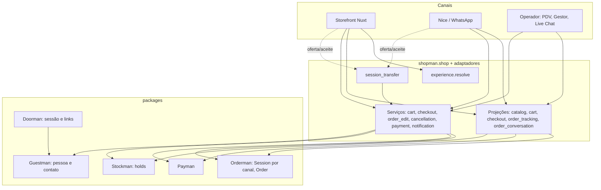
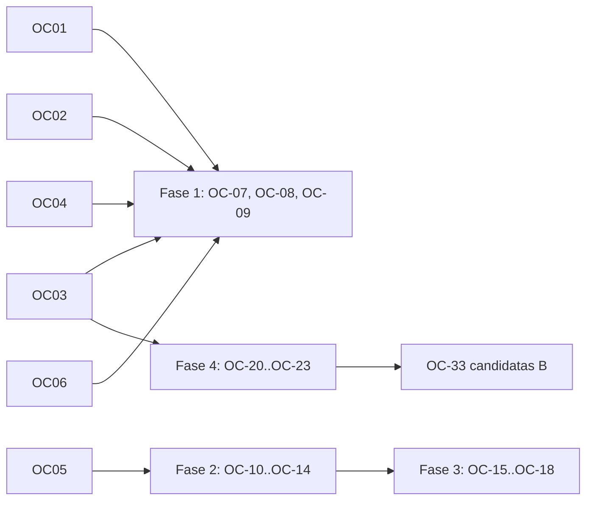

# Excelência Comercial Omnicanal, Etapa II: especificação e plano de implementação

> **Data:** 23/11/2026. **Base:** `origin/main` `0644992aa`. **Estado:** APROVADO pelo dono em 23/11/2026, com as decisões do §10. A execução é a Etapa III, por outro agente.
> **Compromisso:** `DEV-2026-085`.
> **Laudo que fundamenta cada escolha (ler antes):** [2026-11-23-etapa-ii-omnicanal-laudo-adversarial.md](2026-11-23-etapa-ii-omnicanal-laudo-adversarial.md). Os códigos S1–S5, T1–T5 e U1–U6 citados aqui são os achados de lá.
> **Relatórios de origem (preservados):** branch `docs/storefront-excellence-omnicanal-20261123`, commit `dbf912118`.

Sumário: [4 Arquitetura](#4-arquitetura-proposta) · [5 Experiência](#5-especificação-da-experiência-comercial) · [6 Contrato de Excelência](#6-contrato-de-excelência) · [7 Experimentação](#7-especificação-de-experimentação) · [8 Plano](#8-plano-de-implementação) · [9 Testes](#9-plano-de-testes-e-homologação) · [10 Decisões](#10-decisões-do-dono) · [11 Instruções ao agente](#11-instruções-para-o-agente-de-implementação)

(As seções 1 a 3 do pedido, diagnóstico, análise do código e análise dos relatórios, estão no laudo.)

---

## 4. Arquitetura proposta

### 4.1 Princípio

> **Antes do pedido, a sacola se transfere: uma só viva por vez. Depois do pedido, todo canal lê o mesmo pedido.**

Nenhum domínio, app, modelo persistente ou camada nova. Duas funções de serviço novas no orquestrador (`session_transfer`, `experience`), uma regra (`ExperienceRule`) no registro de regras que já existe, e correções.

### 4.2 Fronteiras e autoridades

| Conceito | Dono único | Onde mora | Muda com esta proposta? |
|---|---|---|---|
| Pessoa, contatos, posse do contato, consentimento, linha do tempo | Guestman | `Customer`, `ContactPoint`, `CustomerIdentifier`, `contrib/consent`, `contrib/timeline` | Só frescor da verificação e evento de reatribuição (OC-07) |
| Sessão autenticada, força da identidade, dispositivo confiável, links | Doorman + `storefront/identity.py` | `AccessLink`, `TrustedDevice`, `request.session` | Avisos de pedido passam a levar o link comum, sem credencial (OC-01) |
| Garantia do transporte da conversa | Orquestrador (Concierge) | `ConversationBinding.identity_assurance` | Rebaixa quando o contato é reatribuído (OC-07) |
| Episódio conversacional, turno, orçamento vigente, posse humana | Orquestrador (Concierge) sobre o núcleo do framework | `Conversation`, `ConversationMessage`, `Conversation.quote` | Avisos entram na transcrição (OC-10) |
| Sacola pré-pedido, revisão, holds, commit | Orderman (+ Stockman para holds) | `Session` por canal, `CommitSeal`, `IdempotencyKey` | Nenhuma mudança de modelo; chave `experience` na lista de cópia do commit (OC-22) |
| Passagem da sacola entre canais | Orquestrador | **novo** `shop/services/session_transfer.py` (função, sem modelo; recibo em `Session.data`) | Extraído do que existe (OC-15) |
| Pedido, edição, cancelamento | Orderman + `shop/services/order_edit.py`, `cancellation.py` | `Order` | Nice ganha remarcar, remover, trocar endereço (OC-11) |
| Pagamento | Payman + `shop/services/payment.py` | `PaymentIntent`, `order.data["payment"]` | Nenhuma |
| Verdade de apresentação do pedido | Projeções do orquestrador | `build_order_tracking`, `build_order_conversation` | Ação `copy_pix` carrega o código (OC-05) |
| Variante de experiência | Orquestrador | **novo** `shop/services/experience.py` + `RuleConfig` | Novo resolvedor (é o R4 do release) |
| Texto editável | Orquestrador | `OmotenashiCopy` + defaults | Cache entre processos (OC-03); dimensão `experience` só se necessária (OC-24) |

**Dependências** (sem mudança na regra de dependência do `CLAUDE.md`): `storefront → shop ← backstage`; `shop → packages/*`; o núcleo `conversational-commerce` não importa nada (ADR-049); o adaptador da Nice continua em `shopman/storefront/concierge/`.

### 4.3 Diagrama de autoridade



### 4.4 Fluxos de continuidade

**Nice → Storefront (J6):**

```mermaid
sequenceDiagram
  participant C as Cliente
  participant N as Nice
  participant T as session_transfer
  participant D as Doorman
  participant W as Storefront
  C->>N: "quero ver as fotos no site"
  N->>T: offer(source=whatsapp:S1@rev7, dest=web)
  T->>D: AccessLink(metadata: offer, source=INTERNAL, uso único)
  N-->>C: link + "sua sacola vai junto; aqui ela fica pausada"
  C->>W: abre /a?t=...
  W->>D: exchange
  W->>T: accept(offer)
  T->>T: trava S1; rev ainda 7? recria linhas no canal web (repreça, re-reserva); diferenças
  T->>T: abandona S1 (transferred_to), S2.transferred_from
  T-->>W: TransferReceipt{S2, diffs}
  W-->>C: sacola com diferenças destacadas, se houver
  Note over N: próxima mensagem do cliente: a Nice lê S1 abandonada com transferred_to e diz "sua sacola está no site"; se o cliente quiser pedir por aqui, oferta inversa
```

**Storefront → Nice (J7):** simétrico. A sacola oferece "Continuar pelo WhatsApp"; o mecanismo de entrada pelo WhatsApp que já existe (mensagem pronta com código `NB-`, que carrega contexto e não é credencial) leva a oferta; a Nice só aceita com vínculo `verified_customer` cujo cliente é o dono da sacola, ou, para sacola anônima, vincula ao cliente verificado no aceite.

**Depois do pedido (qualquer canal):** só referência. O pedido é lido por `build_order_tracking`/`build_order_conversation` em qualquer canal; o canal de origem não é dono do pedido.

**Humano ↔ Nice (J8):** `mark_handoff` (cerca de turno, silêncio pelo campo do ManyChat) e `return_to_concierge` (atrás de chave) continuam. A Nice, ao voltar, relê o estado do domínio (sacola, pedidos, avisos na transcrição), não a memória do diálogo.

### 4.5 Contrato do serviço de transferência

`shopman/shop/services/session_transfer.py` (função pura de orquestração, sem modelo):

- `offer(source_channel, source_key, dest_channel, *, customer_ref, actor) -> TransferOffer`
  - lê a sessão de origem aberta; registra `rev` e total no metadado do `AccessLink` (web) ou no código `NB-` (WhatsApp);
  - não altera a origem (oferecer não é transferir).
- `accept(offer, *, dest_context, actor) -> TransferReceipt`
  - autoriza no momento do efeito: o principal do destino é o dono da sacola (mesmo `customer_ref`), ou a sacola de origem é anônima e o principal tem força `device` ou vínculo `verified_customer`;
  - trava a origem (`select_for_update`); se `rev` mudou desde a oferta, recusa com `source_changed` e o canal oferece de novo;
  - se o destino já tem sacola aberta com itens: os itens que chegam entram nela, de forma explícita (quem aceita tocou em trazer), e o mesmo item soma a quantidade pelo `cart_service` do destino; o que não coube vira diferença. **Decisão do dono (24/11/2026, OC-16 #3522)**, que substitui o "recusa com `destination_conflict` e pergunta substituir ou manter": "ou traz a de fora (mesclando) ou não";
  - recria cada linha no destino por `cart_service` (reprecifica e re-reserva pelas regras do canal de destino); coleta diferenças: preço, quantidade reduzida, item indisponível, recebimento e pagamento que não valem no destino;
  - abandona a origem liberando holds; grava `transferred_to` na origem e `transferred_from` no destino (`transferred_from` já é copiado para o pedido pelo commit);
  - idempotente pela oferta: o mesmo `AccessLink` é de uso único; um reenvio do aceite devolve o recibo gravado em `Session.data["transfer_receipt"]` da origem.
- Nunca transfere: pagamento (não existe antes do commit), orçamento da Nice (o `rev` novo o invalida por construção), cupom exclusivo de canal (vira diferença explícita).
- Chaves novas em `Session.data` (`transferred_to`, `transfer_receipt`) entram em `docs/reference/data-schemas.md` antes do uso.

### 4.6 O que fica explicitamente fora

Sessão compartilhada entre canais; espelhamento de sacola; entidade de intenção; caixa de entrada humana própria (depende da decisão D6); experimentação em visitante anônimo (fora por D2); mudança visual L3.

---

## 5. Especificação da experiência comercial

As jornadas reutilizam a numeração do Relatório II (J0–J11). Cada uma tem um critério de pronto verificável.

### 5.1 Visual (Storefront)

| Jornada | Critério de pronto | Estados excepcionais obrigatórios |
|---|---|---|
| Informação sem compra | Horário, endereço, formas de pagamento, alérgenos, entrega respondidos em até 2 toques a partir da home, sem login | Loja fechada; feriado; informação indisponível diz que não sabe |
| Pedir hoje (retirada) | Produto → sacola → horário → pagamento → acompanhamento sem ajuda, em 375 px, com fonte do sistema ampliada | Item acaba entre a leitura e o envio; horário enche; rede cai depois do envio (recuperação mostra o pedido, nunca convida a comprar de novo) |
| Encomendar (outro dia) | Com a loja fechada, o visitante sabe **em uma frase** se pode encomendar e para quando; se puder, chega à sacola sem procurar | Nada encomendável: a página diz isso e oferece aviso, sem prometer finalização (U1) |
| Entrega | Endereço fora da zona é dito antes do pagamento, com alternativa | Endereço ambíguo; mudança de taxa |
| Pagamento Pix | Código visível, botão de copiar com retorno anunciado ao leitor de tela, prazo de validade em texto, estado atualizado por SSE | Pix expira; pago depois de cancelado (texto diz estorno, sem "pago" falso) |
| Cartão | Gateway externo e retorno ao acompanhamento | Recusa; autorização tardia anulada |
| Acompanhar | Poucos estágios em palavras simples, detalhe embaixo (padrão de mercado validado no benchmark) | Pedido recusado pela casa; atraso |
| Recompra | Um gesto a partir da home logada, com preço e disponibilidade de agora | Item que saiu do cardápio |
| Link de aviso vencido | Cai no pedido certo pedindo a entrada, nunca numa página genérica (T5) | Link encaminhado (não entrega a conta, S1) |

### 5.2 Conversacional (Nice)

| Jornada | Critério de pronto |
|---|---|
| J0 informação | Responde fato com fonte; o que não sabe vira "vou verificar" com dono e prazo |
| J1 pedido completo | Descoberta → sacola → recebimento → **forma de pagamento escolhida** → revisão → confirmação por código → pedido → **Pix na conversa** (código em mensagem própria) ou **link do gateway** para cartão → confirmação de pagamento conhecida pela Nice → estados até a entrega/retirada, tudo sem passagem obrigatória pelo Storefront |
| J2 mudar de ideia antes do pedido | Toda mudança material invalida o orçamento (já é assim: `rev` novo) e pede código novo |
| J3 falhas | Confirmação repetida não duplica; resposta perdida se recupera pelo recibo; Pix tardio é estornado e a Nice explica |
| J4 pós-venda | "Cadê meu pedido", "manda o Pix de novo", "troca o horário", "tira um item", "troca o endereço", "cancela" resolvidos na conversa quando elegíveis; o resto vai à equipe com contexto |
| J5 recorrente | "O de sempre" com preço e disponibilidade de agora e nova confirmação |

### 5.3 Híbrida

J6 e J7 pelo serviço de transferência (§4.5). Critérios: a sacola chega com diferenças explícitas; a origem fica pausada e diz onde a sacola está; nenhum hold duplicado; nenhuma cobrança antes do pedido; o cliente que não quer trocar de canal nunca é empurrado.

### 5.4 Assistida (operador)

- Telefone/balcão: o PDV continua criando pedido no canal `pos`; o cliente acompanha pela Nice ou pela loja via referência (já funciona).
- Live Chat: a equipe assume com o contexto do domínio (sacola, pedidos, avisos) visível no Admin da conversa; a volta à Nice exige a chave `human_return_enabled` ligada depois dos testes C08/N19.

### 5.5 Estados excepcionais transversais

Rede lenta ou caída (o estado incerto aparece como incerto); loja fechada; virada do dia; indisponibilidade entre leitura e efeito; provedor de mensagem fora; janela de 24 h fechada (o aviso sai por *flow* aprovado, ou o cliente é avisado ao voltar); pagamento incerto; handoff; reversão de experimento no meio do checkout (o commit é do domínio, não da variante; nada muda).

---

## 6. Contrato de Excelência

Invariantes verificáveis. Cada um tem **onde é provado**. Nenhum é variável de A/B.

| ID | Invariante | Prova |
|---|---|---|
| X1 | Toda frase que oferece uma ação ao cliente só aparece quando a projeção diz que a ação é possível agora | Teste de projeção: catálogo sem item encomendável ⇒ `ordering.state == "none"` ⇒ a home não contém a frase de finalização (OC-04) |
| X2 | Estado comercial (recebido, aceito, pago, pronto, saiu, entregue, cancelado, estornado) vem de uma projeção do domínio; copy nunca reclassifica | Snapshots de contrato + teste de exaustividade: estado desconhecido renderiza "estado desconhecido", nunca "pago"/"confirmado" |
| X3 | Rótulo de ação diz o que a ação faz | Teste da Nice: ação `copy_pix` entrega o código, não um link (OC-05) |
| X4 | Um efeito comercial por intenção do cliente | Testes de idempotência: checkout web (mesma chave → mesmo 201), Nice (mesmo token → mesmo pedido), transferência (mesma oferta → mesmo recibo) |
| X5 | Termos defasados nunca viram pedido | `revision_changed`, `quote_stale`, `source_changed` cobertos |
| X6 | Aviso que a casa envia não carrega credencial de login nem de conta: encaminhado, não abre a conta. **Atualizado em 25/11/2026 (DEV-2026-093):** o aviso leva a capacidade DO pedido (`/pedido/<ref>~<selo>`), que abre aquele pedido e nada mais | Teste: texto renderizado de todo aviso de pedido não contém `/a?t=`, não cunha `AccessLink` e o único selo é o do próprio pedido (`test_aviso_de_pedido_sem_credencial.py`); fronteira da capacidade em `test_link_do_pedido_sem_login.py` |
| X7 | Pedido de uma pessoa nunca é exibido a outra por coincidência de telefone | Teste de número reciclado (OC-02) |
| X8 | Copy editada no Admin chega à loja em até 60 s, sem deploy | Teste de invalidação entre processos (OC-03) |
| X9 | Texto decisivo (preço, disponibilidade, total, estado, erro) com no mínimo 14 px e contraste AA; corpo de leitura 16 px | Auditoria automatizada no Playwright em 320/375/390 px, marcando decisivos com `data-decisive` |
| X10 | WCAG 2.2 AA nas jornadas essenciais, com atenção a 2.5.8 (alvo), 2.4.11 (foco não encoberto pela barra fixa), 3.3.7 (não repetir dado já informado), 3.3.8 (entrada sem teste cognitivo, colar código), 3.2.6 (ajuda no mesmo lugar), 4.1.3 (mudanças anunciadas) | `axe` por rota + roteiro manual de VoiceOver/TalkBack por release |
| X11 | Zoom 200 % e fonte do sistema ampliada não escondem CTA nem informação decisiva | Playwright com `deviceScaleFactor` e CSS `font-size` raiz 200 % |
| X12 | Nenhum texto visível com travessão | Trava existente de copy + varredura do catálogo vivo (dado) |
| X13 | A variante de experiência muda apresentação, nunca preço, disponibilidade, autorização, pagamento ou promessa | Snapshots de contrato iguais entre A e B para as mesmas entradas |
| X14 | Variante não vaza entre visitantes | Resposta com variante diferente da padrão é `private`; teste de borda (OC-21) |
| X15 | Avisos que o cliente recebeu são conhecidos pela Nice | Teste: aviso de pedido de origem conversacional grava mensagem de sistema na conversa (OC-10) |
| X16 | Nenhuma superfície ou agente mantém regra comercial própria | Trava de import: `concierge/` não importa símbolo privado (`_*`) de `storefront/services` ou `shop/services` (OC-14) |

---

## 7. Especificação de experimentação

### 7.1 O que se testa e o que não se testa

- **Correção não se testa, se aplica.** U1–U4, X1–X16 vão direto para a experiência estável. Experimento é para escolhas de desenho em que duas soluções corretas competem.
- **Candidatas B propostas** (hipóteses, sujeitas a aprovação L2 do dono; nenhuma é L3):
  - **B1 "Para quando?" primeiro:** com a loja fechada ou para encomenda, o cardápio pergunta o dia antes da lista (padrão Toast/Starbucks do benchmark), e a disponibilidade passa a responder para aquele dia.
  - **B2 recompra em um gesto no topo da home logada** (padrão Panera/Toast/Olo).
  - **B3 dúvidas no ponto da dúvida:** FAQ contextual no produto, na sacola e no pagamento, no lugar da lista de 34 perguntas na home.

### 7.2 Mecanismo

É o **R4 do WP-RELEASE-01**, executado agora com o Storefront como primeiro consumidor.

- **Configuração:** `RuleConfig` com `rule_path = "shopman.shop.rules.experience.ExperienceRule"`, `params` validados por `validate_params`:
  `{ref, surface, variants: ["a","b"], default: "a", cohorts: {internal: [...refs], pilot: [...]}, allocation: {"b": 0}, salt, owner, hypothesis, metrics: [...], remove_after: "AAAA-MM-DD"}`.
  `remove_after` obrigatório e no máximo 90 dias à frente. Histórico e permissão já vêm do `RuleConfig`.
- **Resolução** (`shopman/shop/services/experience.py`, `resolve(request, surface) -> Assignment`), na precedência do D5 do WP-RELEASE-01: kill switch (regra desligada) → ambiente → loja → allow-list de coorte → percentual estável por identidade (fora por ora: D2) → padrão. Regra vencida (`remove_after` passado) resolve para o padrão e gera alerta de operador.
- **Aderência:** gravada em `request.session["shopman_experience"] = {ref: {variant, generation}}`. Para cliente identificado, hash estável de `customer_ref + salt`, igual em todo dispositivo. **Nenhum cookie novo** (a sessão de servidor já existe e já é cookie necessário); a política de privacidade não muda enquanto não houver alocação de anônimos.
- **Exposição ao Nuxt:** campo aditivo `experience: {ref, variant}` na projeção `shell` (e `site`). O Nuxt usa um composable `useExperience(ref)`; o código de cada variante leva a anotação `// EXPERIMENT(<ref>) remove_after AAAA-MM-DD`.
- **Borda:** toda resposta com variante diferente da padrão é privada. Como a atribuição exige sessão de servidor, a requisição carrega `Cookie` e `carries_credentials` já a tira do gêmeo público (`public_cache.py:46-56`); o teste de aceite prova isso.
- **Kill switch:** desligar a regra ou incrementar `generation`; a próxima requisição resolve o padrão. Rollback de experimento é independente de rollback de release (o build contém A e B).
- **Retirada:** B vence ⇒ o código de A é apagado e a anotação some; B perde ⇒ o código de B é apagado. CI (`scripts/check_experiments.py`) reprova anotação vencida.

### 7.3 Copy

1. **Pré-requisito: OC-03** (cache entre processos). Sem ele, nenhuma promessa sobre copy do Admin é verdadeira.
2. Copy de código Nuxt de uma variante vive no código da variante.
3. Copy de servidor é compartilhada por padrão. Editar copy compartilhada muda A e B, como deve.
4. **Só quando a primeira mudança aprovada de B exigir texto de servidor diferente:** OC-24 acrescenta a dimensão `experience` (padrão `"*"`) à chave única de `OmotenashiCopy` e à cascata do resolvedor (específica → `*`), com o mesmo padrão de `audience`. Copy de B só é vista pela coorte de B, então editar B no Admin já é editar um rascunho visível só a quem testa. Promover B = ação de Admin que move as linhas `experience="b"` para `"*"` numa transação, com histórico. Reverter = desligar o experimento.
5. Snapshots de contrato rodam com `experience="*"`; um snapshot B é acrescentado só se B mudar texto de servidor.

### 7.4 Métricas e promoção

- **Pré-go-live e coortes:** comparação supervisionada (§9.6). Tarefa concluída sem ajuda, interpretação correta do compromisso, erros e becos sem saída, tempo e toques, por perfil (idoso, baixa visão, pouca familiaridade, experiente).
- **Marcação:** `Session.data["experience"]` gravado pela loja; copiado para `Order.data` pelo commit (OC-22). Toda métrica de pedido (conversão a partir de sacola aberta, cancelamento, falha/expiração de pagamento, pedido recuperado) sai do banco, sem rastreador.
- **Guardrails** (herdados do Continuum 0.2, §18 "Rollout normativo"): amostra mínima por braço declarada antes; amostra abaixo do piso, denominador zero ou telemetria ausente = inconclusivo, não promove; vazamento entre públicos = zero. Para UX: taxa de cancelamento, falha de pagamento, pedido recuperado, handoff para equipe, erro de cliente por sessão.
- **Promoção:** passa os portões X1–X16, melhora a fricção alvo, não piora usuários experientes além do limite declarado; o dono decide.
- **Experimentos conversacionais:** continuam no registro próprio do framework (`ExposureEvent`/`DecisionRecord`). O que pode ser compartilhado é só a atribuição de coorte (o adaptador da Nice pode perguntar a `experience.resolve` por uma coorte), nunca o registro nem as métricas.

---

## 8. Plano de implementação

Convenções: **um WP = um branch = um PR**; cada PR cita `Compromisso: DEV-2026-085` e tem a seção `## Ficou de fora`. Tamanho: P (≤1 dia), M (2–3 dias), G (4–6 dias).

### Fase 0: verdade e segurança (paralelizáveis entre si; começam assim que aprovadas)

| WP | O quê | Arquivos | Aceite | Tam. |
|---|---|---|---|---|
| **OC-01** | Avisos de pedido sem credencial (D5, recomendação revista) | `shopman/shop/services/notification.py:829-840` (os avisos passam a usar o link comum de `storefront_links`, não `build_*_access_url`), `shopman/shop/services/access_urls.py` (os três builders saem se ficarem sem uso), `/pedido/<ref>` sem sessão leva à entrada com o pedido como destino | Aviso encaminhado não abre conta nem pedido; dono no próprio celular abre direto; em outro dispositivo, entrada pelo WhatsApp cai no pedido; nenhum token em texto de aviso | P |
| **OC-02** | Pedido por telefone só sem dono declarado | `shopman/shop/services/customer_orders.py` (`order_matches_customer_identity`, histórico `:773-783`), `shopman/shop/projections/customer.py:72` | Pedido com `customer_ref` de A nunca aparece para B que tem o mesmo telefone; pedido sem `customer_ref` (convidado) continua casando por telefone | P |
| **OC-03** | Copy do Admin chega a todos os processos | `shopman/shop/omotenashi/copy.py` (versão no cache Django/Valkey, conferida por requisição, memo local), sinais em `models/omotenashi_copy.py`, `admin/omotenashi.py`; mesmo tratamento para `attribute_defaults` se usar o mesmo padrão | Teste que simula dois processos: salvar no "operador" faz o "storefront" reler; X8 | P |
| **OC-04** | Loja fechada promete só o que existe | `shopman/storefront/presentation/home.py`, `cart.py` (campo `ordering: {state: now/preorder/none, next_date}` derivado dos fatos de promessa do catálogo), `surfaces/storefront-nuxt/app/presentation/home.ts` (frase escolhida pelo estado; textos no catálogo de copy), vitrine com encomendáveis primeiro, snapshots de contrato | X1; com zero encomendáveis a home e a sacola dizem que hoje não há encomenda aberta e oferecem aviso | M |
| **OC-05** | Pix e cartão como ações de conversa | `shopman/shop/projections/order_tracking.py` (ação `copy_pix` com `value` do código, campo aditivo), `shopman/shop/services/conversation.py`, `shopman/storefront/concierge/tools.py` (`render_result`: código em mensagem própria; cartão imprime o link do gateway no pedido), caminho do motor (`service.py:1078` repassa as mensagens extras) | X3; N10–N12 no harness; o motor com `conversational_live_order=True` entrega o Pix. **Coordenar com #3399/#3414** (mesmos arquivos do motor): entra depois deles ou dentro de um deles, nunca em paralelo | M |
| **OC-06** | Copy "de pessoa para pessoa" verdadeira | `shopman/shop/omotenashi/copy.py:409-414` (texto condicionado a a Nice estar viva no número, via estado já projetado) | Com a Nice ligada, a home não promete atendimento humano direto | P |

### Fase 1: identidade (depois de OC-01/OC-02)

| WP | O quê | Arquivos | Aceite | Tam. |
|---|---|---|---|---|
| OC-07 | Frescor e reatribuição de número (depende de **D3**) | Guestman `services/identity.py` (evento `contact_reassigned`), `contrib/identifiers/signals.py`, `contrib/manychat/service.py`, `shopman/storefront/concierge/service.py` (rebaixar vínculo), `storefront/identity.py` (força por frescor) | Cenário de número reciclado: novo titular não vê endereço, pedido nem conversa do anterior | M |
| OC-08 | Contato não verificado e login (depende de **D4**) | `guestman/adapters/auth.py` | Conforme D4 | P |
| OC-09 | Resíduos de logout e higiene de link | `storefront/api/auth.py` (sacola preservada volta a anônima e reprecifica), `finalizar.vue`/`conta` (limpa rascunho local no logout), `doorman` S2S: teto de TTL (24 h), audiência aplicada na troca | Após logout, próximo visitante vê preço público e formulário vazio | P |

### Fase 2: Nice completa (paralelizável com a fase 1)

| WP | O quê | Arquivos | Aceite | Tam. |
|---|---|---|---|---|
| OC-10 | Avisos na transcrição | `shopman/shop/services/notification.py` (após envio de aviso de pedido de cliente com conversa, grava `ConversationMessage` de sistema, sem reenviar), leitura no contexto da Nice | X15; a Nice responde "já te mandei o Pix às 14h12, quer de novo?" | M |
| OC-11 | Alterações pós-pedido na conversa | `shopman/storefront/concierge/` (novos lances: remarcar, remover item, trocar endereço), via `shop/services/order_edit.py` e `cancellation.py` sem regra própria; no motor, como lances `amend_order` já previstos | Mesma elegibilidade do balcão; confirmação por código; recusa explicada; N15 | G |
| OC-12 | Repagamento e troca de forma | `concierge/tools.py` + serviço de pagamento existente (`orders/<ref>/payment/pix/`) | Pix vencido regenerado na conversa; troca Pix↔cartão quando a política do canal permite | M |
| OC-13 | Volta do humano (depende de **D6**) | `concierge/service.py` (`return_to_concierge` relê o domínio), ligar `CONCIERGE_HUMAN_RETURN_ENABLED` no ambiente de testes | C08/N19 verdes | M |
| OC-14 | Uma regra comercial, um lugar | mover `_validate_preorder`, "única forma de pagamento", `_hour_pair`, `_window_start`, `_channel_hold_ttl_minutes` para funções públicas em `shop/services/`; `concierge/` só importa públicas; trava X16 | Trava de import reprova símbolo privado; comportamento idêntico (testes existentes) | M |

### Fase 3: continuidade entre canais (depois da fase 2)

| WP | O quê | Arquivos | Aceite | Tam. |
|---|---|---|---|---|
| OC-15 | Serviço de transferência | **novo** `shopman/shop/services/session_transfer.py`; `concierge/tools.py` (`_copy_cart_to_web` vira chamada), `storefront/api/auth.py` (`_adopt_carried_cart` vira chamada); `docs/reference/data-schemas.md` | §4.5; C01, C03, C05, C07 | G |
| OC-16 | Storefront → Nice | `surfaces/storefront-nuxt/app/pages/sacola.vue` (ação "Continuar pelo WhatsApp"), entrada do código NB na Nice, `session_transfer.accept` | C02; sacola anônima vincula ao verificado | M |
| OC-17 | Sacola aberta em outro canal | `shop/services/sessions.py` (`open_sessions_for_customer(customer_ref, exclude_channel)`, leitura), revisão da Nice e projeção do checkout | C06: aviso com ação de trazer, nunca sincronização | P |
| OC-18 | Ligar a ponte | intenções da Nice chamam `send_web_link` quando o cliente pede ver no site; `CONCIERGE_TRANSFER_ENABLED` ligado no ambiente de testes | C01–C10 verdes | P |

### Fase 4: experimentação (pode correr em paralelo com as fases 1–3; depende de OC-03)

| WP | O quê | Arquivos | Aceite | Tam. |
|---|---|---|---|---|
| OC-20 | Resolvedor (R4 do release) | **novo** `shopman/shop/rules/experience.py` (`ExperienceRule`), **novo** `shopman/shop/services/experience.py`, `shopman/storefront/api` (campo na `shell`/`site`), `scripts/check_experiments.py`, atualização de `docs/plans/WP-RELEASE-01…` (marcar R4 em andamento, sem reescrever decisões) | Aderência por sessão e por cliente; kill switch; vencido resolve padrão; nenhuma alternância em recarga | G |
| OC-21 | Consumo no Nuxt e borda | `surfaces/storefront-nuxt/app/composables/useExperience.ts`, BFF | X14: resposta de variante não padrão é privada; Playwright força coorte pelo seed, nunca por query | M |
| OC-22 | Marcação no pedido | `shopman/storefront` (grava `Session.data["experience"]`), `packages/orderman/.../services/commit.py` (uma chave na lista explícita de `_do_commit`, conforme a regra 5 do `CLAUDE.md`; o PR traz a prova de que nenhuma chave existente carrega isso), `data-schemas.md` | Pedido sabe de qual variante veio | P |
| OC-23 | Protocolo e ferramenta de comparação | `surfaces/storefront-nuxt/tests/e2e/journeys/*` (mesmas jornadas para A e B, mesmo seed, relógio fixo), relatório com capturas e `axe` | §9.6 | M |
| OC-24 | Dimensão `experience` na copy (**condicional**) | `OmotenashiCopy` (+ migração), resolvedor, Admin (filtro e ação de promover) | Só abre quando um B aprovado precisar; §7.3 | M |
| ~~OC-25~~ | Alocação de anônimos: **fora do plano** (D2: nenhum cliente nas coortes por ora) | | | |

### Fase 5: excelência visual L1/L2 do Storefront (paralelizável com tudo, exceto arquivos de OC-04)

| WP | O quê | Aceite |
|---|---|---|
| OC-30 | Tipografia decisiva | X9 em todas as rotas essenciais |
| OC-31 | FAQ sem resposta dupla: `build_public_faq` (`shopman/storefront/presentation/public_information.py:206-235`) junta a resposta operacional (tirada da configuração) com o `FAQEntry` curado sem deduplicar; a pergunta operacional vence e o Admin do `FAQEntry` avisa quando uma curada repete uma operacional. Home com as 6 mais úteis e "ver todas" | Teste: pergunta normalizada nunca aparece duas vezes; a resposta que sobra é a da configuração |
| OC-32 | Semântica e alvos | `h1` que diz o propósito; alvos ≥ 24 px; recompra sem cartão duplicado |
| OC-33 | Candidatas B1–B3 | Só depois de aprovação L2 e de OC-20/21 |

### Dependências e paralelização



Podem correr ao mesmo tempo, por não tocarem os mesmos arquivos: {OC-01, OC-02, OC-03, OC-04, OC-06}; {fase 1} ∥ {fase 2}; {fase 4} ∥ {fases 1–3}; {fase 5} ∥ tudo, menos OC-04. Não podem: OC-05 com #3399/#3414; OC-15 com OC-16 (mesmo serviço); OC-11 com OC-12 (mesmas ferramentas).

### Migrações

Só OC-24 (condicional) cria migração. Antes de abrir PR: `ls <app>/migrations | sed 's/_.*//' | sort | uniq -d`. Nenhuma chave de JSON nova sem entrada em `docs/reference/data-schemas.md`.

---

## 9. Plano de testes e homologação

### 9.1 Unidade e integração (pytest)

- OC-01: nenhum aviso de pedido renderizado contém token; `/pedido/<ref>` sem sessão leva à entrada e volta ao pedido; link do cliente (`#menu`, código NB) continua confiando como hoje.
- OC-02: matriz de identidade (ref igual, ref diferente com mesmo telefone, convidado).
- OC-03: dois "processos" (limpar memo local + versão no cache).
- OC-04: projeção `ordering` com catálogo vazio, só fornada planejada, pronto agora, loja fechada, virada do dia (relógio fixo).
- OC-15: transferência com `rev` mudado, destino ocupado, item indisponível no destino, preço diferente, reenvio do aceite, oferta de sacola anônima.
- OC-20: precedência completa, aderência, vencimento, kill switch, geração.

### 9.2 Contrato

Snapshots existentes (`contracts/projections/storefront_*.json`) regenerados só com campos aditivos (`ordering`, `experience`, `value` em `copy_pix`); o teste Nuxt (`projectionContracts.test.ts`) e `nuxi typecheck` passam; os tipos à mão em `app/types/shopman.ts` ganham os campos opcionais. Teste de exaustividade de estado (X2).

### 9.3 Concorrência

Duas abas e Nice sobre o mesmo cliente: checkout web e `place_order` simultâneos em canais diferentes (dois pedidos legítimos, sem hold cruzado); transferência concorrente com edição na origem (`source_changed`); handoff no meio de `place_order` (`lock_turn_authority`); Pix confirmado depois de cancelamento (estorno). Rodar com `select_for_update` real (Postgres), não SQLite.

### 9.4 Conversa (harness)

Matriz N01–N25 do Relatório II no harness do framework (backend falso de referência) + adaptador Shopman, priorizando N07–N13, N15, N19, N22, N24, N25. N11 e N21 exigem provedor real: uma rodada controlada no WhatsApp do ambiente de testes, com transcrição anexada ao PR (regra da coordenação: ninguém chama o dono para testar sem a rodada inteira transcrita antes).

### 9.5 Navegador e acessibilidade

Playwright (roda na fila, não no PR; rodar local antes do push): jornadas §5.1 em 320/375/390 px, desktop, fonte 200 %, teclado; `axe` por rota; X9 por varredura de `data-decisive`; rede lenta e offline; relógio fixo para loja aberta/fechada. VoiceOver (iOS) e TalkBack (Android) manuais por release, roteiro no PR.

### 9.6 Comparação A/B supervisionada

Mesmo seed, mesmo relógio, mesmas tarefas, ordem A/B alternada entre participantes; perfis: idoso, baixa visão (zoom 200 %), pouca familiaridade digital, experiente. Medir: concluiu sem ajuda; entendeu o compromisso (pergunta de verificação ao final: "para quando é o seu pedido e como vai pagar?"); erros; tempo; toques. Gateway falso; nada de cobrança real. Capturas e trace das duas variantes no mesmo relatório.

### 9.7 Homologação

Cada WP fecha com: saída de comando dos testes tocados e das travas da fila (não contagem); para tela, prévia local com capturas auditadas por script (contraste, tamanho, posição) antes de mostrar ao dono; para Nice, transcrição real.

---

## 10. Decisões do dono

Respostas do dono em 23/11/2026, no chat desta etapa. **Todas decididas.** D1, D2 e D6 como respondidas; D3, D4 e D5 aprovadas na forma da recomendação revista abaixo.

| # | Pergunta | Resposta / estado |
|---|---|---|
| **D1** | Fazer agora o resolvedor de variantes (R4 do release), com a loja como primeiro app? | **Sim, Storefront.** E nem o cliente nem o operador escolhem a versão: quem decide é o servidor, pela coorte configurada no Admin (`RuleConfig`). Não existe chave, botão ou parâmetro de URL para trocar de versão. Para comparar A e B lado a lado, o dono usa duas contas de teste, uma em cada coorte. |
| **D2** | Quem vê a candidata B? | **Só o dono/admin, a gerente (Joyce) e os operadores cadastrados. Nenhum cliente por ora.** OC-25 (anônimos) sai do plano. A coorte `internal` deve ser derivada do cadastro de operadores, para que um operador novo entre sozinho e um desligado saia sozinho; o agente confere como a conta de operador se liga à conta de cliente da loja (que é por telefone) e, se não houver ligação, propõe a menor antes de criar lista à mão. |
| **D3** | Número de WhatsApp que muda de dono | **Aprovada:** defesa em camadas, que é o que a prática recomenda (NIST SP 800-63B trata o telefone como autenticador restrito, nunca como identidade permanente). (a) O número sozinho dá **acesso de número**: pedir, ver pedidos recentes, pagar. Endereços salvos, histórico completo e troca de dados pedem **acesso de dispositivo** (passkey ou dispositivo confiável, que a loja já tem e que não passa com o chip). (b) O acesso de número sem uso verificado há mais de 12 meses volta a pedir prova. (c) Sinal de troca de dono, quando o provedor oferecer: aviso de troca de identidade do WhatsApp na Cloud API da Meta e APIs de troca de chip/reciclagem das operadoras (padrão CAMARA/Open Gateway) [H: disponibilidade pelo ManyChat e pelas operadoras no Brasil a verificar]. (d) Caminho "não sou eu / troquei de número" que desliga o vínculo antigo. |
| **D4** | Telefone digitado no balcão (não verificado) | **Aprovada:** verificar na hora do cadastro. Quando o balcão grava um telefone, o cliente recebe no WhatsApp "Confirme que este número é seu" e responde com um toque. Até confirmar, o número não abre a conta existente; depois de confirmado, vale a regra de D3. Com isso a pergunta "é seguro o bastante?" passa a ter resposta sim: o risco que sobra é o de D3, tratado lá. |
| **D5** | Link dos avisos de pedido | **Aprovada:** nem 5 min nem 72 h. **O aviso leva o link comum do pedido (`/pedido/<ref>`), sem credencial nenhuma.** No celular do próprio cliente a loja já reconhece a sessão ou o dispositivo confiável (180 dias) e abre direto; em outro dispositivo, a entrada pelo WhatsApp (três toques) leva ao pedido. O código Pix já vai no próprio texto do aviso, então pagar não depende do link. Encaminhar deixa de ser risco e não há prazo para discutir. É também o que os avisos por *flow* do ManyChat já fazem por segurança (`adapters/notification_manychat.py:686-715`). OC-01a e OC-01b viram um WP só (OC-01). **Atualização de 25/11/2026 (DEV-2026-093).** Cliente entrou pelo WhatsApp, tocou no link do aviso e teve de entrar de novo: o link abre no navegador embutido do WhatsApp, que não tem a sessão do site. O dono: "Tem que ter uma forma de resolver isso!!!". A Coordenação decidiu por ele (a) o aviso passa a levar a **capacidade do pedido** (`/pedido/<ref>~<selo>`, HMAC do `SECRET_KEY` sobre o ref e `Order.data.view_link_rev`, válida com o pedido aberto e mais 7 dias depois de concluído ou cancelado, revogável trocando a revisão), inclusive no valor do `{{1}}` do botão aprovado na Meta, sem re-submeter modelo; e (b) aberta só pela capacidade, a tela vê o pedido, paga, fala com a loja e confirma o recebimento, e cancelar, pedir de novo e avaliar pedem a entrada (recusa no servidor), com endereço abreviado. **O espírito fica: aviso NUNCA leva credencial de login ou de conta.** |
| **D6** | Respostas da equipe no Live Chat | **Investigar se o ManyChat entrega as mensagens da equipe ao Shopman e gravá-las na conversa**, antes de ligar a volta à Nice (OC-13). |

**Princípio do dono para pagar antes ou depois (23/11):** a regra é o risco para a casa, medido por uma pergunta: *se o cliente falhar, a casa consegue redirecionar a venda a tempo?* Se não consegue (encomenda, produção dedicada, reserva de prateleira que tira o produto do balcão), paga antes. Se consegue, pode pagar depois. A configuração vigente já obedece a esse princípio: a fila da fornada cobra só quando o cliente confirma a vaga, porque se ele não confirmar em 15 minutos a vaga passa ao próximo da fila ou volta à gôndola (`shopman/shop/services/waitlist.py:305-313,726-800`). Toda proposta futura de mudar o momento do pagamento se justifica por essa pergunta.

**Pagamento com a loja fechada:** não é decisão pendente. Está decidido na [ADR-036](../decisions/adr-036-loja-online-paga-ao-pedir.md) e na emenda de 09/11: paga ao pedir; cartão autoriza e é capturado no aceite; Pix pago e estornado sozinho se recusar ou vencer; 60 min de loja aberta para aceitar encomenda e pedido feito com a casa fechada; a fila da fornada cobra só quando o cliente confirma a vaga. A nota do dono na ADR ("se os estornos ficarem constantes, reavaliar") pede uma medida. Sugestão para o plano: contar, por mês, os pedidos estornados por recusa ou prazo (`cancellation_reason` + `payment_refunded`, dados que já existem) e mostrar no B.I.; o gatilho de reavaliação é decisão do dono.

Mudanças L3: **nenhuma proposta**. As candidatas B1–B3 são L2 e pedem aprovação antes de abrir OC-33.

---

## 11. Instruções para o agente de implementação

### 11.1 Contexto mínimo

Leia, nesta ordem: o laudo; este plano; `CLAUDE.md`; ADR-043, ADR-049, ADR-050; `docs/plans/WP-RELEASE-01-versoes-de-apps-sem-quebra.md` (D5, R4); `docs/reference/data-schemas.md`; `docs/reference/suite-vocabulary.md` e `omotenashi-copy.md` antes de qualquer texto. Não releia os relatórios de origem salvo para conferir uma citação.

### 11.2 Sequência

1. As decisões D1 a D6 estão tomadas (§10). Siga-as como escritas lá.
2. Fase 0, em paralelo (um worktree e um PR por WP). OC-05 só depois de conferir o estado de #3399/#3414 e combinar com a frente do framework.
3. Fases 1 e 2 em paralelo; fase 4 em paralelo a partir de OC-03; fase 3 depois da fase 2; fase 5 a qualquer momento, fora dos arquivos de OC-04.

### 11.3 Restrições

- Trabalhe em worktree; nunca no checkout principal. `git add` só arquivo nomeado.
- **Core é sagrado.** O único toque em `packages/` previsto é a chave de OC-22 e, condicionalmente, OC-07 no Guestman (identidade, que é dele). Todo PR que toque `packages/` traz no corpo a prova de que o orquestrador não resolve.
- Nenhum modelo, app ou camada além do listado. Se aparecer necessidade, pare e escreva a prova antes.
- Nenhuma regra comercial nova na Nice ou no Nuxt; toda regra mora em `shop/services/`.
- Configuração de experimento em `RuleConfig`, nunca em env, `settings`, query ou cookie.
- Copy: inequívoca primeiro, curta depois; sem travessão; "dispositivo", nunca "aparelho" (exceto o Storefront, que pode dizer "aparelho" ao cliente); URL de operador em inglês, da loja em português.
- CI: leve no PR, pesado na fila. Antes de cada push, rode o tocado e as travas da fila; um push por rodada; não rode a suíte inteira local.
- Tela mudou: prévia local ao dono antes de enfileirar, com auditoria de contraste e tamanho feita por script.

### 11.4 Critério de conclusão de cada WP

PR na fila ou mergeado, com: `Compromisso: DEV-2026-085`; `## Ficou de fora` com issue `ficou-de-fora` para cada item adiado; saída dos testes; para tela, capturas em 375 px e desktop; para Nice, transcrição; para segurança, o cenário adversarial do §9.1 como teste.

### 11.5 Evidência obrigatória no relatório final de cada fase

Tabela WP → PR → estado (mergeado / na fila / vermelho com causa / esperando decisão) → invariantes X provados → cenários N/C cobertos → o que ficou de fora com número da issue.
